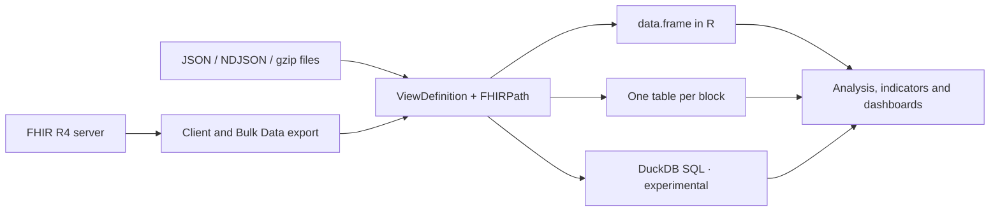
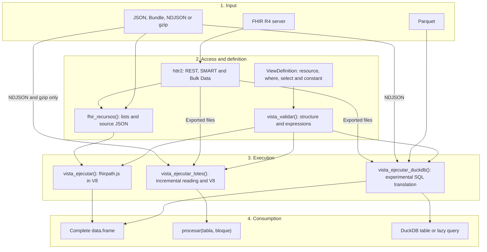
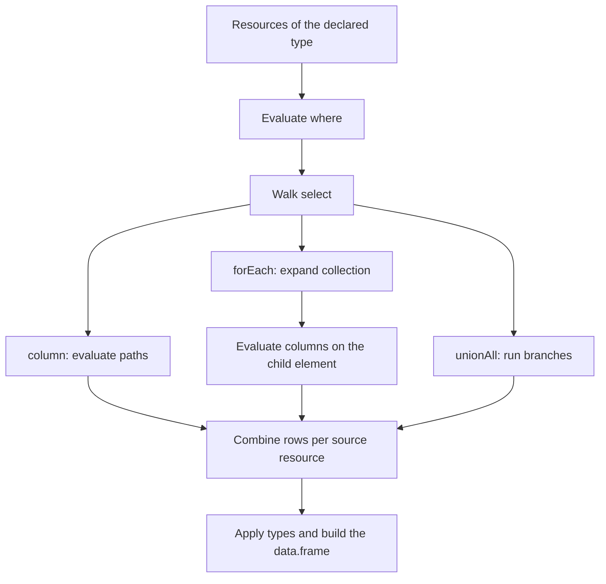
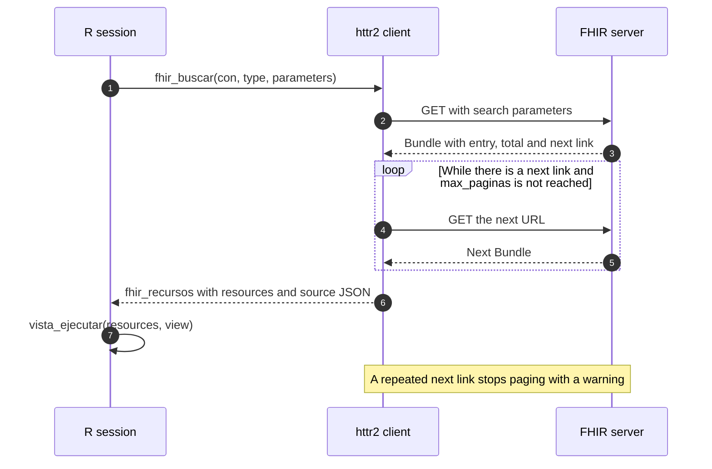
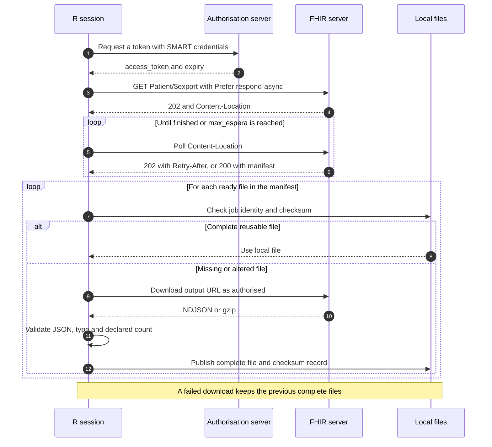
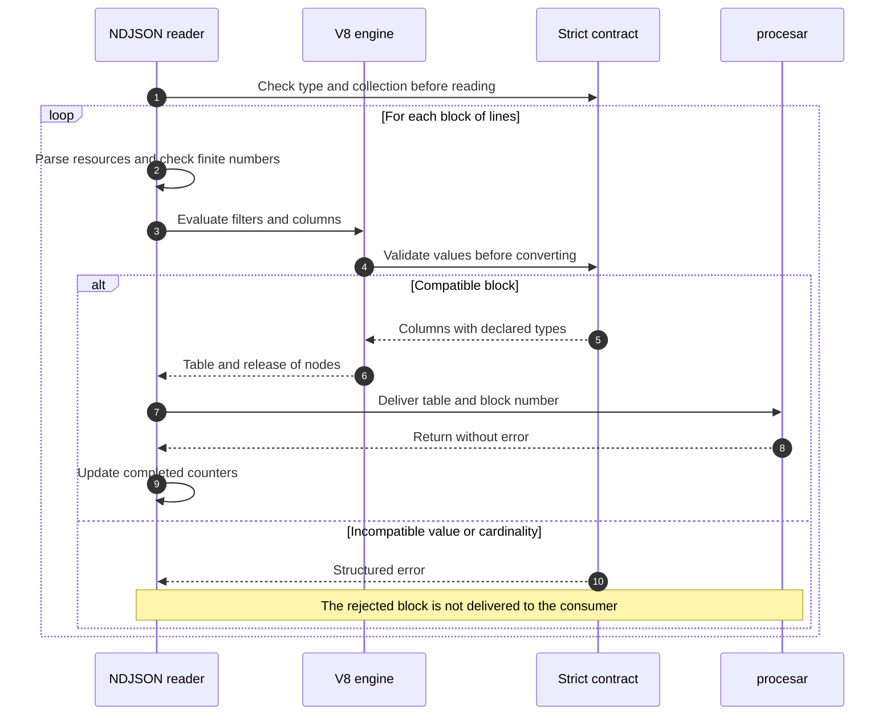
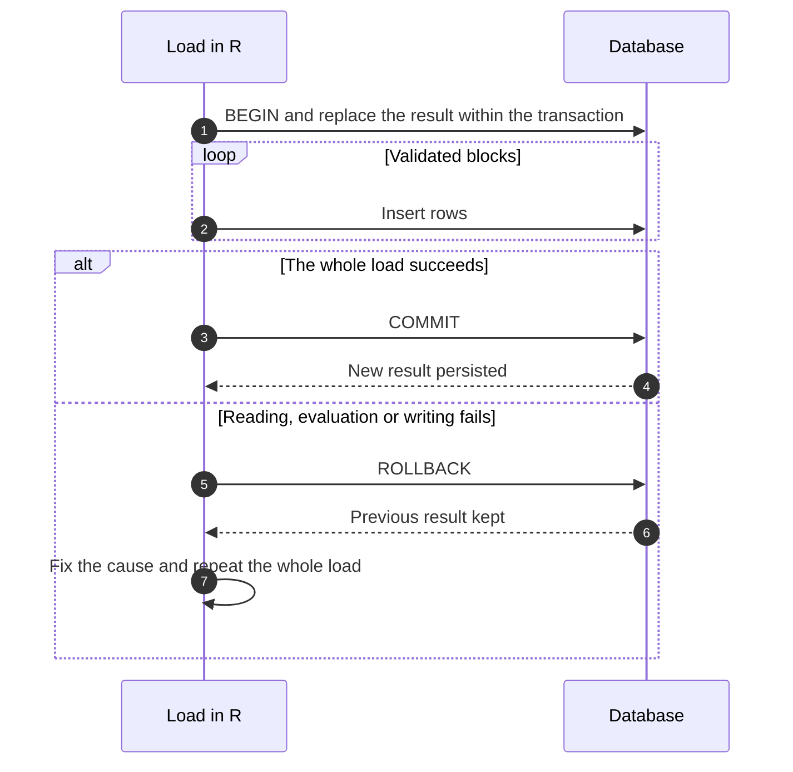
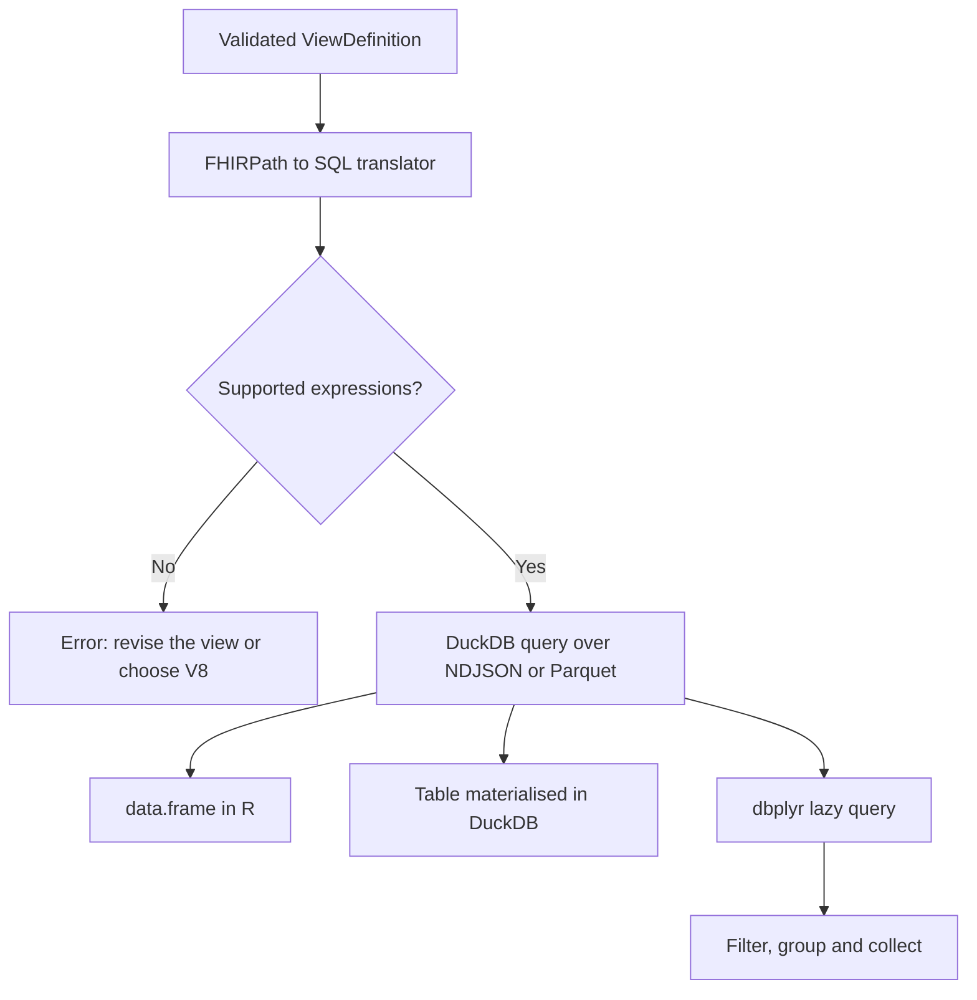
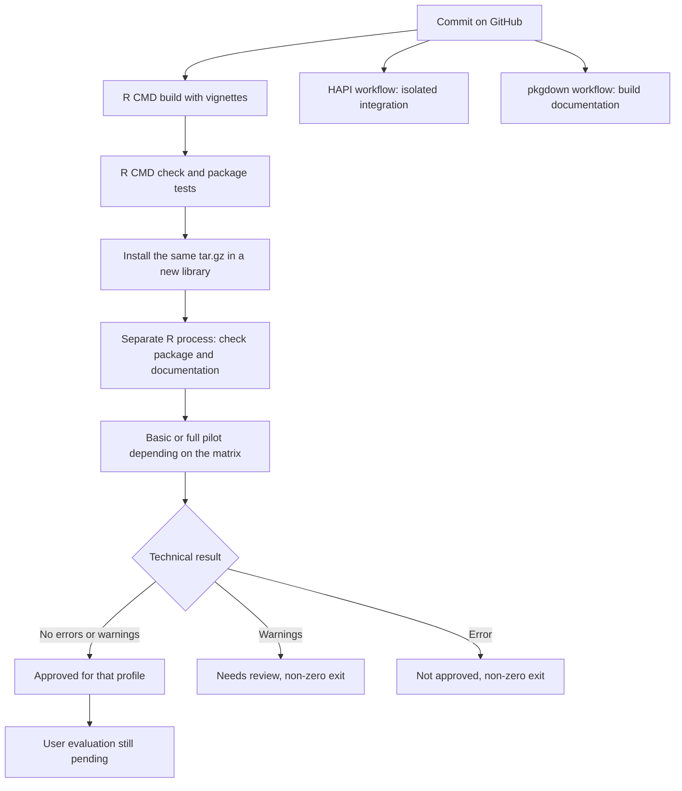

# fhirviews

**From FHIR resources to reproducible tables in R.**

[Español](https://f-slg.github.io/fhirviews/README.md) · **English**

[](https://github.com/f-slg/fhirviews/actions/workflows/R-CMD-check.yaml)
[](https://f-slg.github.io/fhirviews/)
[](#conformance-and-tests)
[](https://hl7.org/fhir/R4/)
[](https://f-slg.github.io/fhirviews/LICENSE.md)

> **About the language.** This is a translation of the Spanish README.
> The package is aimed at users in Ecuador and Latin America: function
> names, arguments, messages, the reference documentation and the
> vignettes are in Spanish. See the
> [glossary](#glossary-of-function-names) below.

**fhirviews** queries **HL7 FHIR R4** servers and turns their resources
into `data.frame`s using **SQL on FHIR** and **FHIRPath**. Define a view
once, save it as a `ViewDefinition` and reuse it on local files, server
responses or population-level exports.

It is designed for clinical analysis, research, epidemiological
surveillance and teaching in R. It includes SMART on FHIR
authentication, views for public health and block-wise NDJSON
processing, without installing Java or Spark.

The technical pipeline combines an HTTP client based on `httr2`, a
FHIRPath evaluator using `fhirpath.js` in V8, and an optional SQL
translator for DuckDB. The extraction definition is independent of the
source: the same `ViewDefinition` can be applied to resources fetched
over REST or to local files. Compatibility of the SQL engine is tested
separately.

[Documentation](https://f-slg.github.io/fhirviews/) ·
[Reference](https://f-slg.github.io/fhirviews/reference/) · [What’s new
in 0.5.0](https://f-slg.github.io/fhirviews/NEWS.md) · [Report a
problem](https://github.com/f-slg/fhirviews/issues/new/choose)


> **Version 0.5.0 · submitted to CRAN on 7 November 2026, under
> review.** Block-wise processing, export recovery with content
> validation and privacy improvements. The DuckDB SQL engine is still
> **experimental**. Until CRAN publishes it, install it from GitHub.

## Contents

- [Glossary of function names](#glossary-of-function-names)
- [What you can do](#what-you-can-do)
- [Installation](#installation)
- [Quick start: from FHIR to a table](#quick-start-from-fhir-to-a-table)
- [Architecture and processing
  sequence](#architecture-and-processing-sequence)
- [Semantics of a view](#semantics-of-a-view)
- [Choosing how to process the data](#choosing-how-to-process-the-data)
- [Querying a FHIR server](#querying-a-fhir-server)
- [Authentication and bulk export](#authentication-and-bulk-export)
- [Processing files in blocks](#processing-files-in-blocks)
- [Working with DuckDB](#working-with-duckdb)
- [Public health views and
  terminologies](#public-health-views-and-terminologies)
- [Validation and privacy](#validation-and-privacy)
- [Conformance and tests](#conformance-and-tests)
- [Performance](#performance)
- [Scope and limitations](#scope-and-limitations)
- [Pilot and local documentation](#pilot-and-local-documentation)
- [Guides and reference](#guides-and-reference)
- [Contributing, citation and
  license](#contributing-citation-and-license)

## Glossary of function names

| Spanish | English | Examples |
|----|----|----|
| `vista` | view (`ViewDefinition`) | [`vista_crear()`](https://f-slg.github.io/fhirviews/reference/vista_crear.md) create, [`vista_ejecutar()`](https://f-slg.github.io/fhirviews/reference/vista_ejecutar.md) run, [`vista_leer()`](https://f-slg.github.io/fhirviews/reference/vista_leer.md) read, [`vista_validar()`](https://f-slg.github.io/fhirviews/reference/vista_validar.md) validate |
| `lotes` | blocks / batches | [`vista_ejecutar_lotes()`](https://f-slg.github.io/fhirviews/reference/vista_ejecutar_lotes.md) run a view block by block |
| `catalogo`, `plantilla` | catalogue, template | [`vista_catalogo()`](https://f-slg.github.io/fhirviews/reference/vista_catalogo.md), [`vista_plantilla()`](https://f-slg.github.io/fhirviews/reference/vista_plantilla.md) |
| `conformidad` | conformance | [`vista_conformidad()`](https://f-slg.github.io/fhirviews/reference/vista_conformidad.md) runs the official test suite |
| `conectar`, `buscar`, `leer` | connect, search, read | [`fhir_conectar()`](https://f-slg.github.io/fhirviews/reference/fhir_conectar.md), [`fhir_buscar()`](https://f-slg.github.io/fhirviews/reference/fhir_buscar.md), [`fhir_leer()`](https://f-slg.github.io/fhirviews/reference/fhir_leer.md) |
| `crear`, `actualizar`, `borrar` | create, update, delete | [`fhir_crear()`](https://f-slg.github.io/fhirviews/reference/fhir_crear.md), [`fhir_actualizar()`](https://f-slg.github.io/fhirviews/reference/fhir_crear.md), [`fhir_borrar()`](https://f-slg.github.io/fhirviews/reference/fhir_crear.md) |
| `exportar`, `estado` | export, status | [`fhir_exportar()`](https://f-slg.github.io/fhirviews/reference/fhir_exportar.md), [`fhir_exportar_estado()`](https://f-slg.github.io/fhirviews/reference/fhir_exportar.md) |
| `autenticacion` | authentication | [`fhir_auth_backend()`](https://f-slg.github.io/fhirviews/reference/fhir_auth.md), [`fhir_auth_cliente()`](https://f-slg.github.io/fhirviews/reference/fhir_auth.md), [`fhir_auth_interactiva()`](https://f-slg.github.io/fhirviews/reference/fhir_auth.md) |
| `expandir`, `validar_codigo` | expand, validate code | [`tx_expandir()`](https://f-slg.github.io/fhirviews/reference/tx_expandir.md), [`tx_validar_codigo()`](https://f-slg.github.io/fhirviews/reference/tx_validar_codigo.md) |
| `recursos`, `tabla` | resources, table | [`fhir_recursos()`](https://f-slg.github.io/fhirviews/reference/fhir_recursos.md), [`fhir_tabla()`](https://f-slg.github.io/fhirviews/reference/fhir_tabla.md) |
| `procesar`, `bloque`, `tamano_lote` | process, block, block size | arguments of [`vista_ejecutar_lotes()`](https://f-slg.github.io/fhirviews/reference/vista_ejecutar_lotes.md) |
| `diferido`, `estricto` | lazy, strict | arguments of [`vista_ejecutar_duckdb()`](https://f-slg.github.io/fhirviews/reference/vista_ejecutar_duckdb.md) and [`vista_ejecutar_lotes()`](https://f-slg.github.io/fhirviews/reference/vista_ejecutar_lotes.md) |

## What you can do

| Need | Tools |
|----|----|
| Turn JSON, Bundles or R resources into tables | [`vista_crear()`](https://f-slg.github.io/fhirviews/reference/vista_crear.md), [`vista_ejecutar()`](https://f-slg.github.io/fhirviews/reference/vista_ejecutar.md) |
| Query FHIR with automatic paging | [`fhir_conectar()`](https://f-slg.github.io/fhirviews/reference/fhir_conectar.md), [`fhir_buscar()`](https://f-slg.github.io/fhirviews/reference/fhir_buscar.md), [`fhir_leer()`](https://f-slg.github.io/fhirviews/reference/fhir_leer.md) |
| Access protected servers | [`fhir_auth_cliente()`](https://f-slg.github.io/fhirviews/reference/fhir_auth.md), [`fhir_auth_backend()`](https://f-slg.github.io/fhirviews/reference/fhir_auth.md), [`fhir_auth_interactiva()`](https://f-slg.github.io/fhirviews/reference/fhir_auth.md) |
| Download a population with Bulk Data | [`fhir_exportar()`](https://f-slg.github.io/fhirviews/reference/fhir_exportar.md), [`fhir_exportar_estado()`](https://f-slg.github.io/fhirviews/reference/fhir_exportar.md) |
| Read NDJSON and gzip without holding the whole output in memory | [`vista_ejecutar_lotes()`](https://f-slg.github.io/fhirviews/reference/vista_ejecutar_lotes.md) |
| Run a SQL-translatable view on NDJSON or Parquet | [`vista_ejecutar_duckdb()`](https://f-slg.github.io/fhirviews/reference/vista_ejecutar_duckdb.md) — experimental |
| Query several tables with SQL | [`vista_duckdb()`](https://f-slg.github.io/fhirviews/reference/vista_duckdb.md) — views evaluated with V8 and stored in one transaction |
| Start from public health views | [`vista_catalogo()`](https://f-slg.github.io/fhirviews/reference/vista_catalogo.md), [`vista_plantilla()`](https://f-slg.github.io/fhirviews/reference/vista_plantilla.md) |
| Define cohorts with the codes of a ValueSet | [`tx_expandir()`](https://f-slg.github.io/fhirviews/reference/tx_expandir.md), [`vista_con_valueset()`](https://f-slg.github.io/fhirviews/reference/vista_con_valueset.md) |
| Write and validate resources on the server | [`fhir_crear()`](https://f-slg.github.io/fhirviews/reference/fhir_crear.md), [`fhir_actualizar()`](https://f-slg.github.io/fhirviews/reference/fhir_crear.md), [`fhir_borrar()`](https://f-slg.github.io/fhirviews/reference/fhir_crear.md), [`fhir_validar()`](https://f-slg.github.io/fhirviews/reference/fhir_validar.md) |

A `ViewDefinition` describes the columns, filters and collections to
extract, using FHIRPath expressions. Keeping that definition next to the
analysis makes the transformation decisions explicit and easier to
review.



## Installation

The client and the V8 engine require **R ≥ 4.1.0**. The repository is
public and you can install from GitHub. If the maintainer gave you a
`.tar.gz` file for the pilot, follow the [local
installation](#pilot-and-local-documentation) instructions.

Install from GitHub:

``` r

install.packages("pak")  # once
pak::pak("f-slg/fhirviews")
```

The main branch keeps receiving changes. To reproduce an analysis,
install a specific commit and keep
[`sessionInfo()`](https://rdrr.io/r/utils/sessionInfo.html) together
with the view and the data:

``` r

pak::pak("f-slg/fhirviews@<commit-SHA>")
```

FHIRPath is evaluated with
[fhirpath.js](https://github.com/HL7/fhirpath.js), bundled with the
package, through [V8](https://cran.r-project.org/package=V8). On systems
with binaries available, installing V8 needs no extra steps. If you
build from source, see its [installation
instructions](https://github.com/jeroen/V8#installation).

Install the optional dependencies that your workflow needs:

| Feature | Additional packages |
|----|----|
| DuckDB tables and SQL engine | `DBI`, `duckdb` ≥ 1.3.0; the current DuckDB version requires R ≥ 4.2 |
| Lazy queries on DuckDB | The above, plus `dplyr` and `dbplyr` |
| SMART Backend Services, with a signed JWT | `jose`, `openssl` |
| Interactive login, with PKCE | `httpuv` |
| RStudio addins and Connections pane | `rstudioapi` |

``` r

# Example: enable DuckDB
install.packages(c("DBI", "duckdb"))
```

## Quick start: from FHIR to a table

This example uses **fictitious data bundled with the package**. Once
installed, it works offline and needs no optional dependencies.

``` r

library(fhirviews)

archivo <- system.file("extdata", "caso_clinico.ndjson", package = "fhirviews")

signos <- vista_crear(
  "Observation",
  c(fecha  = "effective.ofType(dateTime)",
    medida = "code.text",
    valor  = "value.ofType(Quantity).value",
    unidad = "value.ofType(Quantity).unit"),
  where = "value.ofType(Quantity).exists()"
)

tabla <- vista_ejecutar(archivo, signos)
tabla[, c("id", "medida", "valor", "unidad")]
#>          id                  medida  valor            unidad
#> 1  obs-temp    Temperatura corporal  38.40                °C
#> 2    obs-fr Frecuencia respiratoria  20.00 respiraciones/min
#> 3    obs-fc     Frecuencia cardíaca 102.00       latidos/min
#> 4 obs-tumor        Tamaño del tumor   3.50                cm
#> 5   obs-bsa     Superficie corporal   1.77                m2
```

The view selects `Observation`, keeps those with a `valueQuantity` and
extracts four columns (date, measure, value and unit).
[`vista_crear()`](https://f-slg.github.io/fhirviews/reference/vista_crear.md)
adds the resource key in `id`. You can also start from a view in the
catalogue:

``` r

tabla_catalogo <- vista_ejecutar(archivo, vista_plantilla("signos_vitales"))
head(tabla_catalogo)

# Save the definition as JSON to version or share it
json_vista <- vista_json(signos)
writeLines(json_vista, "signos-vitales.json")
vista_reutilizable <- vista_leer("signos-vitales.json")
```

## Architecture and processing sequence

Responsibilities are split into four layers. The client fetches
resources; the definition declares the extraction; the engines produce
rows; the consumer decides how to store, summarise or query the result.



To build a reproducible analysis, follow this sequence:

1.  **Identify the input:** server, files and expected FHIR version.
2.  **Define the view:** resource, filters, columns, types and list
    expansion.
3.  **Check a sample:** compare the rows with the original JSON using
    V8.
4.  **Choose the execution:** in-memory table, blocks or SQL over files.
5.  **Control persistence:** a transaction or a temporary destination,
    depending on the consumer.
6.  **Reconcile results:** included and excluded events, references and
    aggregates.
7.  **Keep evidence:** view JSON, input identity, versions and checks.

Batch evaluation in
[`vista_ejecutar()`](https://f-slg.github.io/fhirviews/reference/vista_ejecutar.md)
groups V8 calls for resources that are already loaded. Block-wise
reading in
[`vista_ejecutar_lotes()`](https://f-slg.github.io/fhirviews/reference/vista_ejecutar_lotes.md)
also splits the input file; these are two different levels of
processing.

## Semantics of a view

A `ViewDefinition` describes a declarative transformation. It is not a
SQL query written by the user: its paths are FHIRPath expressions, and
the engine applies them to resources of the type given in `resource`.

| Element | Responsibility | Effect on rows |
|----|----|----|
| `resource` | Choose the input FHIR type | Other types are ignored |
| `where` | Evaluate boolean conditions on the resource | Drops resources that do not match |
| `column` | Evaluate a path and give it a name and type | Adds columns to the current context |
| `forEach` | Iterate over a collection | One row per element; none if empty |
| `forEachOrNull` | Iterate, keeping the context when there are no elements | Keeps one row with missing values |
| `select` | Compose nested extractions | Parts are combined within the same source |
| `unionAll` | Concatenate branches with compatible columns | Keeps the rows of every branch, including duplicates |
| `constant` | Declare parameters used by the expressions | Lets you adjust filters without rewriting paths |
| `repeat` | Traverse nested structures along the declared paths | Expands descendants to extract rows from recursive structures |
| `collection: true` | Keep several values in one column | Produces a list column |



A scalar column that returns several values raises an error: declare
`collection: true` to keep them, or use an expression that returns a
single value. Two collections expanded in sibling parts can multiply the
rows of a resource, so check both cardinality and keys before counting
events or joining tables. `%rowIndex` gives the index of the element
within its expansion context; it does not replace the resource key.

## Choosing how to process the data

| Situation | Function | Where the result goes |
|----|----|----|
| Resources and table fit in memory | [`vista_ejecutar()`](https://f-slg.github.io/fhirviews/reference/vista_ejecutar.md) | A complete `data.frame` |
| You want to read NDJSON or gzip in blocks with FHIRPath in V8 | [`vista_ejecutar_lotes()`](https://f-slg.github.io/fhirviews/reference/vista_ejecutar_lotes.md) | To the `procesar(tabla, bloque)` function you define |
| You have NDJSON or Parquet and a view supported by the SQL translator | [`vista_ejecutar_duckdb()`](https://f-slg.github.io/fhirviews/reference/vista_ejecutar_duckdb.md) | In R, a DuckDB table or a lazy query |
| You want to query several views evaluated with V8 together | [`vista_duckdb()`](https://f-slg.github.io/fhirviews/reference/vista_duckdb.md) | Tables in a DBI connection |

Block-wise processing limits the input read at each step. Total memory
also depends on the rows produced by the view and on what your function
keeps. In DuckDB, use `tabla` or `diferido = TRUE` to avoid bringing the
whole output into R.

## Querying a FHIR server

The following example uses a public test server and needs an internet
connection:

``` r

con <- fhir_conectar("https://hapi.fhir.org/baseR4")

pacientes <- fhir_buscar(
  con, "Patient", `_count` = 20, max_paginas = 2, progreso = FALSE
)

vista_pacientes <- vista_crear(
  "Patient", c(sexo = "gender", nacimiento = "birthDate")
)
vista_ejecutar(pacientes, vista_pacientes)
```

The search follows the server’s
[`next`](https://rdrr.io/r/base/Control.html) links. `_count` requests
the page size; `max_paginas` limits the number of pages downloaded.
Availability and results of public servers may vary.



Paging follows the link provided by the server; it does not compute page
numbers. The connection’s headers and token are restricted to its FHIR
base URL. Bulk Data files have their own origin and authorisation
policy.

Use `fhir_capacidades(con)` to see the resources and operations the
server supports,
[`fhir_leer()`](https://f-slg.github.io/fhirviews/reference/fhir_leer.md)
to read a specific resource and
[`fhir_everything()`](https://f-slg.github.io/fhirviews/reference/fhir_everything.md)
to request `$everything`. In RStudio, the **Connections** pane lets you
browse resources, and the addins run FHIR requests or views from the
editor.

## Authentication and bulk export

For SMART Backend Services, first register the client and its public key
with the authorisation server. The private key must be RSA with at least
2048 bits, or EC P-384.

``` r

# Replace the URL, the client ID and the key with those of your environment
con <- fhir_conectar(
  "https://fhir.hospital.ejemplo/r4",
  autenticacion = fhir_auth_backend(
    "tablero-vigilancia", "~/.claves/privada.pem",
    alcances = "system/*.rs", kid = "clave-2026"
  )
)

# Start the job and keep its reference before downloading
exp <- fhir_exportar(
  con, "paciente", tipos = c("Patient", "Condition"),
  carpeta = "exportacion", esperar = FALSE
)
exp <- fhir_exportar_estado(exp, esperar = TRUE)
```

The client obtains and renews the token. The export honours
`Retry-After` and checks the NDJSON it receives before recording each
file as complete: JSON content, resource type and count when the
manifest includes it. gzip files are also supported.

If a download is interrupted, run
`exp <- fhir_exportar_estado(exp, esperar = TRUE)` again, keeping the
object and the folder. Complete files from the same job are reused if
their checksum matches; missing or altered files are downloaded again.
Each incomplete file restarts from the beginning. Recovery depends on
the server keeping the job and its download URLs.



The manifest is the contract for the download, not a guarantee of
clinical quality. Content validation and the checksum verify different
things: the first checks that the NDJSON is as expected; the second
detects changes to the local file between retries. Recovery works on
whole files, without resuming partial bytes or guaranteeing that the
server’s URLs are still valid.

*Client credentials* with a secret and interactive login with PKCE are
also available. See the [authentication and Bulk Data
guide](https://f-slg.github.io/fhirviews/articles/servidores-y-volumen.html)
(in Spanish).

## Processing files in blocks

This complete example walks through the bundled file and prints a
summary per block. The processing function can write each table to a
database or compute aggregates:

``` r

archivo <- system.file("extdata", "caso_clinico.ndjson", package = "fhirviews")
vista <- vista_crear("Observation", c(medida = "code.text"))

totales <- vista_ejecutar_lotes(
  archivo, vista,
  procesar = function(tabla, bloque) {
    cat("Bloque", bloque, ":", nrow(tabla), "filas\n")
  },
  tamano_lote = 20
)
totales
```

For your own export, replace `archivo` with your NDJSON or `.ndjson.gz`
paths. The return value contains `bloques`, `recursos` and `filas`
(blocks, resources and rows); the results of the `procesar()` function
are discarded.

### Strict contract before writing

Set `estricto = TRUE` and declare `type` in **every** column. The
contract is checked up front and must match across the branches of
`unionAll`:

``` r

vista <- vista_leer(list(
  resource = "Observation",
  where = list(list(path = "value.ofType(Quantity).exists()")),
  select = list(list(column = list(
    list(name = "id", path = "getResourceKey()", type = "id"),
    list(name = "valor", path = "value.ofType(Quantity).value", type = "decimal")
  )))
))

vista_ejecutar_lotes(
  archivo, vista,
  procesar = function(tabla, bloque) {
    cat("Bloque validado:", bloque, "Filas:", nrow(tabla), "\n")
  },
  tamano_lote = 20, estricto = TRUE
)
```

Every value is validated **before** the block is delivered. Numeric
strings are not converted to numbers, nor numbers to strings. Integers
must be finite, integral and representable in R; the ranges of
`positiveInt` and `unsignedInt` are enforced. Non-finite numbers are
rejected in the input and in the results before serialisation could turn
them into missing values. Decimals must be finite. Missing values become
typed `NA`s, and collection elements are checked too. Text types do not
validate the format of dates, URIs or clinical codes here.

An error of class `fhirviews_error_lotes` reports `bloque`, `fase`,
`indice_archivo`, `completados` and, where relevant, `columna`,
`tipo_esperado` and `motivo` (block, phase, file index, completed
blocks, column, expected type and reason). The phase distinguishes
`esquema`, `lectura`, `evaluacion` and `procesar` (schema, reading,
evaluation and processing). Messages omit the values and the original
error from the destination. Block 0 means an incompatible definition
detected before reading.

With `estricto = FALSE`, the usual behaviour applies: types can be
inferred per block, and incompatible conversions may produce warnings
and keep the values unconverted.



The error stops the run. Upfront validation protects the delivery of the
block; the atomicity of whatever `procesar()` writes depends on the
destination and on the transaction set up by the consumer.

### Recovery and partial writes

[`vista_ejecutar_lotes()`](https://f-slg.github.io/fhirviews/reference/vista_ejecutar_lotes.md)
stops the load on failure and does not retry writes. The block that
fails in `procesar()` may have been partially written. The `completados`
counters count calls that returned without error; they do not confirm
persistence and are not a safe checkpoint for skipping blocks.

The following example uses fictitious data and a temporary DuckDB
database. It runs a load inside a transaction, forces a failure after
writing, checks the rollback and repeats the full load twice:

``` r

# Requires DBI and duckdb; needs no server and no DuckDB JSON extension
source(system.file("examples", "lotes-transaccion.R", package = "fhirviews"))
```

The strategy replaces the whole result within the same transaction, so a
retry does not add another copy. It does not deduplicate events already
present in the input. To use another database, check its transaction
support and limits. For files or destinations without rollback, write to
a new temporary folder and publish the set only after validating the
full load. Keep the input, its order, the view and the block size; do
not resume with a blind `append` onto partial output.



## Working with DuckDB

The **experimental** SQL engine translates a `ViewDefinition` into a
DuckDB query. It is useful when the input is large and the view can be
expressed in the FHIRPath subset that the translator supports:

``` r

archivo <- system.file("extdata", "caso_clinico.ndjson", package = "fhirviews")
vista <- vista_crear("Patient", c(sexo = "gender"))

pacientes_sql <- vista_ejecutar_duckdb(archivo, vista)
vista_sql(vista)  # inspect the generated query
```

Test the view first with
[`vista_ejecutar()`](https://f-slg.github.io/fhirviews/reference/vista_ejecutar.md)
on a representative sample. Expressions that the translator does not
support raise an error. For your own NDJSON or Parquet files, use their
paths instead of `archivo`.

The SQL engine needs DuckDB’s `json` extension and may download it the
first time. In offline environments, prepare the extension for the same
DuckDB version and check `LOAD json` before running the process. The
standard vignette build avoids that download; its SQL examples are
enabled explicitly with `FHIRVIEWS_VINETAS_DUCKDB=true`.

To store several views evaluated with the V8 engine and query them with
SQL, use
[`vista_duckdb()`](https://f-slg.github.io/fhirviews/reference/vista_duckdb.md).
This function writes the tables in one transaction; it does not use the
experimental translator.

### Choosing the SQL result

| Option | Execution and result | Typical use |
|----|----|----|
| Default | Runs the SQL and collects the result into a `data.frame` | Final tables that fit in R |
| `tabla = "name"` | Materialises the result in DuckDB and returns the connection | Later queries without moving the whole table |
| `diferido = TRUE` | Returns a dbplyr query bound to the connection | Filter or aggregate before `collect()` |



`tabla` and `diferido = TRUE` are mutually exclusive. There is no
automatic fallback to V8 when translation fails. A lazy query may read
the files again when it runs, so its inputs must remain available. Close
the connections you create when you are done; lazy results depend on
their connection staying open.

## Public health views and terminologies

The catalogue includes seven views: patients, diagnoses, encounters,
immunisations, medications, vital signs and notifiable diseases. You can
inspect them and adapt their constants:

``` r

vista_catalogo()[, c("nombre", "recurso")]

archivo_dengue <- system.file(
  "extdata", "dengue_2025.ndjson.gz", package = "fhirviews"
)
casos <- vista_ejecutar(archivo_dengue, vista_plantilla("notificacion_obligatoria"))
```

With a terminology server,
[`tx_expandir()`](https://f-slg.github.io/fhirviews/reference/tx_expandir.md)
retrieves the codes of a ValueSet,
[`tx_buscar_codigo()`](https://f-slg.github.io/fhirviews/reference/tx_buscar_codigo.md)
calls `$lookup` and
[`tx_validar_codigo()`](https://f-slg.github.io/fhirviews/reference/tx_validar_codigo.md)
calls `$validate-code`.
[`vista_con_valueset()`](https://f-slg.github.io/fhirviews/reference/vista_con_valueset.md)
embeds the expanded codes in the view so that running it later does not
depend on the network.

### Reproducible surveillance demo

To run a complete workflow with the bundled fictitious data:

``` r

source(system.file("examples", "vigilancia.R", package = "fhirviews"))
```

The script prints the output folder and checks that the summaries match
the selected events. With the bundled data set it starts from 755
events, selects 661 confirmed cases with ICD-10 codes A90/A91 and
excludes 94 refuted ones. It produces:

- Confirmed events and summaries by canton and month of onset, as CSV.
- Count checks to review the transformation.
- The view JSON files, the package version, the input checksum and
  [`sessionInfo()`](https://rdrr.io/r/utils/sessionInfo.html).
- A `LEEME.txt` file with the definition of the indicator and its
  limits.

These are **counts of fictitious events**, not unique patients or
population rates. Territorial codes must be read as text to keep leading
zeros. To choose another folder, set `FHIRVIEWS_DEMO_SALIDA` before
running the script; the folder must be new, to avoid overwriting files.

To turn cases into territorial indicators, see the [example of rates by
canton with FHIR and
pobecu](https://f-slg.github.io/fhirviews/articles/tasas-pobecu.html)
(in Spanish).


## Validation and privacy

[`vista_validar()`](https://f-slg.github.io/fhirviews/reference/vista_validar.md)
checks a view definition.
[`fhir_validar()`](https://f-slg.github.io/fhirviews/reference/fhir_validar.md)
asks the **server** to validate a resource with `$validate`; the scope
of that validation depends on the server’s profiles and capabilities.

Since 0.5.0, the `valido` attribute distinguishes three outcomes:

| Value | Meaning |
|----|----|
| `TRUE` | The server returns a complete OperationOutcome with no errors or fatal issues, in a successful HTTP response |
| `FALSE` | The OperationOutcome contains errors or fatal issues, in a successful HTTP response |
| `NA` | The operation fails at the HTTP level, or the response does not allow validity to be determined |

``` r

# Requires a connection and a server that supports $validate
resultado <- fhir_validar(con, list(resourceType = "Patient", gender = "female"))
if (!isTRUE(attr(resultado, "valido"))) {
  stop("El recurso no tiene una validación positiva del servidor.")
}
```

The HTTP status is available in `attr(resultado, "estado")`. A positive
validation does not certify the clinical quality of the data.

By default, HTTP errors omit the server’s response body, which may
contain patient information. Sensitive query values, including `_id`,
are also hidden. For controlled debugging:

``` r

options(fhirviews.mostrar_detalles = TRUE)  # server content in errors
options(fhirviews.mostrar_consulta = TRUE) # full query values

# Back to the default behaviour
options(fhirviews.mostrar_detalles = FALSE, fhirviews.mostrar_consulta = FALSE)
```

Structured details remain available in `error$outcome` when you catch an
HTTP error. These options do not anonymise resources, URL paths or
output files: access to and storage of clinical data are the
responsibility of the environment running the analysis. Tokens are kept
in memory unless disk caching is explicitly requested with
`cache_disco = TRUE`.

## Conformance and tests

The package includes the [official SQL on FHIR test
suite](https://github.com/FHIR/sql-on-fhir.js/tree/main/tests). Both
engines pass **133/133 tests of the shareable profile** and **7/11
experimental tests** of the bundled suite. The four pending ones concern
`lowBoundary()` and `highBoundary()` and differences in precision or
time zone. Conformance refers to that suite and does not certify a
clinical system.

``` r

vista_conformidad()                   # V8 engine
vista_conformidad(motor = "duckdb")   # requires DuckDB and its json extension
```


CI checks the package on Windows, macOS Intel and Linux, plus R-devel
and R 4.1. macOS uses `macos-26-intel` by default; this matrix does not
validate Apple Silicon. The workflow can be run manually, choosing
between macOS 26 Intel and macOS 15 Intel, to retry availability
problems. The selector does not guarantee provider capacity: macOS
remains a required check. On R 4.1 and R-devel, the client and V8 are
checked. The three systems on R release include DuckDB and its SQL
tests. HTTP tests use mocked responses. The write integration is enabled
separately against **your own test server**:

``` sh
FHIRVIEWS_SERVIDOR_ESCRITURA=http://localhost:8080/fhir \
  Rscript -e 'devtools::test(filter = "servidor")'
```

That server must allow writes; some tests require terminology and Bulk
Data. The suite skips operations the server does not support. See
[`tests/testthat/test-servidor.R`](https://f-slg.github.io/fhirviews/tests/testthat/test-servidor.R)
to set up an isolated HAPI server.

To run the full integration reproducibly from the repository, with
Docker or Podman and the test dependencies installed (in addition to the
package’s required dependencies: `pkgload`, `testthat`, `DBI` and
`duckdb`):

``` sh
bash data-raw/probar-hapi.sh
```

The script uses an image pinned by digest, opens a random port on
localhost only and removes its own container when it finishes, even if
the tests fail. It prints the folder that keeps the logs, the JSON and
CSV summary, the skips and the R environment. The run requires writes,
transactions, basic terminology and Bulk Data; an unexpected skip makes
the test fail. The inline ValueSet variant that HAPI does not support is
recorded separately. The **Integracion HAPI** workflow runs this same
script and keeps the results for 14 days. On its first run it may
download the image and DuckDB’s JSON extension.

### Candidate check sequence

The R-CMD-check matrix first tests the package and then installs the
built source archive in a new library. Acceptance runs in a separate R
process and checks the load path, the help, the vignettes and the report
for the requested profile. The full profile adds rollback and
transactional retry.



Acceptance reports are stored as `piloto-*` artifacts for 14 days.
Approval of a basic profile does not evaluate recovery with DuckDB; that
check is recorded as `no_evaluado` (not evaluated). The workflows verify
the declared scope, and their result should be checked for the specific
commit being delivered.

## Performance

The following measurement compares both engines with synthetic patients
and a view that includes `where`, four columns and `forEach` over
`name`.


|  Patients |      Rows | V8 engine | DuckDB engine | Times faster |
|----------:|----------:|----------:|--------------:|-------------:|
|    10,000 |    17,824 |     2.3 s |        0.22 s |           11 |
|    50,000 |    89,128 |    11.0 s |        0.92 s |           12 |
|   100,000 |   178,062 |    23.2 s |        1.18 s |           20 |
|   250,000 |   444,912 |    58.9 s |        1.56 s |           38 |
| 1,000,000 | 1,780,958 |         — |         5.8 s |            — |

End-to-end time, from the NDJSON file to the `data.frame`, with
synthetic patients and a view with `where`, four columns and `forEach`
over `name` (`data-raw/motor-duckdb.R`; Linux, 8 cores, R 4.5.2, duckdb
1.5.6).

These are results for that machine and that view, not a performance
guarantee. Collection expansion, result size, disk and memory can change
the behaviour. The reproducible script is in
[`data-raw/motor-duckdb.R`](https://f-slg.github.io/fhirviews/data-raw/motor-duckdb.R).

### Comparison with fhircrackr

[fhircrackr](https://CRAN.R-project.org/package=fhircrackr) is the most
widely used CRAN package for flattening FHIR resources in R. It
describes columns with XPath over XML Bundles and expands collections
with `fhir_melt()`. The comparison produces **the same table** with both
packages: a date filter, four columns per patient and one row per name.
Before timing, the script checks that the three results are identical.

| Patients | Rows | fhircrackr 2.4.0 · 1 core | fhircrackr 2.4.0 · 8 cores | fhirviews · V8 | fhirviews · DuckDB |
|---:|---:|---:|---:|---:|---:|
| 1,000 | 1,752 | 0.56 s | 0.35 s | 0.16 s | 0.10 s |
| 10,000 | 17,824 | 4.4 s | 1.6 s | 1.3 s | 0.18 s |
| 50,000 | 89,180 | 25.1 s | 6.9 s | 7.2 s | 0.60 s |
| 100,000 | 178,316 | 48.5 s | 15.8 s | 15.4 s | 1.11 s |

End-to-end time, from the files to the `data.frame`, median of three
runs. Each package reads its natural format: NDJSON in fhirviews and XML
Bundles of 500 resources in fhircrackr. With the data already in memory,
transformation only, the V8 engine is 4 to 5 times faster than
`fhir_crack()` + `fhir_melt()`.

How to read these numbers:

- The V8 engine uses a single core. Compared with fhircrackr on one core
  it is about **3 times faster**; with `ncores = 8`, fhircrackr reaches
  times similar to V8. DuckDB uses all available cores, so its advantage
  combines the engine with parallelism.
- A single, simple synthetic resource type (`Patient`) was used, on a
  single machine (Linux, 12 cores, R 4.5.2, duckdb 2.0.0). With more
  deeply nested resources the result may differ.
- In fhirviews the extraction is a standard, portable `ViewDefinition`.
  In fhircrackr, the date filter and the numbering of names are done in
  R after `fhir_crack()`, because XPath 1.0 cannot compare dates.

The reproducible script is
[`data-raw/benchmark-fhircrackr.R`](https://f-slg.github.io/fhirviews/data-raw/benchmark-fhircrackr.R),
and the results are in
[`data-raw/benchmark-fhircrackr.csv`](https://f-slg.github.io/fhirviews/data-raw/benchmark-fhircrackr.csv)
(one core) and
[`data-raw/benchmark-fhircrackr-ncores8.csv`](https://f-slg.github.io/fhirviews/data-raw/benchmark-fhircrackr-ncores8.csv)
(eight cores).

#### A more nested resource: Observation

The same comparison with 100,000 more complex `Observation` resources:
two codings per resource that must be filtered by system, choice
elements (`effective[x]`, `value[x]`), the patient reference and one row
per blood pressure component (`forEachOrNull`).

| Observations | Rows | fhircrackr · 1 core | fhircrackr · 8 cores | fhirviews · V8 | fhirviews · DuckDB |
|---:|---:|---:|---:|---:|---:|
| 1,000 | 1,274 | 0.44 s | 0.32 s | 0.18 s | 0.07 s |
| 10,000 | 12,639 | 4.1 s | 1.6 s | 1.6 s | 0.18 s |
| 50,000 | 63,059 | 20.8 s | 7.2 s | 8.4 s | 0.72 s |
| 100,000 | 125,578 | 44.0 s | out of memory | 17.6 s | 1.42 s |

The result holds on one core: V8 is about 2.5 times faster than
fhircrackr. With eight cores, fhircrackr matches V8 or is slightly
faster, but each parallel process copies the data: with 100,000
observations the eight processes exceeded the machine’s 14 GB of memory
and the system stopped them. V8 and DuckDB handled that size without
problems.

Script:
[`data-raw/benchmark-fhircrackr-observation.R`](https://f-slg.github.io/fhirviews/data-raw/benchmark-fhircrackr-observation.R).

## Scope and limitations

- **FHIR R4 and JSON.** The bundled model is R4; compatibility with R5
  or with XML resources is not claimed.
- **FHIRPath.** Evaluation happens in V8. Remote resolution with
  `resolve()` is disabled; terminology lookups are done with the `tx_*`
  functions before the view runs.
- **Precision and dates.** JSON numbers lose trailing decimal zeros when
  read. Dates are kept as ISO 8601 text to allow partial values such as
  `2025` or `2025-03`.
- **Memory and schema.**
  [`vista_ejecutar()`](https://f-slg.github.io/fhirviews/reference/vista_ejecutar.md)
  collects the result in memory; block-wise processing requires your
  function to handle the output. Type conversion warnings should be
  reviewed before persisting data.
- **Experimental DuckDB.** The SQL translator covers a subset of
  FHIRPath. Check your views against V8 before running them at scale.
- **Server capabilities.** SMART, `$validate`, terminology and `$export`
  depend on the configuration and permissions of the connected server.

Development priorities include stabilising the DuckDB engine, improving
decimal precision and extending the search and terminology operations.
Proposals and their tracking are in [GitHub
Issues](https://github.com/f-slg/fhirviews/issues).

## Pilot and local documentation

### Download the participant kit

**[Download the pilot kit
(ZIP)](https://github.com/f-slg/fhirviews/raw/refs/heads/main/data-raw/fhirviews-kit-piloto-v1.zip)**

1.  Download and unzip the file.
2.  Open `FORMULARIO-PILOTO.html` in a browser.
3.  Choose the **R** or **FHIR** profile, record the candidate and
    follow the tasks.
4.  Export the JSON to keep both forms and prepare the notice to the
    maintainer. It is sent manually through the agreed channel.

The kit includes detailed protocols, checklists, a log for time and
help, issues, closing criteria and an annex for the observer. The form
works locally and does not transmit any information automatically.
Browser storage does not replace exporting the report. The kit materials
are in Spanish.

You can also read the protocols in the repository:

- [R profile: analyst, researcher or
  epidemiologist](https://github.com/f-slg/fhirviews/blob/main/data-raw/piloto-participantes-v1/PROTOCOLO-PERFIL-R.md).
- [FHIR profile: interoperability and health
  informatics](https://github.com/f-slg/fhirviews/blob/main/data-raw/piloto-participantes-v1/PROTOCOLO-PERFIL-FHIR.md).
- [Kit instructions and
  files](https://github.com/f-slg/fhirviews/blob/main/data-raw/piloto-participantes-v1/LEEME.md).

The ZIP contains the evaluation materials, not the R package. While the
release is still a draft, the maintainer provides the candidate archive
identified in the manifest, so that exactly the same version is
evaluated.

### Install the candidate and run the trial

The pilot uses the bundled fictitious data. Install the dependencies and
the source archive provided by the maintainer:

``` r

install.packages(c("cli", "httr2", "jsonlite", "rlang", "V8"))
install.packages("fhirviews_0.5.0.tar.gz", repos = NULL, type = "source")
```

Restart R, choose a new folder and run:

``` r

Sys.setenv(
  FHIRVIEWS_PILOTO_SALIDA = "piloto-basico-01",
  FHIRVIEWS_PILOTO_PERFIL = "basico"
)
source(system.file("examples", "piloto.R", package = "fhirviews"))
```

Open `piloto-basico-01/aceptacion.csv` to see the checks and
`aceptacion.json` for their diagnostics. The statuses are `aprobado`,
`fallo`, `requiere_revision`, `pendiente` and `no_evaluado` (approved,
failed, needs review, pending and not evaluated). Any warning requires
review and prevents automatic approval; the report records safe codes
without copying the original messages.

The `basico` profile checks the API, the surveillance results and the
strict rejection of an incompatible block. To also check rollback and
retries, install `DBI` and `duckdb`, change the profile to `completo`
and use another new folder. The files stay local; fill in
`experiencia-usuario.txt` with the obstacles, the help you needed and
your assessment. Technical approval leaves that human evaluation pending
and does not validate a server or your own data.

Help and vignettes are available in the installation:

``` r

help(package = "fhirviews")
help("vista_ejecutar_lotes", package = "fhirviews")
browseVignettes("fhirviews")
```

The [maintainer’s
guide](https://f-slg.github.io/fhirviews/inst/examples/PILOTO-MANTENEDOR.md)
(in Spanish) describes how to build and verify the candidate, interpret
the codes and close the pilot. It is also distributed with the package,
in `examples/PILOTO-MANTENEDOR.md`.

## Guides and reference

The source code is available in the public repository. Help and
vignettes can also be read locally, as described in the previous
section, without depending on the website being available. All guides
are in Spanish.

| Guide | Content |
|----|----|
| [Getting started](https://f-slg.github.io/fhirviews/articles/fhirviews.html) | Client, resources and first views with the clinical case |
| [ViewDefinition in detail](https://f-slg.github.io/fhirviews/articles/vistas.html) | Columns, collections, filters, types and SQL |
| [Servers and large volumes](https://f-slg.github.io/fhirviews/articles/servidores-y-volumen.html) | SMART, bulk export and DuckDB |
| [Rates by canton](https://f-slg.github.io/fhirviews/articles/tasas-pobecu.html) | Indicators with FHIR and Ecuador’s population |
| [Architecture](https://f-slg.github.io/fhirviews/articles/arquitectura.html) | Engines, batch evaluation and security |
| [Function reference](https://f-slg.github.io/fhirviews/reference/) | Signatures, arguments and API examples |

Related projects: [pobecu](https://f-slg.github.io/pobecu/) for
Ecuador’s population, [geoecu](https://f-slg.github.io/geoecu/) for
territorial boundaries and
[aprende-fhir](https://github.com/f-slg/aprende-fhir) for teaching with
a fictitious clinical case.

## Contributing, citation and license

For usage questions, join the
[Discussions](https://github.com/f-slg/fhirviews/discussions). For bugs
or proposals, open an
[issue](https://github.com/f-slg/fhirviews/issues/new/choose) with a
minimal reproducible example and fictitious data. Issues and discussions
in English are welcome. See the [contributing
guide](https://f-slg.github.io/fhirviews/CONTRIBUTING.md) and the [code
of conduct](https://f-slg.github.io/fhirviews/CODE_OF_CONDUCT.md).

To cite the package:

``` r

citation("fhirviews")
```

**Author and maintainer:** Ronald Fabricio Salas Guerrero.
[MIT](https://f-slg.github.io/fhirviews/LICENSE.md) license. The
licenses and attributions of the bundled code and data are detailed in
[`inst/COPYRIGHTS`](https://f-slg.github.io/fhirviews/inst/COPYRIGHTS).

fhirviews is an independent project. FHIR® and HL7® are registered
trademarks of Health Level Seven International; their use does not imply
institutional endorsement. All bundled example data are fictitious.
