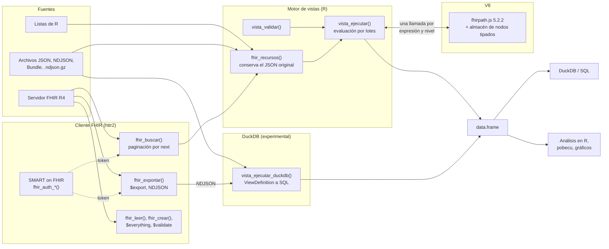
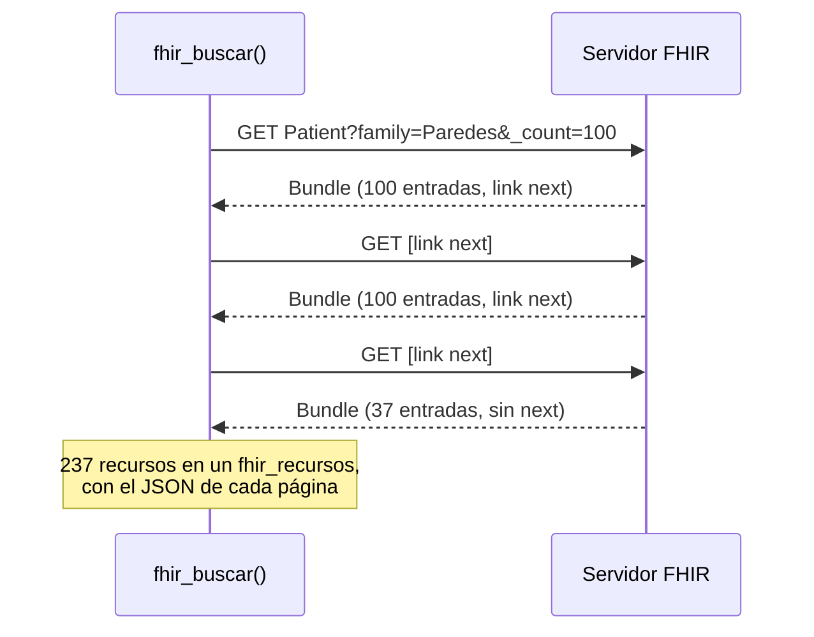
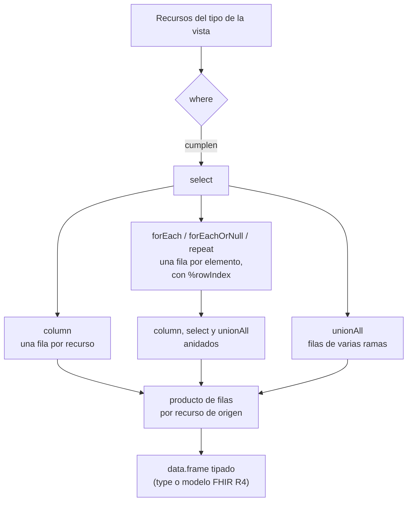

# fhirviews 

<!-- badges: start -->
[](https://github.com/f-slg/fhirviews/actions/workflows/R-CMD-check.yaml)
[](https://f-slg.github.io/fhirviews/)
[](https://f-slg.github.io/fhirviews/reference/vista_conformidad.html)
[](https://hl7.org/fhir/R4/)
[](https://github.com/f-slg/fhirviews/blob/main/LICENSE.md)
<!-- badges: end -->

**fhirviews** lleva **HL7 FHIR R4** a R: un cliente para hablar con cualquier
servidor FHIR desde R y RStudio, como harías con Postman, y un motor que
convierte los recursos FHIR en **tablas** con el estándar
**[SQL on FHIR](https://sql-on-fhir.org/)** (`ViewDefinition`). El motor de
vistas funciona dentro de R, sin Java ni Spark, devuelve `data.frame` y pasa
**todas las pruebas *shareable*** del banco oficial de conformidad. Se
conecta a servidores protegidos con **SMART on FHIR**, descarga poblaciones
completas con **`$export`** y, con su **motor DuckDB**, aplana millones de
recursos en un portátil. Incluye además **terminologías** (`$expand`,
`$lookup`, `$validate-code`) y un **catálogo de vistas** listas para salud
pública.


> **Nota:** fhirviews es un paquete independiente, desarrollado a título
> personal. No es un producto de HL7 ni de ninguna otra institución. Los datos
> de los ejemplos son ficticios.

## Contenido

- [¿Por qué fhirviews?](#por-qué-fhirviews)
- [Instalación](#instalación)
- [Inicio rápido](#inicio-rápido)
- [Para qué se puede usar](#para-qué-se-puede-usar)
- [Cómo funciona](#cómo-funciona)
- [Conformidad con SQL on FHIR](#conformidad-con-sql-on-fhir)
- [Rendimiento](#rendimiento)
- [Funciones](#funciones)
- [Comparación con otras herramientas](#comparación-con-otras-herramientas)
- [Hoja de ruta](#hoja-de-ruta)
- [Documentación, contribuciones y licencia](#documentación)

## ¿Por qué fhirviews?

**FHIR** es el estándar con el que hoy se intercambian datos clínicos:
historias clínicas, laboratorios, vacunación, sistemas de vigilancia. Sus
recursos son **árboles JSON**: un paciente tiene varios nombres, cada nombre
varios apellidos, cada observación varios componentes... Ideal para
intercambiar información, incómodo para analizarla: un indicador, una tasa o
un modelo estadístico necesitan **tablas**.

Aplanar FHIR a mano es frágil: cada equipo escribe su propio código, con sus
propias decisiones sobre qué hacer con las listas, las extensiones o los
valores ausentes, y los resultados no se pueden comparar.
**[SQL on FHIR](https://sql-on-fhir.org/)** resuelve esto con un formato
estándar, el `ViewDefinition`: una descripción en JSON de qué columnas sacar de
cada recurso, con expresiones [FHIRPath](https://hl7.org/fhirpath/). La misma
vista da la misma tabla en cualquier implementación (Pathling, Aidbox, Google
FHIR Data Pipes...). fhirviews trae ese estándar a R.

| Necesidad | Qué ofrece fhirviews |
|---|---|
| Consultar un servidor FHIR sin salir de R | Cliente completo: búsqueda con paginación, lectura, escritura, transacciones, `$everything`, `$validate`, errores legibles |
| Trabajar con servidores protegidos | Autenticación SMART on FHIR / OAuth2: *client credentials*, *Backend Services* (JWT firmado) e inicio de sesión en el navegador, con renovación automática del token |
| Convertir recursos en tablas de forma reproducible | Motor de `ViewDefinition` conforme al estándar, validado con el banco oficial |
| Trabajar con volúmenes reales | Exportación masiva con `$export` (FHIR Bulk Data); motor V8 por lotes y motor DuckDB que traduce la vista a SQL: un millón de pacientes en segundos |
| Definir indicadores con `ValueSet` | Expansión de `ValueSet` con paginación, `$lookup` y `$validate-code` en un servidor de terminología; los códigos quedan dentro de la vista, sin red al ejecutarla |
| Analizar con SQL | Las vistas se guardan en DuckDB (u otra base DBI) con un comando |
| Enseñar y explorar | Panel *Connections* y addins de RStudio, peticiones al estilo Postman, datos de ejemplo |

## Instalación

```r
# install.packages("pak")
pak::pak("f-slg/fhirviews")
```

fhirviews evalúa FHIRPath con [fhirpath.js](https://github.com/HL7/fhirpath.js)
a través del paquete [V8](https://cran.r-project.org/package=V8):

- **Windows y macOS:** V8 se instala como binario, sin pasos adicionales.
- **Ubuntu, Debian, RHEL y derivados (x86_64 o arm64):** V8 descarga
  automáticamente una versión estática del motor.
- **Fedora, Arch u otros:** instala `v8-devel` (o el equivalente) o define
  `DOWNLOAD_STATIC_LIBV8=1` antes de instalar V8.

Opcionales, según lo que vayas a usar:

| Paquetes | Para |
|---|---|
| `duckdb` (1.3.0 o posterior) y `DBI` | `vista_duckdb()` y el motor DuckDB (`vista_ejecutar_duckdb()`) |
| `jose` y `openssl` | Autenticación SMART *Backend Services* (`fhir_auth_backend()`) |
| `httpuv` | Inicio de sesión en el navegador (`fhir_auth_interactiva()`) |
| `rstudioapi` | Addins de RStudio |
| [pobecu](https://f-slg.github.io/pobecu/) | Población del Ecuador para calcular tasas |

## Inicio rápido

El paquete incluye el caso clínico ficticio del taller
[aprende-fhir](https://github.com/f-slg/aprende-fhir) (60 recursos de 29
tipos), así que el ejemplo funciona sin conexión:

```r
library(fhirviews)

caso <- fhir_recursos(system.file("extdata", "caso_clinico.ndjson",
                                  package = "fhirviews"))

signos <- vista_crear(
  "Observation",
  c(fecha  = "effective.ofType(dateTime)",
    medida = "code.text",
    valor  = "value.ofType(Quantity).value",
    unidad = "value.ofType(Quantity).unit"),
  where = "value.ofType(Quantity).exists()"
)
vista_ejecutar(caso, signos)
#>          id                     fecha                  medida  valor            unidad
#> 1  obs-temp 2025-03-20T07:30:00-05:00    Temperatura corporal  38.40                °C
#> 2    obs-fr 2025-03-20T07:30:00-05:00 Frecuencia respiratoria  20.00 respiraciones/min
#> 3    obs-fc 2025-03-20T07:30:00-05:00     Frecuencia cardíaca 102.00       latidos/min
#> 4 obs-tumor                2025-05-08        Tamaño del tumor   3.50                cm
#> 5   obs-bsa                2025-07-01     Superficie corporal   1.77                m2
```

Con un servidor real, los mismos pasos:

```r
con <- fhir_conectar("https://hapi.fhir.org/baseR4")
observaciones <- fhir_buscar(con, "Observation", category = "vital-signs",
                             `_count` = 100, max_paginas = 5)
vista_ejecutar(observaciones, signos)
```

## Para qué se puede usar

### 1. Explorar un servidor FHIR como en Postman

```r
con <- fhir_conectar("https://hapi.fhir.org/baseR4")
fhir_capacidades(con)                               # qué recursos y operaciones admite
fhir_ejecutar_texto("GET Patient?family=Paredes&_count=5")
fhir_leer(con, "Patient", "123")
fhir_everything(con, "Patient", "123")              # todo lo del paciente
```

Las respuestas se imprimen con el estado HTTP y el JSON con sangría, y los
errores muestran lo que dice el servidor (`OperationOutcome`):

```r
fhir_leer(con, "Patient", "no-existe")
#> Error:
#> ! El servidor respondió 404 Not Found.
#> ✖ GET https://hapi.fhir.org/baseR4/Patient/no-existe
#> • [error] HAPI-2001: Resource Patient/no-existe is not known
```

En RStudio, el servidor aparece en el panel **Connections** (tipos de recurso,
columnas y vista previa), y los addins **Ejecutar petición FHIR** y **Ejecutar
ViewDefinition** ejecutan el texto seleccionado con un clic.

### 2. Servidores de producción: SMART on FHIR y exportación masiva

Los servidores reales exigen autenticación y, para una población completa,
ofrecen `$export` (FHIR Bulk Data). Con una clave privada registrada en el
servidor de autorización (*SMART Backend Services*), todas las funciones usan
el token sin hacer nada más:

```r
con <- fhir_conectar(
  "https://fhir.hospital.ejemplo/r4",
  autenticacion = fhir_auth_backend("tablero-vigilancia", "~/.claves/privada.pem",
                                    alcances = "system/*.rs", kid = "clave-2026")
)
```

La exportación masiva, aquí contra el servidor de referencia de SMART Health
IT (abierto, con datos sintéticos):

```r
con <- fhir_conectar("https://bulk-data.smarthealthit.org/fhir")
exp <- fhir_exportar(con, "paciente",
                     tipos = c("Patient", "Condition", "Observation"),
                     carpeta = "exportacion")
exp
#> <fhir_exportacion> completada (nivel paciente)
#>   Carpeta: exportacion
#>   Condition                1 archivo, 639 recursos
#>   Observation              2 archivos, 16315 recursos
#>   Patient                  1 archivo, 100 recursos
```

El token se pide, se renueva y se envía solo al propio servidor; la
exportación respeta `Retry-After`, muestra el avance y descarga los NDJSON.
Probado contra el servidor de referencia
[bulk-data.smarthealthit.org](https://bulk-data.smarthealthit.org) y contra un
servidor SMART local que verifica la firma de cada JWT. Detalle en la viñeta
[*Servidores reales y grandes volúmenes*](https://f-slg.github.io/fhirviews/articles/servidores-y-volumen.html).

### 3. Millones de recursos con el motor DuckDB

`vista_ejecutar_duckdb()` traduce el mismo `ViewDefinition` a una consulta SQL
de [DuckDB](https://duckdb.org/) y la ejecuta directamente sobre los NDJSON o
Parquet, sin cargarlos en R. Da las mismas tablas que `vista_ejecutar()` (las
pruebas comparan ambos motores) y pasa también las 133 pruebas *shareable*:

```r
casos <- vista_ejecutar_duckdb("exportacion/*.ndjson", v_dengue)
vista_sql(v_dengue)          # la consulta SQL generada
```

Es un motor experimental: traduce un subconjunto de FHIRPath y, si algo no se
puede traducir, lo dice con un error en lugar de adivinar. Ver
[Rendimiento](#rendimiento).

### 4. Vistas listas para salud pública y terminologías

`vista_catalogo()` trae siete `ViewDefinition` estándar para las tablas más
comunes en vigilancia (pacientes con residencia, signos vitales,
diagnósticos, notificación obligatoria, inmunizaciones, encuentros y
medicamentos). Se usan tal cual o se ajustan sus constantes con
`vista_plantilla()`, y funcionan con los dos motores:

```r
vista_catalogo()[, c("nombre", "recurso")]
#>                     nombre           recurso
#> 1             diagnosticos         Condition
#> 2               encuentros         Encounter
#> 3           inmunizaciones      Immunization
#> 4             medicamentos MedicationRequest
#> 5 notificacion_obligatoria         Condition
#> 6                pacientes           Patient
#> 7           signos_vitales       Observation

dengue <- system.file("extdata", "dengue_2025.ndjson.gz", package = "fhirviews")
vista_ejecutar_duckdb(dengue, vista_plantilla("notificacion_obligatoria"))
```

Si un indicador se define con un `ValueSet` (por ejemplo, todos los códigos
de diabetes en SNOMED CT), `tx_expandir()` lo expande en un servidor de
terminología y `vista_con_valueset()` guarda los códigos dentro de la vista,
de modo que ejecutarla ya no necesita red:

```r
tx <- fhir_conectar("https://tx.fhir.org/r4")
tx_expandir(tx, "http://hl7.org/fhir/ValueSet/administrative-gender")
#>                                      system    code display
#> 1 http://hl7.org/fhir/administrative-gender    male    Male
#> 2 http://hl7.org/fhir/administrative-gender  female  Female
#> 3 http://hl7.org/fhir/administrative-gender   other   Other
#> 4 http://hl7.org/fhir/administrative-gender unknown Unknown

tx_validar_codigo(tx, "http://hl7.org/fhir/ValueSet/administrative-gender",
                  "http://hl7.org/fhir/administrative-gender",
                  c("female", "mujer"))$valido
#> [1]  TRUE FALSE

diabetes <- tx_expandir(tx, url_valueset_diabetes)
v <- vista_con_valueset(vista_plantilla("diagnosticos"), diabetes)
```

### 5. Vigilancia epidemiológica: de casos FHIR a tasas por territorio

Los sistemas de notificación guardan cada caso como `Patient` + `Condition`.
Con dos vistas y la población oficial del INEC del paquete
[pobecu](https://f-slg.github.io/pobecu/) se obtienen tasas por cantón:

```r
dengue <- fhir_recursos(system.file("extdata", "dengue_2025.ndjson.gz",
                                    package = "fhirviews"))
pacientes <- vista_ejecutar(dengue, v_paciente)  # con el código DPA del cantón
casos <- vista_ejecutar(dengue, v_dengue)        # solo diagnósticos confirmados
por_canton <- aggregate(paciente ~ dpa_canton, merge(casos, pacientes, ...), length)
pobecu::pob_tasa(por_canton, "casos")
```


El ejemplo completo está en la viñeta
[*Tasas por cantón con FHIR y pobecu*](https://f-slg.github.io/fhirviews/articles/tasas-pobecu.html).

### 6. Indicadores y tableros con SQL

`vista_duckdb()` guarda varias vistas como tablas de
[DuckDB](https://duckdb.org/) en un paso. A partir de ahí, cualquier
indicador es una consulta SQL:

```r
db <- vista_duckdb(dengue, list(
  paciente = vista_crear("Patient", c(sexo = "gender", nacimiento = "birthDate",
                                      provincia = "address.state.first()")),
  dengue = vista_crear("Condition", c(
    paciente = "subject.getReferenceKey(Patient)",
    inicio = "onset.ofType(dateTime)",
    grave = "code.coding.where(system = 'http://hl7.org/fhir/sid/icd-10').code = 'A91'"),
    where = "verificationStatus.coding.where(code = 'confirmed').exists()")
))

DBI::dbGetQuery(db, "
  SELECT p.provincia, count(*) AS casos,
         round(100 * avg(CASE WHEN d.grave THEN 1 ELSE 0 END), 1) AS pct_graves,
         round(avg(date_diff('year', CAST(p.nacimiento AS DATE),
                             CAST(d.inicio AS DATE))), 1) AS edad_media
  FROM dengue d JOIN paciente p ON d.paciente = p.id
  GROUP BY p.provincia ORDER BY casos DESC")
#>   provincia casos pct_graves edad_media
#> 1    Guayas   329        5.2       29.7
#> 2    Manabí   136        5.1       27.7
#> 3  Los Ríos   111       14.4       28.3
#> 4    El Oro    85       10.6       30.5
```

### 7. Cohortes y conjuntos de datos para investigación

Las vistas son reproducibles y se pueden compartir: el mismo `ViewDefinition`
JSON produce la misma tabla en fhirviews y en otras implementaciones. Para
exportar una cohorte a Parquet o CSV basta con DuckDB:

```r
vista_json(v_dengue)                                   # compartir la definición
DBI::dbExecute(db, "COPY dengue TO 'dengue.parquet' (FORMAT parquet)")
```

### 8. Interoperabilidad: cargar, validar y transaccionar

```r
local <- fhir_conectar("http://localhost:8080/fhir")   # por ejemplo, HAPI en Podman
fhir_validar(local, "paciente.json")                   # $validate: tabla de problemas
fhir_crear(local, "transaccion.json")                  # Bundle transaction -> POST [base]
for (r in caso) fhir_actualizar(local, r)              # cargar el caso clínico con sus ids
```

### 9. Docencia

El caso clínico de [aprende-fhir](https://github.com/f-slg/aprende-fhir) viene
incluido, `fhir_tabla()` da un vistazo rápido sin escribir vistas,
`vista_fhirpath()` permite probar expresiones FHIRPath una a una y
`vista_validar()` explica qué está mal en un `ViewDefinition`:

```r
vista_fhirpath(caso[1], "name.where(use = 'official').text")
#> [1] "Luis Alberto Paredes Cevallos"
```

## Cómo funciona



**Autenticación.** Con `autenticacion = fhir_auth_*()`, el token SMART se pide
en la primera petición, se renueva solo, se reintenta una vez si el servidor lo
rechaza y se envía únicamente al servidor de la conexión. En *Backend Services*
cada pedido de token firma un JWT nuevo (RS384 o ES384, `jti` aleatorio,
validez de cinco minutos).

**Cliente.** Las peticiones usan `application/fhir+json`, se reintentan si el
servidor está saturado (429/503) y convierten el `OperationOutcome` de los
errores en mensajes legibles, con una clase de error por código HTTP. La
búsqueda sigue los enlaces `next` de cada Bundle y se detiene si el servidor
repite uno. El token de acceso solo se envía al servidor de la conexión y se
avisa si viajaría sin cifrar.



**Motor de vistas.** El `ViewDefinition` se valida (estructura, nombres,
`unionAll`, constantes, compilación de cada expresión FHIRPath) y se ejecuta
**por lotes**: cada `column`, `forEach` o `where` es una sola llamada a V8 para
todos los recursos a la vez, no una por recurso. Los elementos que devuelven
`forEach` y `repeat` se guardan en V8 como nodos tipados, de modo que
`ofType()` y `extension()` funcionan también en elementos anidados. Las filas
de cada parte se combinan con índices (`rep()` y `sequence()`) en R.



**Motor DuckDB.** `vista_ejecutar_duckdb()` traduce la vista a una sola
consulta SQL: cada recurso se lee como JSON sin esquema
(`read_json_objects()`), las colecciones de FHIRPath son listas de DuckDB, las
funciones se traducen a `list_filter()` y `list_transform()`, y `forEach`,
`unionAll` y `repeat` se resuelven dentro de cada fila, lo que deja a DuckDB
procesar los archivos en paralelo. Lo que no sabe traducir da un error en lugar
de adivinar. `vista_sql()` muestra la consulta.

**Tipos.** Con `type`, cada columna se convierte al tipo de R correspondiente
(`boolean` a lógico, `integer` a entero, `decimal` a numérico, el resto a
texto) y se avisa si algún valor no es compatible. Sin `type`, las columnas
vacías toman el tipo del modelo de FHIR R4, para que la misma vista dé siempre
los mismos tipos.

**Seguridad.** fhirpath.js corre aislado en V8, sin acceso a red ni a archivos
(funciones como `resolve()` están desactivadas): un `ViewDefinition` no puede
hacer peticiones ni leer datos fuera de los recursos que se le pasan.

## Conformidad con SQL on FHIR

El paquete incluye el
[banco oficial de pruebas](https://github.com/FHIR/sql-on-fhir.js/tree/main/tests)
de SQL on FHIR, que se ejecuta en cada comprobación de integración continua.
Pasan **las 133 pruebas del perfil *shareable*** (el que debe cumplir toda
implementación) y 7 de las 11 experimentales con los dos motores.


Las cuatro que fallan son de `lowBoundary()` y `highBoundary()`, funciones
experimentales de FHIRPath que dependen de la precisión decimal original del
JSON y de la zona horaria. Para comprobarlo en tu equipo, o con la versión más
reciente del banco:

```r
vista_conformidad()
vista_conformidad(motor = "duckdb")
vista_conformidad(descargar = TRUE, informe = "informe.json")  # formato oficial
```

## Rendimiento

fhirviews tiene dos motores para ejecutar la misma vista:

- **V8** (`vista_ejecutar()`): evalúa FHIRPath con fhirpath.js, por lotes. Es el
  motor completo (todas las funciones de FHIRPath) y el que conviene para
  desarrollar y validar vistas.
- **DuckDB** (`vista_ejecutar_duckdb()`, experimental): traduce la vista a SQL
  y la ejecuta directamente sobre los archivos, en paralelo y sin cargarlos en
  R. Es el que conviene para volúmenes grandes.


| Pacientes | Filas | Motor V8 | Motor DuckDB | Veces más rápido |
|---:|---:|---:|---:|---:|
| 10 000 | 17 824 | 2,3 s | 0,22 s | 11 |
| 50 000 | 89 128 | 11,0 s | 0,92 s | 12 |
| 100 000 | 178 062 | 23,2 s | 1,18 s | 20 |
| 250 000 | 444 912 | 58,9 s | 1,56 s | 38 |
| 1 000 000 | 1 780 958 | — | 5,8 s | — |

Tiempo de punta a punta, desde el archivo NDJSON hasta el `data.frame`, con
pacientes sintéticos y una vista con `where`, cuatro columnas y `forEach` sobre
`name` (`data-raw/motor-duckdb.R`; Linux, 8 núcleos, R 4.5.2, duckdb 1.5.6).
Ambos motores dan tablas idénticas: las pruebas del paquete los comparan con
las vistas de todas las viñetas y con más de 100 expresiones de FHIRPath, y lo
que el motor DuckDB no puede traducir con certeza da un error en lugar de un
resultado distinto. Con `vista_ejecutar_duckdb(..., diferido = TRUE)` el
resultado queda como tabla de dplyr sobre DuckDB, para filtrar y resumir sin
traer todas las filas a R. Con el motor V8, los recursos que llegan como
JSON (de un servidor, de `$export` o de un archivo) pasan el texto original
directamente a V8; los armados como listas de R son unas cuatro veces más
lentos porque deben convertirse a JSON.

## Funciones

| Grupo | Funciones | Para qué |
|---|---|---|
| Conexión | `fhir_conectar()`, `fhir_disponible()`, `fhir_capacidades()` | Conectarse, comprobar que el servidor responde y ver qué admite |
| Autenticación | `fhir_auth_cliente()`, `fhir_auth_backend()`, `fhir_auth_interactiva()`, `fhir_smart_configuracion()` | SMART on FHIR / OAuth2 para servidores protegidos |
| Lectura | `fhir_buscar()`, `fhir_leer()`, `fhir_everything()` | Buscar con paginación, leer un recurso o todo un paciente |
| Escritura | `fhir_crear()`, `fhir_actualizar()`, `fhir_borrar()` | Crear, actualizar, borrar y ejecutar transacciones |
| Exportación masiva | `fhir_exportar()`, `fhir_exportar_estado()`, `fhir_exportar_cancelar()` | Operación `$export` (FHIR Bulk Data): espera al servidor y descarga los NDJSON para el análisis poblacional |
| Validación | `fhir_validar()` | Operación `$validate`, con la tabla de problemas |
| Peticiones libres | `fhir_peticion()`, `fhir_ejecutar_texto()` | Cualquier otra petición, también escrita como en Postman |
| Recursos | `fhir_recursos()`, `fhir_tabla()` | Reunir recursos de cualquier fuente y verlos como tabla rápida |
| Vistas | `vista_crear()`, `vista_leer()`, `vista_json()`, `vista_validar()` | Definir, leer, exportar y validar `ViewDefinition` |
| Catálogo de vistas | `vista_catalogo()`, `vista_plantilla()` | Vistas listas para salud pública: pacientes con residencia, signos vitales, diagnósticos, notificación obligatoria, inmunizaciones, encuentros y medicamentos |
| Ejecución | `vista_ejecutar()`, `fhir_vista()`, `vista_fhirpath()` | Aplicar una vista (a recursos o directamente al servidor) y probar FHIRPath |
| Motor DuckDB | `vista_ejecutar_duckdb()`, `vista_sql()` | Ejecutar la vista como SQL de DuckDB sobre NDJSON o Parquet (experimental) |
| Terminologías | `tx_expandir()`, `tx_buscar_codigo()`, `tx_validar_codigo()`, `vista_con_valueset()` | `$expand`, `$lookup` y `$validate-code` en un servidor de terminología (tx.fhir.org, Snowstorm) y vistas filtradas por los códigos de un `ValueSet` |
| SQL | `vista_duckdb()` | Guardar vistas como tablas de DuckDB u otra base DBI |
| Conformidad | `vista_conformidad()` | Ejecutar el banco oficial de pruebas de SQL on FHIR, con cualquiera de los dos motores |
| RStudio | `fhir_conexion_activa()`, `fhir_desconectar()` | Conexión activa del panel *Connections* y de los addins |
| Motor | `fhirviews_motor()`, `fhirviews_version_fhirpath()` | Versión de fhirpath.js y del motor de JavaScript |

## Comparación con otras herramientas

fhirviews no es la única forma de usar FHIR o SQL on FHIR desde R. En
particular, el paquete [pathling](https://cran.r-project.org/package=pathling)
(CSIRO) también ejecuta `ViewDefinition` desde R con `ds_view()`, sobre Spark.

| | fhirviews | [pathling](https://cran.r-project.org/package=pathling) | [fhircrackr](https://cran.r-project.org/package=fhircrackr) |
|---|---|---|---|
| Base técnica | R + fhirpath.js en V8; motor opcional que traduce a SQL de DuckDB | Biblioteca Java de Pathling sobre Apache Spark (vía sparklyr) | R |
| Requisitos | Solo paquetes de R (V8) | Java y Spark | Solo paquetes de R |
| Tablas con `ViewDefinition` (SQL on FHIR) | Sí, `vista_ejecutar()` | Sí, `ds_view()` | No: descripciones propias con XPath |
| Resultado | `data.frame` de R | Spark DataFrame | `data.frame` de R |
| Cliente REST de FHIR | Sí, en JSON: búsqueda con paginación, escritura, transacciones, `$everything`, `$validate`, *bulk export* (`$export`) | Lectura con *bulk export* (`$export`) | Sí, en XML: búsqueda, `POST`, `PUT` |
| Autenticación | SMART on FHIR en todas las peticiones: *client credentials*, *Backend Services* (JWT), *authorization code* + PKCE | SMART (secreto o clave privada) para la lectura con `$export` | OAuth2 / OpenID Connect (`fhir_authenticate()`) y autenticación básica |
| Terminologías (SNOMED CT, LOINC, ValueSet) | Sí: `$expand` (con paginación), `$lookup` y `$validate-code` con un servidor de terminología; `vista_con_valueset()` guarda los códigos en la vista | Sí, funciones `tx_*` con un servidor de terminología, también dentro de las consultas | No |
| Volumen de datos | Motor V8: memoria de la sesión de R. Motor DuckDB: millones de recursos en un portátil | Distribuido: grandes volúmenes en un clúster | Memoria de una sesión de R |
| Banco oficial de SQL on FHIR | Incluido en el paquete (`vista_conformidad()`) | Pathling figura en la [página de implementaciones](https://sql-on-fhir.org/extra/impls.html) | No aplica |
| RStudio | Panel *Connections* y addins | Conexión de Spark | No |
| Documentación | Español | Inglés | Inglés |

**¿Cuál elegir?**

- **pathling**, para grandes volúmenes en Spark o en un clúster, o si
  necesitas consultar el servidor de terminología dentro de cada expresión
  (por ejemplo, `subsumes()` o traducciones con `$translate`).
- **fhirviews**, para análisis en un portátil o un servidor sin instalar Java
  ni Spark (hasta millones de recursos con el motor DuckDB), para trabajar con
  un servidor FHIR (autenticarse, leer, escribir, validar, exportar) y llevar
  los resultados a `data.frame`, DuckDB o pobecu, y para enseñar.
- **fhircrackr**, si ya trabajas con su formato de diseño de tablas o con
  recursos en XML.

Las vistas de SQL on FHIR son portables: un mismo `ViewDefinition` en JSON se
puede ejecutar en fhirviews y en pathling. Los tres paquetes pueden convivir,
porque sus funciones no comparten nombres.

## Hoja de ruta

- Motor de FHIRPath escrito en R, como alternativa a V8 (la capa ya está
  separada: `options(fhirviews.motor = ...)`).
- Búsquedas largas por `POST [tipo]/_search`.
- Motor DuckDB estable (ya traduce la mayor parte de FHIRPath, incluidos
  `lowBoundary()` / `highBoundary()` de fechas): `memberOf()`, decimales con
  su precisión y uso en producción.
- Terminologías: `memberOf()` en FHIRPath y `$translate` (las
  expansiones, `$lookup` y `$validate-code` ya están en las funciones
  `tx_*`).
- Operaciones de SQL on FHIR 3.0 (`$run`, `$export` de vistas) y
  `SQLQuery`.
- Caché del panel *Connections* para servidores lentos.
- Publicación en CRAN (el paquete ya pasa `R CMD check --as-cran` sin
  errores ni avisos).

## Documentación

- [Primeros pasos](https://f-slg.github.io/fhirviews/articles/fhirviews.html):
  cliente, recursos y primeras vistas con el caso clínico.
- [ViewDefinition en detalle](https://f-slg.github.io/fhirviews/articles/vistas.html):
  todos los elementos de la especificación, validación y DuckDB.
- [Tasas por cantón con FHIR y pobecu](https://f-slg.github.io/fhirviews/articles/tasas-pobecu.html):
  vigilancia epidemiológica de punta a punta.
- [Servidores reales y grandes volúmenes](https://f-slg.github.io/fhirviews/articles/servidores-y-volumen.html):
  SMART on FHIR, `$export` y el motor DuckDB.
- [Cómo funciona por dentro](https://f-slg.github.io/fhirviews/articles/arquitectura.html):
  arquitectura, motor por lotes, tipos y seguridad.
- [Referencia de funciones](https://f-slg.github.io/fhirviews/reference/).

### Paquetes relacionados

- [pobecu](https://f-slg.github.io/pobecu/): población del Ecuador por
  provincia, cantón y parroquia.
- [geoecu](https://f-slg.github.io/geoecu/): límites territoriales del Ecuador.
- [aprende-fhir](https://github.com/f-slg/aprende-fhir): taller de HL7 FHIR con
  un caso clínico ecuatoriano ficticio.

### Contribuir

Las preguntas van en
[Discussions](https://github.com/f-slg/fhirviews/discussions) y los errores o
propuestas en [issues](https://github.com/f-slg/fhirviews/issues/new/choose)
(hay una plantilla para problemas de conformidad con SQL on FHIR). Revisa la
[guía de contribución](https://github.com/f-slg/fhirviews/blob/main/.github/CONTRIBUTING.md).
Este proyecto sigue un
[código de conducta](https://github.com/f-slg/fhirviews/blob/main/.github/CODE_OF_CONDUCT.md);
al participar, te comprometes a respetarlo.

### Cita

```r
citation("fhirviews")
```

### Licencia

MIT © Ronald Fabricio Salas Guerrero. El paquete incluye fhirpath.js (NLM y
Health Samurai, licencia tipo BSD) y el banco de pruebas de SQL on FHIR (MIT),
sin modificar; el detalle está en
[`inst/COPYRIGHTS`](https://github.com/f-slg/fhirviews/blob/main/inst/COPYRIGHTS).

FHIR® y HL7® son marcas registradas de Health Level Seven International; su
uso no implica respaldo de HL7.
