# fhirviews 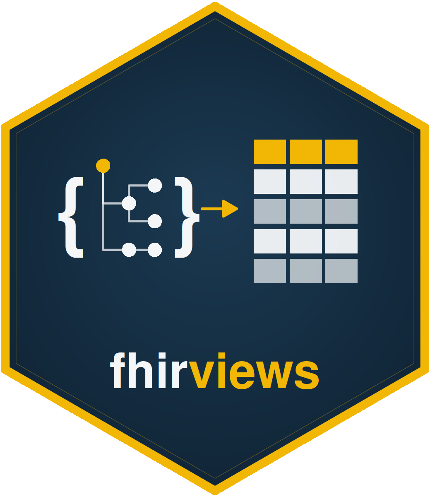

**De recursos FHIR a tablas reproducibles en R, y de SQL a FHIR mediante mapeos explícitos.**

**Español** · [English](https://github.com/f-slg/fhirviews/blob/main/README.en.md)

<!-- badges: start -->
[](https://github.com/f-slg/fhirviews/actions/workflows/R-CMD-check.yaml)
[](https://f-slg.github.io/fhirviews/)
[](#conformidad-y-pruebas)
[](https://hl7.org/fhir/R4/)
[](https://github.com/f-slg/fhirviews/blob/main/LICENSE.md)
[](https://doi.org/10.5281/zenodo.24238725)
<!-- badges: end -->

**fhirviews** consulta servidores **HL7 FHIR R4** y transforma sus recursos en
`data.frame` mediante **SQL on FHIR** y **FHIRPath**. Define una vista una vez,
guárdala como `ViewDefinition` y reutilízala sobre archivos locales, respuestas
del servidor o exportaciones poblacionales.

También construye **Patient, Observation, Encounter, Condition, Immunization,
Specimen y DiagnosticReport** desde un `data.frame`
o una consulta SQL por DBI, con un mapeo explícito de columnas, constantes y
referencias. La salida se guarda como JSON o NDJSON conservando la escala decimal.

Está pensado para análisis clínico, investigación, vigilancia epidemiológica y
docencia desde R. Incluye autenticación SMART on FHIR, vistas para salud pública
y procesamiento NDJSON por bloques, sin instalar Java ni Spark.

El flujo técnico combina un cliente HTTP basado en `httr2`, un evaluador
FHIRPath con `fhirpath.js` en V8 y un traductor SQL opcional para DuckDB.
La definición de extracción es independiente del origen: un mismo
`ViewDefinition` puede aplicarse a recursos obtenidos por REST o a archivos
locales. La compatibilidad del motor SQL se comprueba por separado.

[Documentación](https://f-slg.github.io/fhirviews/) ·
[Referencia](https://f-slg.github.io/fhirviews/reference/) ·
[Novedades](NEWS.md) ·
[Reportar un problema](https://github.com/f-slg/fhirviews/issues/new/choose)

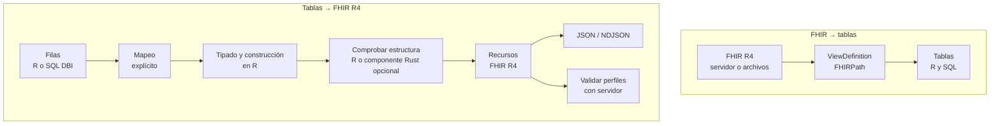

La lectura usa V8 o el traductor DuckDB experimental. La construcción admite
**Patient, Observation, Encounter, Condition, Immunization, Specimen y DiagnosticReport** y conserva la
escala decimal disponible en el origen. Para construir recursos desde una tabla
extraída, prepara las filas y elige un mapa; las columnas omitidas o agregadas
necesitan decisiones propias.

## Estado y versiones

| Versión o componente | Estado y uso |
|---|---|
| **Desarrollo actual: `0.5.0.9002`** | Código de GitHub. SQL → FHIR para siete recursos R4, colecciones de referencias y API para un componente Rust externo opcional; ocho vistas de catálogo. Todavía sin DOI de versión propio. |
| **Candidato de piloto `0.5.0.9002`** | El kit actualizado incluye los siete constructores R4 y evaluación bilingüe por alcance; siete tipos exige la tarea Specimen → Observation → DiagnosticReport. No requiere Rust. |
| **Archivo `0.5.0.9000`** | Código anterior preservado en [Zenodo](https://doi.org/10.5281/zenodo.24238726). Su DOI identifica ese archivo concreto. |
| **`0.5.0`** | [Lanzamiento de GitHub](https://github.com/f-slg/fhirviews/releases/tag/v0.5.0), enviado a CRAN el 7 de noviembre de 2026. No incluye SQL → FHIR. Consulta el [catálogo oficial de CRAN](https://cran.r-project.org/web/packages/available_packages_by_name.html) para su publicación. |
| **Rust** | Componente CLI opcional, seleccionado por el usuario; R sigue siendo la ruta predeterminada. ZIP independientes para Linux x86_64, Windows x64 y macOS Intel/Apple Silicon, con SHA-256 y procedencia. [Uso](#validación-con-el-componente-rust-opcional) · [Resultados y límites](#rendimiento). |
| **Federación y R4/R6** | Trabajo previsto; todavía no disponible. [Pendientes y orden de trabajo](#pendientes-y-orden-de-trabajo). |

La prioridad es cerrar R4 con el candidato instalado y un piloto externo.
La lectura y las vistas pueden trabajar con otros recursos R4; la construcción
desde SQL admite los siete tipos indicados; los perfiles propios necesitan validación adicional.
Publicar en GitHub o Zenodo y ser aceptado por CRAN son procesos independientes.

## Contenido

- **Empezar:** [Qué puedes hacer](#qué-puedes-hacer) · [Instalación](#instalación) · [Inicio rápido](#inicio-rápido-de-fhir-a-una-tabla).
- **Extraer y consultar:** [Servidor FHIR](#consultar-un-servidor-fhir) · [Autenticación y Bulk Data](#autenticación-y-exportación-masiva) · [Archivos por bloques](#procesar-archivos-por-bloques) · [DuckDB](#trabajar-con-duckdb).
- **Construir recursos:** [SQL → FHIR](#de-sql-a-fhir) · [Reglas del mapeo](#reglas-del-mapeo) · [Recursos admitidos](#recursos-admitidos-y-próximos-grupos).
- **Comprender las vistas:** [Arquitectura](#arquitectura-y-secuencia-de-procesamiento) · [Semántica](#semántica-de-una-vista) · [Elegir el motor](#elegir-cómo-procesar-los-datos) · [Catálogo y terminologías](#vistas-de-salud-pública-y-terminologías).
- **Comprobar resultados:** [Validación y privacidad](#validación-y-privacidad) · [Conformidad y pruebas](#conformidad-y-pruebas) · [Rendimiento y Rust](#rendimiento) · [Límites](#alcance-y-límites).
- **Seguir el desarrollo:** [Cierre R4](#estabilización-de-r4) · [Pendientes](#pendientes-y-orden-de-trabajo) · [Piloto](#piloto-y-documentación-local) · [Guías](#guías-y-referencia).
- **Autoría y colaboración:** [Citar el paquete](#citar-el-paquete) · [Contribuir](#contribuir) · [Licencia](#licencia).

## Qué puedes hacer

| Necesidad | Herramientas |
|---|---|
| Convertir JSON, Bundles o recursos de R en tablas | `vista_crear()`, `vista_ejecutar()` |
| Consultar FHIR con paginación automática | `fhir_conectar()`, `fhir_buscar()`, `fhir_leer()` |
| Acceder a servidores protegidos | `fhir_auth_cliente()`, `fhir_auth_backend()`, `fhir_auth_interactiva()` |
| Descargar una población mediante Bulk Data | `fhir_exportar()`, `fhir_exportar_estado()` |
| Recorrer NDJSON y gzip sin reunir toda la salida en memoria | `vista_ejecutar_lotes()` |
| Ejecutar una vista traducible a SQL sobre NDJSON o Parquet | `vista_ejecutar_duckdb()` — experimental |
| Consultar varias tablas con SQL | `vista_duckdb()` — vistas evaluadas con V8 y guardadas en una transacción |
| Construir siete tipos de recursos R4 desde tablas o consultas SQL | `fhir_mapa()`, `fhir_desde_tabla()`, `fhir_desde_sql()` |
| Seleccionar el validador estructural Rust externo opcional | `fhir_componente_rust()` y argumento `componente` |
| Guardar recursos conservando decimales del JSON original | `fhir_escribir()` — JSON o NDJSON |
| Partir de vistas para salud pública | `vista_catalogo()`, `vista_plantilla()` |
| Definir cohortes con códigos de un ValueSet | `tx_expandir()`, `vista_con_valueset()` |
| Escribir y validar recursos en el servidor | `fhir_crear()`, `fhir_actualizar()`, `fhir_borrar()`, `fhir_validar()` |

Un `ViewDefinition` describe las columnas, filtros y colecciones que se quieren
extraer mediante expresiones FHIRPath. Guardar esa definición junto al análisis
hace explícitas las decisiones de transformación y facilita su revisión.

## Instalación

El cliente y el motor V8 requieren **R ≥ 4.1.0**. El repositorio es público;
puedes instalar desde GitHub. Si el mantenedor te entregó un `.tar.gz` para
el piloto, usa las instrucciones de [instalación local](#piloto-y-documentación-local).

Instala desde GitHub:

```r
install.packages("pak")  # una sola vez
pak::pak("f-slg/fhirviews")
```

La rama principal recibe cambios. Para reproducir un análisis, instala un
commit concreto y conserva `sessionInfo()` junto con la vista y los datos:

```r
pak::pak("f-slg/fhirviews@<SHA-del-commit>")
```

FHIRPath se ejecuta con [fhirpath.js](https://github.com/HL7/fhirpath.js),
incluido en el paquete, a través de [V8](https://cran.r-project.org/package=V8).
En sistemas con binarios disponibles, la instalación de V8 no requiere pasos
adicionales. Si compilas desde código fuente, consulta sus
[instrucciones de instalación](https://github.com/jeroen/V8#installation).

Instala las dependencias opcionales según tu flujo:

| Funcionalidad | Paquetes adicionales |
|---|---|
| Tablas y motor SQL de DuckDB | `DBI`, `duckdb` ≥ 1.3.0; la versión actual de DuckDB requiere R ≥ 4.2 |
| Consultas diferidas sobre DuckDB | Los anteriores, más `dplyr` y `dbplyr` |
| SMART Backend Services, con JWT firmado | `jose`, `openssl` |
| Inicio de sesión interactivo, con PKCE | `httpuv` |
| Addins y panel Connections de RStudio | `rstudioapi` |

```r
# Ejemplo: habilitar DuckDB
install.packages(c("DBI", "duckdb"))
```

## Inicio rápido: de FHIR a una tabla

Este ejemplo usa datos **ficticios incluidos en el paquete**. Una vez instalado,
funciona sin conexión y no requiere dependencias opcionales.

```r
library(fhirviews)

archivo <- system.file("extdata", "caso_clinico.ndjson", package = "fhirviews")

signos <- vista_crear(
  "Observation",
  c(fecha  = "effective.ofType(dateTime)",
    medida = "code.text",
    valor  = "value.ofType(Quantity).value",
    unidad = "value.ofType(Quantity).unit"),
  where = "value.ofType(Quantity).exists()"
)

tabla <- vista_ejecutar(archivo, signos)
tabla[, c("id", "medida", "valor", "unidad")]
#>          id                  medida  valor            unidad
#> 1  obs-temp    Temperatura corporal  38.40                °C
#> 2    obs-fr Frecuencia respiratoria  20.00 respiraciones/min
#> 3    obs-fc     Frecuencia cardíaca 102.00       latidos/min
#> 4 obs-tumor        Tamaño del tumor   3.50                cm
#> 5   obs-bsa     Superficie corporal   1.77                m2
```

La vista selecciona `Observation`, filtra las que tienen `valueQuantity` y
extrae cuatro columnas. `vista_crear()` añade la clave del recurso en `id`.
También puedes empezar con una vista del catálogo:

```r
tabla_catalogo <- vista_ejecutar(archivo, vista_plantilla("signos_vitales"))
head(tabla_catalogo)

# Guardar la definición en JSON para versionarla o compartirla
json_vista <- vista_json(signos)
writeLines(json_vista, "signos-vitales.json")
vista_reutilizable <- vista_leer("signos-vitales.json")
```

## Arquitectura y secuencia de procesamiento

La extracción se distribuye en cuatro capas. El cliente obtiene
recursos; la definición declara la extracción; los motores generan filas; el
consumidor decide cómo guardar, resumir o consultar el resultado.
La [construcción desde SQL](#de-sql-a-fhir) tiene un mapeo y controles propios.

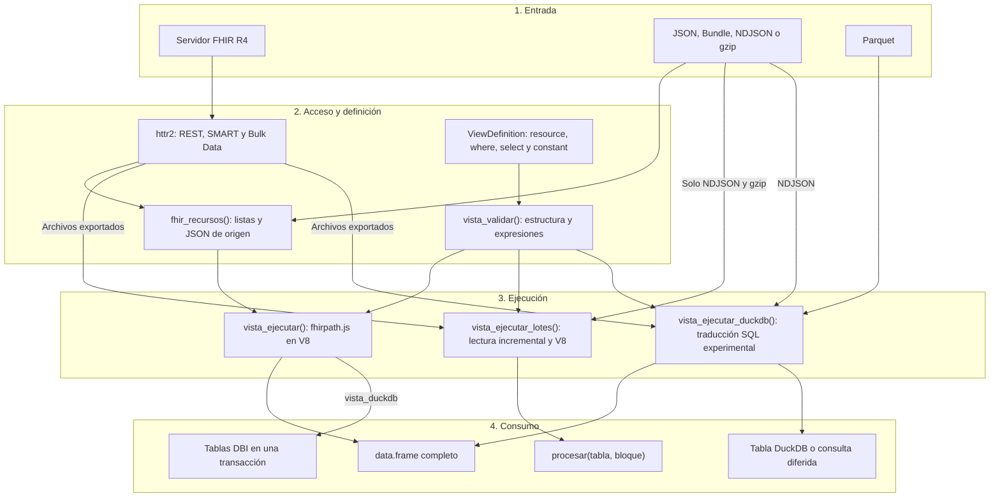

Para construir un análisis reproducible, sigue esta secuencia:

1. **Identifica la entrada:** servidor, archivos y versión FHIR esperada.
2. **Define la vista:** recurso, filtros, columnas, tipos y expansión de listas.
3. **Contrasta una muestra:** revisa las filas frente al JSON original con V8.
4. **Elige la ejecución:** tabla en memoria, bloques o SQL sobre archivos.
5. **Controla la persistencia:** transacción o destino temporal según el consumidor.
6. **Reconcilia resultados:** eventos incluidos y excluidos, referencias y agregados.
7. **Conserva evidencia:** vista JSON, identidad de la entrada, versiones y controles.

La evaluación por lotes de `vista_ejecutar()` agrupa llamadas a V8 para los
recursos ya cargados. La lectura por bloques de `vista_ejecutar_lotes()` divide
además el archivo de entrada; son dos niveles diferentes de procesamiento.

## Semántica de una vista

Un `ViewDefinition` describe una transformación declarativa. No es una consulta
SQL escrita por el usuario: sus rutas se expresan en FHIRPath y el motor las
aplica sobre recursos del tipo indicado en `resource`.

| Elemento | Responsabilidad | Efecto sobre las filas |
|---|---|---|
| `resource` | Elegir el tipo FHIR de entrada | Los otros tipos no participan |
| `where` | Evaluar condiciones booleanas sobre el recurso | Descarta recursos que no cumplen |
| `column` | Evaluar una ruta y asignarle nombre y tipo | Añade columnas al contexto actual |
| `forEach` | Recorrer una colección | Genera una fila por elemento; cero si está vacía |
| `forEachOrNull` | Recorrer conservando el contexto sin elementos | Mantiene una fila con valores ausentes |
| `select` | Componer extracciones anidadas | Las partes se combinan dentro del mismo origen |
| `unionAll` | Concatenar ramas con columnas compatibles | Conserva las filas de las ramas, incluidos duplicados |
| `constant` | Declarar parámetros usados por las expresiones | Permite ajustar filtros sin reescribir rutas |
| `repeat` | Recorrer estructuras anidadas por las rutas declaradas | Expande descendientes para extraer filas de estructuras recursivas |
| `collection: true` | Conservar varios valores en una columna | Produce una columna de listas |

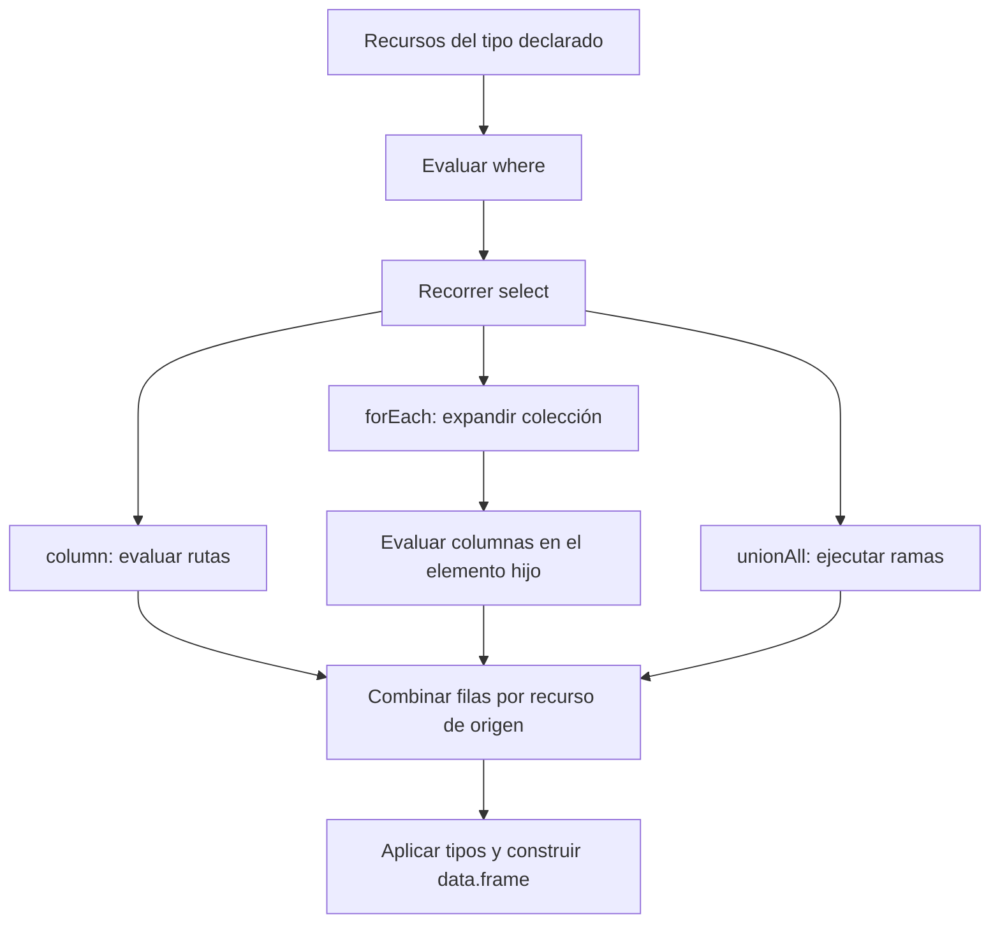

Una columna escalar que devuelve varios valores produce un error: declara
`collection: true` para conservarlos o usa una expresión que devuelva uno.
Dos colecciones expandidas en partes hermanas pueden multiplicar las filas de
un mismo recurso. Por eso deben verificarse tanto la cardinalidad como las
claves antes de contar eventos o unir tablas. `%rowIndex` identifica el índice
del elemento en su contexto de expansión; no sustituye la clave del recurso.

## Elegir cómo procesar los datos

| Situación | Función | Dónde queda el resultado |
|---|---|---|
| Los recursos y la tabla caben en memoria | `vista_ejecutar()` | Un `data.frame` completo |
| Quieres leer NDJSON o gzip por bloques con FHIRPath en V8 | `vista_ejecutar_lotes()` | En la función `procesar(tabla, bloque)` que tú defines |
| Tienes NDJSON o Parquet y una vista compatible con el traductor SQL | `vista_ejecutar_duckdb()` | En R, una tabla de DuckDB o una consulta diferida |
| Quieres consultar juntas varias vistas evaluadas con V8 | `vista_duckdb()` | Tablas en una conexión DBI |

El procesamiento por bloques limita la entrada que se lee en cada paso. La
memoria total depende también de las filas generadas por la vista y de lo que
conserve tu función. En DuckDB, usa `tabla` o `diferido = TRUE` para evitar traer
toda la salida a R.

## Consultar un servidor FHIR

El siguiente ejemplo usa un servidor público de pruebas y requiere conexión:

```r
con <- fhir_conectar("https://hapi.fhir.org/baseR4")

pacientes <- fhir_buscar(
  con, "Patient", `_count` = 20, max_paginas = 2, progreso = FALSE
)

vista_pacientes <- vista_crear(
  "Patient", c(sexo = "gender", nacimiento = "birthDate")
)
vista_ejecutar(pacientes, vista_pacientes)
```

La búsqueda sigue los enlaces `next` del servidor. `_count` solicita el tamaño
de página; `max_paginas` limita las páginas descargadas. La disponibilidad y
los resultados de los servidores públicos pueden variar.

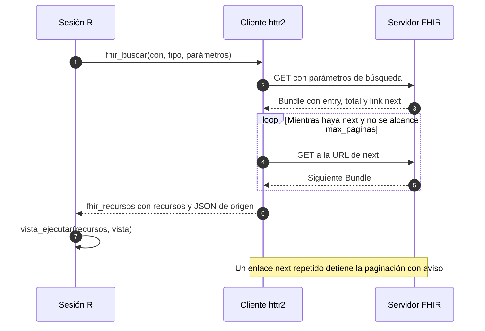

La paginación sigue el enlace entregado por el servidor; no calcula números de
página. Las cabeceras de la conexión y su token se restringen a su base FHIR.
Los archivos de Bulk Data tienen su propia política de origen y autorización.

Usa `fhir_capacidades(con)` para consultar los recursos y operaciones que
admite el servidor, `fhir_leer()` para leer un recurso concreto y
`fhir_everything()` para solicitar `$everything`. En RStudio, el panel
**Connections** permite explorar recursos y los addins ejecutan peticiones
FHIR o vistas desde el editor.

## Autenticación y exportación masiva

Para SMART Backend Services, registra previamente el cliente y su clave pública
en el servidor de autorización. La clave privada debe ser RSA de al menos
2048 bits o EC P-384.

```r
# Sustituye la URL, el identificador y la clave por los de tu entorno
con <- fhir_conectar(
  "https://fhir.hospital.ejemplo/r4",
  autenticacion = fhir_auth_backend(
    "tablero-vigilancia", "~/.claves/privada.pem",
    alcances = "system/*.rs", kid = "clave-2026"
  )
)

# Iniciar el trabajo y conservar su referencia antes de descargar
exp <- fhir_exportar(
  con, "paciente", tipos = c("Patient", "Condition"),
  carpeta = "exportacion", esperar = FALSE
)
exp <- fhir_exportar_estado(exp, esperar = TRUE)
```

El cliente obtiene y renueva el token. La exportación respeta `Retry-After` y
verifica el NDJSON recibido antes de registrar cada archivo como completo:
contenido JSON, tipo de recurso y conteo cuando el manifiesto lo incluye.
También admite archivos gzip.

Si una descarga se interrumpe, vuelve a ejecutar
`exp <- fhir_exportar_estado(exp, esperar = TRUE)` conservando el objeto y la
carpeta. Los archivos completos del mismo trabajo se reutilizan si su checksum
coincide; los ausentes o alterados se descargan de nuevo. Cada archivo
incompleto se reinicia desde el comienzo. La recuperación depende de que el
servidor conserve el trabajo y sus URL de descarga.

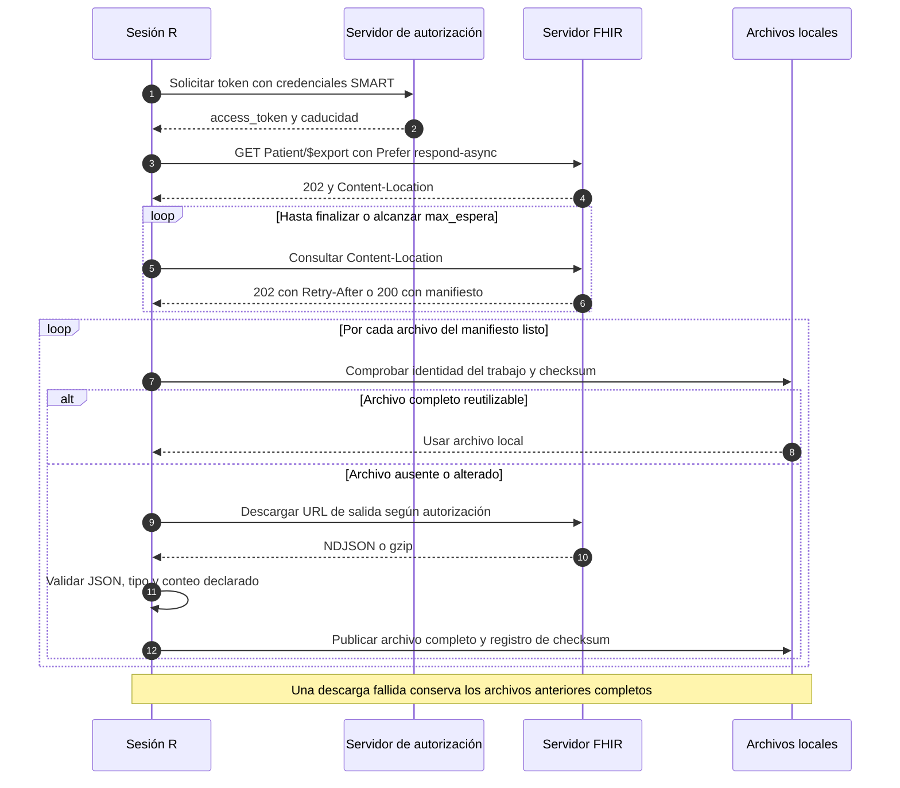

El manifiesto es el contrato de la descarga, no una garantía de calidad clínica.
La validación de contenido y el checksum verifican aspectos distintos: el primero
comprueba el NDJSON esperado; el segundo permite detectar cambios en el archivo
local entre reintentos. La recuperación es por archivo completo, sin reanudar
bytes parciales ni asegurar que las URL del servidor sigan vigentes.

También están disponibles *client credentials* con secreto e inicio de sesión
interactivo con PKCE. Consulta la
[guía de autenticación y Bulk Data](https://f-slg.github.io/fhirviews/articles/servidores-y-volumen.html).

## Procesar archivos por bloques

Este ejemplo completo recorre el archivo incluido y muestra un resumen por
bloque. La función de procesamiento puede escribir cada tabla en una base de
datos o generar agregados:

```r
archivo <- system.file("extdata", "caso_clinico.ndjson", package = "fhirviews")
vista <- vista_crear("Observation", c(medida = "code.text"))

totales <- vista_ejecutar_lotes(
  archivo, vista,
  procesar = function(tabla, bloque) {
    cat("Bloque", bloque, ":", nrow(tabla), "filas\n")
  },
  tamano_lote = 20
)
totales
```

Para una exportación propia, sustituye `archivo` por sus rutas NDJSON o
`.ndjson.gz`. El retorno contiene `bloques`, `recursos` y `filas`; los resultados
de la función `procesar()` se descartan.

### Contrato estricto antes de escribir

Activa `estricto = TRUE` y declara `type` en **todas** las columnas. El contrato
se comprueba desde el inicio y debe coincidir entre las ramas de `unionAll`:

```r
vista <- vista_leer(list(
  resource = "Observation",
  where = list(list(path = "value.ofType(Quantity).exists()")),
  select = list(list(column = list(
    list(name = "id", path = "getResourceKey()", type = "id"),
    list(name = "valor", path = "value.ofType(Quantity).value", type = "decimal")
  )))
))

vista_ejecutar_lotes(
  archivo, vista,
  procesar = function(tabla, bloque) {
    cat("Bloque validado:", bloque, "Filas:", nrow(tabla), "\n")
  },
  tamano_lote = 20, estricto = TRUE
)
```

Cada valor se valida **antes** de entregar el bloque. No se convierten textos
numéricos en números ni números en texto. Los enteros deben ser finitos,
integrales y representables en R; se respetan los rangos de `positiveInt` y
`unsignedInt`. Se rechazan números no finitos en la entrada y en los
resultados antes de que la serialización pueda convertirlos en ausentes.
Los decimales deben ser finitos. Los ausentes producen `NA`
tipados; los elementos de colecciones también se comprueban. Los tipos de
texto no validan aquí el formato de fechas, URI ni códigos clínicos.

Un error de clase `fhirviews_error_lotes` informa `bloque`, `fase`,
`indice_archivo`, `completados` y, cuando corresponde, `columna`,
`tipo_esperado` y `motivo`. La fase distingue `esquema`, `lectura`, `evaluacion`
y `procesar`. Los mensajes omiten los valores y el error original del destino.
El bloque 0 corresponde a una definición incompatible detectada antes de leer.

Con `estricto = FALSE`, el comportamiento sigue siendo el habitual: los tipos
pueden inferirse por bloque y las conversiones incompatibles pueden generar
avisos y conservar los valores sin convertir.

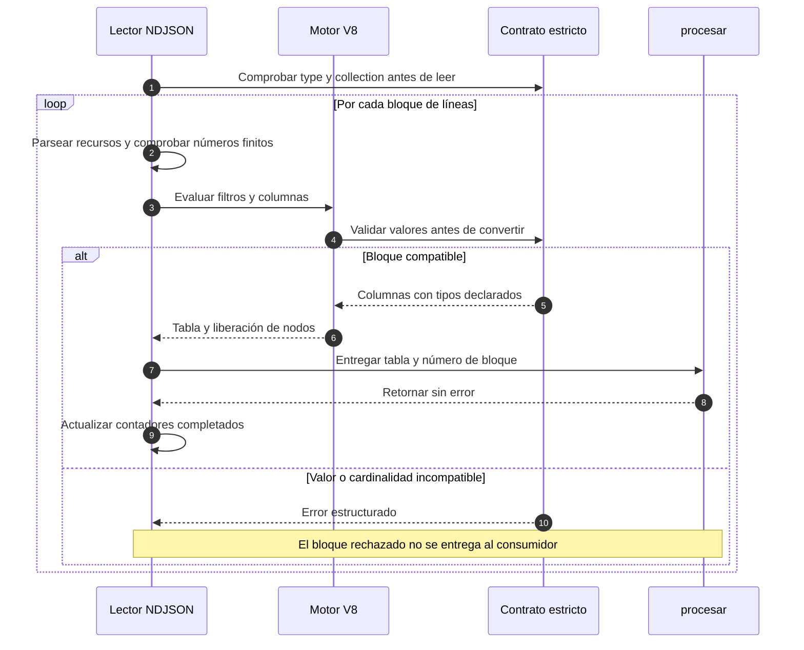

El error termina la ejecución. La validación previa protege la entrega del
bloque; la atomicidad de lo que escriba `procesar()` depende del destino y de
la transacción configurada por el consumidor.

### Recuperación y escrituras parciales

`vista_ejecutar_lotes()` detiene la carga al fallar y no reintenta escrituras.
El bloque que falla en `procesar()` puede haber escrito parcialmente. Los
contadores `completados` indican llamadas que retornaron sin error; no son una
confirmación de persistencia ni un checkpoint seguro para saltarse bloques.

El ejemplo siguiente usa datos ficticios y una base DuckDB temporal. Ejecuta
una carga dentro de una transacción, provoca un fallo después de escribir,
comprueba el rollback y repite la carga completa dos veces:

```r
# Requiere DBI y duckdb; no necesita servidor ni extensión JSON de DuckDB
source(system.file("examples", "lotes-transaccion.R", package = "fhirviews"))
```

La estrategia reemplaza el resultado completo dentro de la misma transacción;
no acumula otra copia al reintentar. No deduplica eventos ya presentes en la
entrada. Para usar otra base, verifica su soporte y límites de transacciones.
Para archivos o destinos sin rollback, escribe en una carpeta temporal nueva y
publica el conjunto solo después de validar la carga completa. Conserva la
entrada, su orden, la vista y el tamaño de bloque; no reanudes mediante un
`append` ciego sobre una salida parcial.

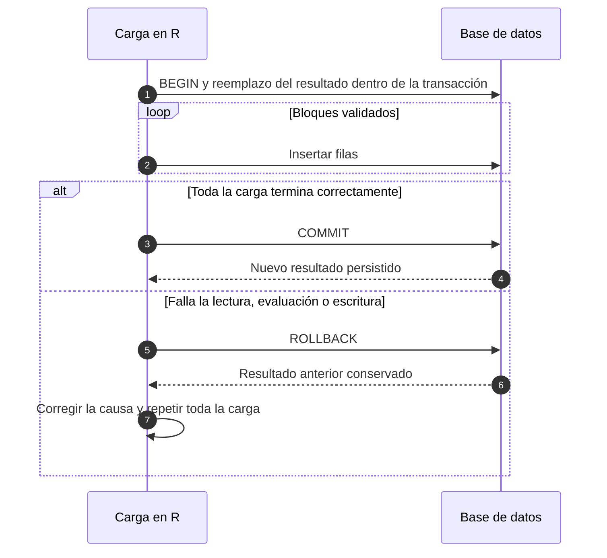

## Trabajar con DuckDB

El motor SQL **experimental** traduce un `ViewDefinition` a una consulta de
DuckDB. Es útil cuando la entrada es grande y la vista puede expresarse en el
subconjunto FHIRPath que admite el traductor:

```r
archivo <- system.file("extdata", "caso_clinico.ndjson", package = "fhirviews")
vista <- vista_crear("Patient", c(sexo = "gender"))

pacientes_sql <- vista_ejecutar_duckdb(archivo, vista)
vista_sql(vista)  # inspeccionar la consulta generada
```

Prueba primero la vista con `vista_ejecutar()` sobre una muestra representativa.
Las expresiones que el traductor no admite producen un error. Para NDJSON o
Parquet propios, usa sus rutas en lugar de `archivo`.

El motor SQL necesita la extensión `json` de DuckDB y puede descargarla la
primera vez. En entornos sin internet, prepara esa extensión con la misma
versión de DuckDB y comprueba `LOAD json` antes de ejecutar el proceso. La
construcción estándar de las viñetas evita esa descarga; sus ejemplos SQL se
habilitan explícitamente con `FHIRVIEWS_VINETAS_DUCKDB=true`.

### Versiones de DuckDB

La CI prueba el motor con tres líneas de DuckDB: **1.3.0** (mínimo
declarado), **1.5** (soporte extendido hasta marzo de 2027) y la versión
vigente de CRAN, **2.0**, en Windows, macOS y Linux. El workflow
`DuckDB versiones` falla si alguna prueba del motor se omite.

| Aspecto | Qué cambia con DuckDB 2.0 |
|---|---|
| Consultas generadas | Sin cambios: el traductor usa `lambda x: ...`, la sintaxis que 2.0 exige por defecto y que 2.1 dejará como única. |
| Archivos `.duckdb` | Una base **creada** con DuckDB 2.0 no se abre con versiones anteriores. Si `vista_duckdb()` o `tabla =` escriben en un archivo que también leen equipos con DuckDB 1.x, usa la misma versión en todos o comparte los resultados en Parquet. Las bases creadas con 1.x siguen abriéndose en 2.0. |
| NDJSON y Parquet | Los archivos de entrada no cambian: cualquier versión los lee. |
| Producción | DuckDB recomienda esperar la primera versión de corrección (2.0.1) y probar antes en un entorno paralelo cuando el proceso sea crítico. La línea 1.5 sigue soportada mientras tanto. |

Para guardar varias vistas evaluadas con el motor V8 y consultarlas con SQL,
usa `vista_duckdb()`. Esta función escribe las tablas en una transacción; no
utiliza el traductor experimental.

### Selección del resultado SQL

| Opción | Ejecución y resultado | Uso habitual |
|---|---|---|
| Predeterminada | Ejecuta SQL y recoge el resultado en un `data.frame` | Tablas finales que caben en R |
| `tabla = "nombre"` | Materializa el resultado en DuckDB y devuelve la conexión | Consultas posteriores sin transportar toda la tabla |
| `diferido = TRUE` | Devuelve una consulta de dbplyr ligada a la conexión | Filtrar o agregar antes de `collect()` |

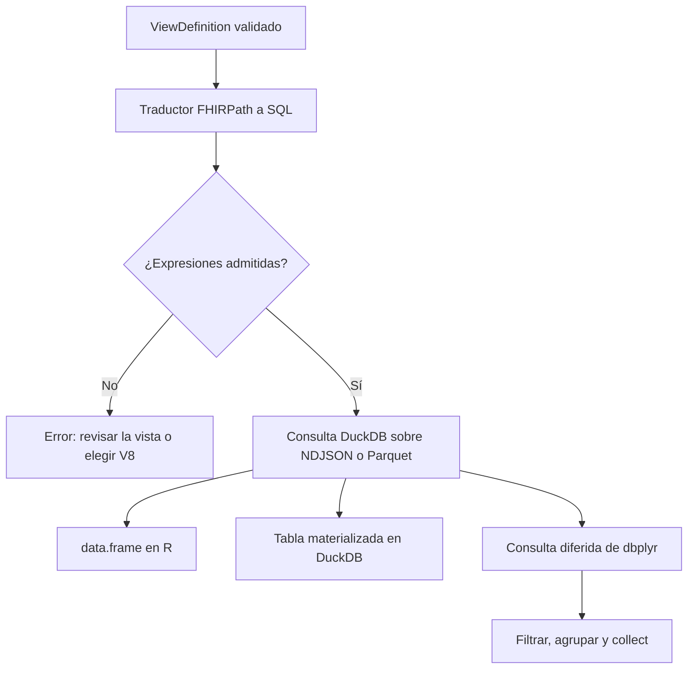

`tabla` y `diferido = TRUE` son opciones mutuamente excluyentes.
No hay cambio automático a V8 cuando falla la traducción. Una consulta diferida
puede volver a leer los archivos al ejecutarse, por lo que sus entradas deben
permanecer disponibles. Cierra las conexiones creadas cuando termines; los
resultados diferidos dependen de que su conexión siga abierta.

## De SQL a FHIR

`fhir_desde_sql()` ejecuta una consulta mediante una conexión **DBI**, lee
sus filas y construye recursos con un `fhir_mapa()`. `fhir_desde_tabla()`
aplica el mismo mapeo a un `data.frame`. Admite
**Patient, Observation, Encounter, Condition, Immunization, Specimen y DiagnosticReport de FHIR R4 4.0.1**.

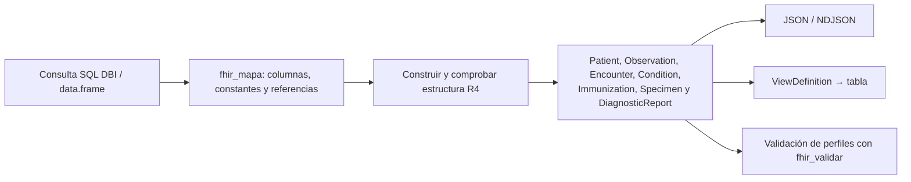

SQL on FHIR define una **proyección** de recursos a tablas. El camino de
regreso necesita un mapeo propio: `where()`, `first()`, `join()`, agregaciones
o columnas omitidas pueden perder información. Un `ViewDefinition` no se
invierte automáticamente y no se promete reconstruir el recurso original.

### Ejemplo completo con una base SQL

Este ejemplo usa SQLite en memoria y datos ficticios. Instala `DBI` y
`RSQLite` si los necesitas. Con DuckDB, PostgreSQL o SQL Server, cambia la
conexión por la de su controlador DBI y adapta la sintaxis de la consulta.

```r
library(fhirviews)
con_db <- DBI::dbConnect(RSQLite::SQLite(), ":memory:")

DBI::dbWriteTable(con_db, "pacientes", data.frame(
  paciente_id = c("p1", "p2"), sexo = c("female", "male"),
  nacimiento = c("1985-03-12", "2001-11-30"),
  apellido = c("Paredes", "Salazar"), nombre = c("Ana", "Jorge")
))
DBI::dbWriteTable(con_db, "resultados", data.frame(
  resultado_id = c("o1", "o2"), paciente_id = c("p1", "p2"),
  valor = c("98.00", "131.0"), unidad = c("mg/dL", "mg/dL")
))

mapa_pacientes <- fhir_mapa("Patient", c(
  id = "paciente_id", gender = "sexo", birthDate = "nacimiento",
  "name[0].family" = "apellido", "name[0].given[0]" = "nombre"
))
pacientes <- fhir_desde_sql(con_db,
  "SELECT * FROM pacientes ORDER BY paciente_id", mapa_pacientes)

mapa_resultados <- fhir_mapa("Observation", c(
  id = "resultado_id", "subject.reference" = "paciente_id",
  "valueQuantity.value" = "valor", "valueQuantity.unit" = "unidad"
), constantes = list(
  status = "final", "code.text" = "Glucosa"
), referencias = c("subject.reference" = "Patient"))
observaciones <- fhir_desde_sql(con_db,
  "SELECT * FROM resultados ORDER BY resultado_id", mapa_resultados)

observaciones[[1]]$subject$reference  # "Patient/p1"
vista_fhirpath(observaciones, "value.ofType(Quantity).value")  # 98, 131

salida <- tempfile(fileext = ".ndjson")
fhir_escribir(c(pacientes, observaciones), salida)
fhir_escribir(observaciones, tempfile(fileext = ".json"), formato = "json")

# Comprobar los campos extraídos de los recursos construidos
vista <- vista_crear("Observation", c(
  paciente = "subject.getReferenceKey(Patient)",
  valor = "value.ofType(Quantity).value"
))
vista_ejecutar(salida, vista)
#   id paciente valor
# 1 o1       p1    98
# 2 o2       p2   131

# Parámetros enlazados por el controlador, sin interpolar valores
uno <- fhir_desde_sql(con_db,
  "SELECT * FROM pacientes WHERE paciente_id = ?", mapa_pacientes,
  parametros = list("p1"))
DBI::dbDisconnect(con_db)
```

Los nombres de las funciones y argumentos permanecen en español. El marcador
de parámetro depende del controlador: `?` en SQLite/DuckDB; por ejemplo, `$1`
en RPostgres. Las uniones, filtros y traducciones de códigos se definen en la
consulta o antes de construir los recursos. `status = "final"` y el nombre de
la medición son decisiones explícitas del ejemplo, no valores predeterminados.
En una implementación real declara los sistemas, códigos y unidades que
correspondan a tus datos y perfiles.

### Reglas del mapeo

| Elemento | Comportamiento |
|---|---|
| `campos` | Los nombres son destinos JSON FHIR y los valores son columnas de origen. |
| `constantes` | Lista con destinos y valores fijos. No puede repetir un destino de `campos`. |
| `referencias` | Destino `.reference` → tipo FHIR; una clave `p1` produce `Patient/p1`. Recibe claves, no URLs ni referencias ya prefijadas. |
| `name[0].family` | Índices desde cero; los campos repetidos deben indicar un índice. |
| `name[0].given[]` | Colección de primitivos desde una columna de listas. |
| `result[].reference` | Colección de referencias desde una columna de listas. Mantiene orden y duplicados y omite ausentes; admite `referencias = c("result[].reference" = "Observation")`. No puede compartir otros campos ni índices del mismo arreglo. |
| Campos de elección | Se usa el nombre JSON concreto: `valueQuantity.value`, `deceasedBoolean`, etc. No se evalúan expresiones FHIRPath. |
| `NA`, `NULL`, `""`, colecciones vacías | Se omiten; los objetos y posiciones sin contenido se compactan. Los índices identifican posiciones de construcción, no huecos que se guardan como `null`. |
| `id` | Debe estar mapeado, ser válido y único en el resultado. Los enteros seguros se convierten a texto. |
| Booleanos y enteros | Se exigen valores lógicos o enteros dentro del rango FHIR; no se convierte `"false"` en booleano ni se trunca `1.7`. |
| `code`, `uri`, `url`, `canonical` | Un código permite solo espacios simples internos; las URI no permiten separadores, incluidos tabulaciones y espacios Unicode. El constructor rechaza el valor sin recortarlo ni modificarlo. |
| Fechas | Se aceptan fechas FHIR parciales válidas y `Date`. `Date` conserva precisión de fecha en destinos `date` y `dateTime`; los instantes requieren hora. Las fechas con hora requieren zona; `POSIXct`/`POSIXlt` se convierten a UTC. |
| Errores | Clase `fhirviews_error_mapeo`, con `fila` y `campo` cuando se conocen. |

Para varios nombres por paciente, prepara una fila por paciente y columnas de
listas, por ejemplo:

```r
datos <- data.frame(id = "p1")
datos$nombres <- list(c("Ana", "Lucía"))
mapa <- fhir_mapa("Patient", c(id = "id", "name[0].given[]" = "nombres"))
fhir_desde_tabla(datos, mapa)
```

Las filas con el mismo `id` se rechazan; no se agrupan ni sobrescriben
silenciosamente. Una consulta con varias filas por paciente debe agruparse
antes. Una consulta sin filas produce cero recursos.

### Decimales, validación y salida

Una columna decimal acepta números o **literales numéricos como texto**.
`"1.00"` se escribe como el número JSON `1.00`, sin comillas. Si el controlador
convierte un `DECIMAL(p,s)` a `double`, ya se han perdido sus ceros finales:
extráelo como texto con el `CAST` apropiado de tu motor. Para BIGINT y claves
fuera del rango de enteros seguros, usa también texto. Se rechazan `NaN`,
infinitos numéricos y conversiones incompatibles.

`fhir_escribir()` conserva los literales de la fuente JSON y reemplaza el
archivo indicado: NDJSON contiene un recurso por línea; `formato = "json"`
contiene un arreglo, no un Bundle de transacción. Modificar las listas de
recursos descarta la fuente original; a partir de números de R no es posible
recuperar la escala perdida. La conversión no envía recursos al servidor.

Al volver a leer recursos de un servidor, utiliza el modo que conserva la
fuente. La lectura habitual devuelve una lista de R y no retiene la escala:

```r
# con_fhir es una conexión creada con fhir_conectar()
originales <- fhir_leer(con_fhir, "Observation", "o1", como_recursos = TRUE)
vista_fhirpath(originales, "value.ofType(Quantity).value.lowBoundary()")
fhir_escribir(originales, tempfile(fileext = ".ndjson"))
```

`como_recursos = TRUE` devuelve una colección `fhir_recursos`; por defecto,
`fhir_leer()` mantiene la lista habitual para conservar compatibilidad. No
se puede recuperar `72.00` desde una lista que ya lo convirtió en `72`.

Las comprobaciones locales cubren rutas, tipos, cardinalidades, obligatorios
del modelo base, elecciones incompatibles, destinos de referencias y los
bindings **required** que pueden enumerarse completamente con el paquete R4.
Incluyen `Patient.gender`, `Observation.status`, `Encounter.status`, `Immunization.status` y los
estados clínico y de verificación de `Condition`, además de códigos anidados
como `HumanName.use`. Para `Coding` y `CodeableConcept` se exige un par
`system`/`code` del ValueSet; se permiten traducciones adicionales si hay al
menos uno válido. Un `CodeableConcept` requerido necesita codificación:
`text` no la sustituye. Los bindings extensibles, preferidos y de ejemplo
conservan su flexibilidad; por ejemplo, `Encounter.class` es extensible.

El generador registra versión y SHA256 de la fuente y conserva los bindings
y los destinos de `Reference`. Los conjuntos con filtros, imports o fuentes
externas se remiten al servidor de terminología; no se usa una lista parcial
como si fuera completa. Las referencias comprueban el destino declarado en
`referencias`, el tipo identificable en literales `Tipo/id` o URLs y la
coherencia con `Reference.type`. Los identificadores externos y las referencias
URN requieren comprobaciones de existencia y resolución en el servidor.

**Estas comprobaciones no son validación completa de FHIR**: los perfiles,
invariantes y terminologías se comprueban con `fhir_validar(con, recurso,
perfil = "URL-canónica")` sobre los recursos y el servidor elegidos.

`fhir_desde_sql()` recoge toda la consulta en memoria y conserva la conexión
abierta; ciérrala cuando termines. Este módulo no ofrece todavía agrupación
automática de filas, recursos `contained`, envío masivo ni traducción de `StructureMap`. El ejemplo
ejecutable se instala en `system.file("examples", "sql-a-fhir.R", package =
"fhirviews")`.

### Encuentros y diagnósticos desde SQL

`Encounter` necesita `status` y `class`. `Condition` necesita `subject` en el
snapshot base; sus invariantes y los perfiles pueden exigir otros campos.
El estado clínico y el de verificación usan `CodeableConcept`, por lo que
deben declarar su sistema y código. Los estados proceden de los datos o de
constantes explícitas del mapeo.

```r
me <- fhir_mapa("Encounter", c(
  id = "id", status = "estado", "class.code" = "clase",
  "subject.reference" = "paciente", "period.start" = "inicio"
), constantes = list(
  "class.system" = "http://terminology.hl7.org/CodeSystem/v3-ActCode",
  "subject.type" = "Patient"
), referencias = c("subject.reference" = "Patient"))

mc <- fhir_mapa("Condition", c(
  id = "id", "subject.reference" = "paciente",
  "encounter.reference" = "encuentro",
  "clinicalStatus.coding[0].code" = "estado", "code.text" = "descripcion"
), constantes = list(
  "clinicalStatus.coding[0].system" =
    "http://terminology.hl7.org/CodeSystem/condition-clinical",
  "subject.type" = "Patient", "encounter.type" = "Encounter"
), referencias = c(
  "subject.reference" = "Patient", "encounter.reference" = "Encounter"
))
```

Las columnas `estado` de ambos mapeos representan vocabularios diferentes:
por ejemplo, `finished` para el encuentro y `active` para el diagnóstico.
El ejemplo ejecutable completo crea las tablas ficticias, ejecuta consultas
con parámetros, incluye el estado de verificación, escribe NDJSON y
reconstruye una tabla de diagnósticos enlazados:

```r
source(system.file("examples", "encuentros-diagnosticos.R", package = "fhirviews"))
```

Usa una consulta con una fila por encuentro y otra con una fila por
diagnóstico. Un paciente puede aparecer en varios recursos mediante
referencias; las filas del mismo recurso siguen exigiendo un `id` único.
En un servidor, guarda primero los recursos referenciados o utiliza una
transacción apropiada. Verifica con `fhir_validar()` los perfiles base o
los perfiles canónicos del proyecto antes de utilizar su salida.

### Inmunizaciones desde SQL

`Immunization` representa un evento de vacunación registrado. El mapeo exige
`id`, único por fila, además de los obligatorios de R4:

| Elemento | Regla de construcción |
|---|---|
| `status` | Código exacto: `completed`, `not-done` o `entered-in-error`. |
| `vaccineCode` | `CodeableConcept` con la vacuna. El binding base es de ejemplo; el perfil del proyecto puede exigir un sistema y catálogo concretos. |
| `patient.reference` | Referencia a `Patient`; `Group` y otros tipos se rechazan. |
| `occurrenceDateTime` o `occurrenceString` | Debe existir exactamente una variante. La primera admite una fecha FHIR válida; la segunda conserva texto cuando la fecha no está expresada como fecha. |
| `encounter.reference` | Opcional; su destino es `Encounter`. |
| `protocolApplied[0].doseNumberPositiveInt` o `doseNumberString` | Si existe una entrada de `protocolApplied`, exige exactamente una variante de número de dosis. El entero debe ser positivo; el texto no se convierte automáticamente a entero. |
| `doseQuantity` | Cantidad de tipo `SimpleQuantity`; se prohíbe `comparator`. El valor decimal puede venir como texto, por ejemplo `"0.50"`, para conservar la escala. |
| `primarySource` | Valor lógico explícito. El mapeador no deduce si una fuente es primaria ni convierte `0`, `1`, `"true"` o `"false"` automáticamente. |

Las `Quantity` generales conservan los comparadores admitidos por su modelo.
La restricción de `SimpleQuantity` se aplica en su contexto, por ejemplo a
`doseQuantity` y a los extremos de un `Range`.

El siguiente mapeo recibe las claves del paciente y del encuentro, las dos
variantes de fecha y las dos de número de dosis en columnas independientes:

```r
mi <- fhir_mapa("Immunization", c(
  id = "id", status = "estado", "patient.reference" = "paciente",
  "encounter.reference" = "encuentro", "encounter.type" = "tipo_encuentro",
  "vaccineCode.coding[0].system" = "sistema_vacuna",
  "vaccineCode.coding[0].code" = "vacuna", "vaccineCode.text" = "descripcion",
  occurrenceDateTime = "fecha", occurrenceString = "fecha_texto",
  "doseQuantity.value" = "dosis", "doseQuantity.unit" = "unidad",
  "doseQuantity.code" = "unidad", "doseQuantity.system" = "sistema_unidad",
  "protocolApplied[0].doseNumberPositiveInt" = "numero",
  "protocolApplied[0].doseNumberString" = "numero_texto",
  "statusReason.text" = "motivo"
), constantes = list("patient.type" = "Patient", primarySource = TRUE),
referencias = c("patient.reference" = "Patient", "encounter.reference" = "Encounter"))

# con_db es la conexión DBI abierta y vacunaciones contiene una fila por evento.
sql <- paste(
  "SELECT *, CASE WHEN NULLIF(encuentro, '') IS NOT NULL THEN 'Encounter' END AS tipo_encuentro",
  "FROM vacunaciones ORDER BY id"
)
vacunas <- fhir_desde_sql(con_db, sql, mi)
```

Aquí `primarySource = TRUE` es una decisión explícita del ejemplo: todas sus
filas representan registros de la fuente primaria. Los estados, motivos,
unidades, fechas y dosis deben proceder de los datos o de constantes que
correspondan a ese origen. El estado `not-done` no rellena ni elimina campos
por su cuenta. Los códigos de vacuna del ejemplo instalado son ficticios y
usan `https://example.org/fhir/CodeSystem/vacunas`.

Para una fecha conocida, llena `fecha` y deja `fecha_texto = NA`. Para una
fecha textual, haz lo contrario. `Date` se conserva como `YYYY-MM-DD` en
`occurrenceDateTime`, sin inventar una hora; `POSIXct` se convierte a UTC.
El mismo criterio de exclusión se aplica a `numero` y `numero_texto`.

Si no hay encuentro, el `CASE` deja también su tipo vacío. Si no hay cantidad
de dosis, deja vacíos su valor, unidad y sistema. Una constante en una ruta
anidada crea ese contenido en todas las filas: los campos de objetos opcionales
deben conservar sus ausencias conjuntamente. El constructor rechaza una
referencia que solo contenga `type`; necesita `reference`, `identifier` o
`display`. Para booleanos que SQLite entregue
como enteros, verifica primero que solo haya `0`, `1` o `NA`, conviértelos a
lógicos en R y usa `fhir_desde_tabla()`; las conexiones que entregan booleanos
nativos pueden usarlos directamente en `fhir_desde_sql()`.

El ejemplo completo crea Patient y Encounter, consulta SQLite, construye las
dos variantes de Immunization, escribe NDJSON y obtiene una tabla con fecha,
fecha textual, cantidad y número de dosis:

```r
source(system.file("examples", "inmunizaciones-sql.R", package = "fhirviews"))
```

La vista de catálogo `vista_plantilla("inmunizaciones")` sigue disponible.
Su columna `fecha` proyecta la variante `dateTime`; para conservar también
`occurrenceString`, el ejemplo define una columna `fecha_texto` con
`occurrence.ofType(string)`.

Valida el JSON contra
`http://hl7.org/fhir/StructureDefinition/Immunization` o la URL canónica del
perfil del proyecto mediante `fhir_validar()`. Las invariantes y la terminología
clínica se comprueban en esa etapa; por ejemplo, cada entrada de `education`
debe contener `documentType` o `reference` según la invariante R4 `imm-1`.

### Muestras e informes de laboratorio

`Specimen` admite muestras clínicas y ambientales. En la base R4, `status`
y `subject` son opcionales; si se aporta estado se comprueba su ValueSet y
el origen puede ser Patient, Group, Device, Substance o Location. También se
comprueban las alternativas `collection.collected[x]` y los destinos de
`parent`, `request`, `collection.collector` y los aditivos. El `id` sigue
siendo obligatorio por el contrato del constructor.

`DiagnosticReport` exige `status` y `code`. Su `subject` es opcional en la
base R4; `result` referencia Observation y `specimen`, Specimen. Las variantes
de `effective[x]` son excluyentes, `issued` necesita un instante con zona
horaria y cada entrada `media` necesita `link`. Los perfiles del proyecto
pueden exigir más campos. Las invariantes y terminologías externas se
contrastan con `fhir_validar()`.

Un informe puede contener cualquier número de referencias por fila:

```r
informes <- data.frame(id = c("d1", "d2"))
informes$resultados <- list(c("o1", "o2"), "o3")
informes$muestras <- list("s1", c("s2", "s3"))
mapa <- fhir_mapa("DiagnosticReport", c(
  id = "id", "result[].reference" = "resultados", "specimen[].reference" = "muestras"
), constantes = list(status = "final", "code.text" = "Informe ficticio"),
referencias = c("result[].reference" = "Observation", "specimen[].reference" = "Specimen"))
recursos <- fhir_desde_tabla(informes, mapa)
recursos[[1]]$result
# list(list(reference = "Observation/o1"), list(reference = "Observation/o2"))
```

El mapa crea las referencias; los recursos enlazados se construyen aparte.
No se mezclan `result[].reference` y `result[0].display` u otros destinos del
mismo arreglo. Las demás colecciones de objetos siguen usando índices
explícitos, por ejemplo `presentedForm[0].contentType` y `presentedForm[0].data`.
No se agrupan filas automáticamente ni se infiere la correspondencia entre
listas independientes.

El ejemplo instalado [laboratorio-r4.R](https://github.com/f-slg/fhirviews/blob/main/inst/examples/laboratorio-r4.R)
crea tablas DuckDB ficticias, construye Patient, Specimen, dos Observation y
DiagnosticReport mediante consultas SQL, y compara tres vistas con V8 y DuckDB.
Las colecciones de resultados y muestras proceden de agregaciones SQL `list()`:

```r
source(system.file("examples", "laboratorio-r4.R", package = "fhirviews"))
ejemplo <- laboratorio_r4()
ejemplo$tablas$resultados  # dos filas: una por Observation referenciada
fhir_escribir(ejemplo$recursos, tempfile(fileext = ".ndjson"))
```

La integración HAPI exige validar los perfiles base, guardar, recuperar y
comparar referencias y tablas; también debe rechazar estados, destinos,
campos obligatorios y entradas `media` inválidos. Los literales `5.00`,
`72.00` y `13.50` conservan su escala al escribir y evaluar límites.

### Validación con el componente Rust opcional

`fhir_componente_rust()` está disponible desde **0.5.0.9002**. Puedes usar
un ZIP precompilado del [catálogo HTTPS](https://f-slg.github.io/fhirviews/componentes/rust/catalogo.json)
sin instalar Cargo, rustc ni Rtools. Estos archivos contienen el componente;
el paquete R se instala por separado. El catálogo identifica el commit fuente,
protocolo, tamaño y SHA-256 de cada ZIP y enlaza un manifiesto inmutable.

| Clave del catálogo | Binario | Plataforma de la prueba de consumo |
|---|---|---|
| `linux-x86_64` | Linux x86_64, musl estático; no depende de glibc | Ubuntu 22.04 |
| `windows-x86_64` | Windows x64, runtime C enlazado estáticamente | Windows del runner de GitHub |
| `macos-intel` | macOS Intel, mínimo 15.0 | macOS 15 Intel |
| `macos-apple-silicon` | macOS ARM64, mínimo 15.0 | macOS 15 Apple Silicon |

Ejemplo de descarga explícita y comprobación **antes de descomprimir o
ejecutar**. Elige la clave que corresponda a tu sistema y arquitectura:

```r
catalogo <- jsonlite::fromJSON(
  "https://f-slg.github.io/fhirviews/componentes/rust/catalogo.json",
  simplifyVector = FALSE)
plataforma <- "linux-x86_64" # o windows-x86_64, macos-intel, macos-apple-silicon
p <- catalogo$plataformas[[plataforma]]
stopifnot(!is.null(p), catalogo$contrato == "fhirviews-r4-validator/1")
archivo <- tempfile(fileext = ".zip")
utils::download.file(p$url, archivo, mode = "wb")
conexion <- file(archivo, "rb")
huella <- unclass(as.character(openssl::sha256(conexion)))
close(conexion)
stopifnot(identical(huella, p$sha256))
destino <- tempfile("fhirviews-componente-")
dir.create(destino)
utils::unzip(archivo, exdir = destino)
binario <- file.path(destino, p$directorio, p$ejecutable)
Sys.chmod(binario, "0755")
componente <- fhir_componente_rust(binario, fallback = FALSE)
```

El ejemplo usa una carpeta temporal; elige una carpeta persistente nueva
si quieres conservar el ejecutable entre sesiones. Los ZIP incluyen
`MANIFIESTO.json`, `SHA256SUMS`, `Cargo.lock`, licencias y atribuciones.
El SHA-256 comprueba integridad respecto del catálogo; los binarios no están
firmados ni notarizados. En macOS se aplican las políticas de seguridad del
equipo; no se desactiva Gatekeeper ni se elimina cuarentena automáticamente.
Consulta la [guía de distribución y reproducción](https://github.com/f-slg/fhirviews/tree/main/data-raw/distribucion-rust).

También puedes compilar [el código del componente](https://github.com/f-slg/fhirviews/tree/main/componentes/rust)
con Cargo y rustc >= 1.75 y el enlazador de tu plataforma:

```sh
cargo build --release --locked --jobs 2 --manifest-path componentes/rust/Cargo.toml
cargo test --locked --jobs 2 --manifest-path componentes/rust/Cargo.toml
```

```r
componente <- fhir_componente_rust(
  "componentes/rust/target/release/fhirviews-rust-validator",
  fallback = FALSE, tiempo = 60L) # en Windows, termina en .exe
ejemplo_rust <- laboratorio_r4(componente = componente)
stopifnot(identical(ejemplo$recursos, ejemplo_rust$recursos))
# También: fhir_desde_tabla(datos, mapa, componente = componente)
#          fhir_desde_sql(db, sql, mapa, parametros, componente = componente)
```

Sin `componente`, la validación estructural sigue en R. El componente revisa
recursos ya construidos y tipificados por R: campos obligatorios, elecciones,
cardinalidades, bindings enumerables y destinos de referencias. R conserva
las conversiones, la serialización y los decimales. No evalúa SQL on FHIR ni
FHIRPath, no convierte R4/R6 y no sustituye un validador de perfiles.

El contrato CLI `fhirviews-r4-validator/1` comprueba capacidades, versión
FHIR, identidad del esquema y conteo de recursos. El plan se prepara una vez
por sesión R; el proceso Rust lo lee en cada llamada. Ante datos inválidos,
R reproduce el primer error con su mensaje completo, clase, fila y campo.
`fallback = TRUE` avisa y valida con R si el ejecutable falta, falla, excede
el tiempo o devuelve una respuesta incompatible. `FALSE` exige el componente
y produce `fhirviews_error_componente` ante esos fallos.

La comunicación usa archivos temporales locales que se eliminan al terminar;
el componente no usa la red. La consulta DBI y los recursos siguen completos
en memoria R. La instalación del paquete no descarga Rust ni ejecutables.
La CLI evita enlazar con la ABI de R. Los ZIP se prueban en trabajos separados
desde el paquete R instalado con sus pruebas, usando el ejecutable extraído
y bloqueando Cargo/rustc/rustup. La publicación exige que pasen las cuatro
plataformas; conserva rutas por versión y commit sin reemplazar sus bytes.
La integración nativa dentro del paquete R sigue pendiente.

La [revisión de Helios](https://github.com/f-slg/fhirviews/blob/main/data-raw/revision-helios-20261115.md)
identifica mejoras aplicables: interfaces entre componentes, esquema fijo,
procesamiento incremental y capacidades por versión. Esta entrega aplica la
interfaz opcional y las colecciones de referencias. Los cursores DBI por
bloques, Arrow directo y adaptadores multiversión siguen pendientes. La
comparación es de diseño y código; no se realizó un benchmark contra Helios.

### Recursos admitidos y próximos grupos

El lector y las vistas ya pueden trabajar con otros tipos de recursos FHIR.
La construcción desde SQL o tablas admite **Patient, Observation, Encounter,
Condition, Immunization, Specimen y DiagnosticReport**. La ampliación se hace por grupos comprobados:

| Estado | Recursos | Recorrido |
|---|---|---|
| Admitidos | `Patient`, `Observation` | Pacientes y resultados, con escala decimal conservada. |
| Admitidos | `Encounter`, `Condition` | Paciente → encuentro → diagnóstico, con referencias entre los tres. |
| Admitido | `Immunization` | Paciente → evento de vacunación, con vacuna, estado y fecha explícitos. |
| Admitidos desde 0.5.0.9002 | `Specimen`, `DiagnosticReport` | Muestra → observaciones → informe, con colecciones de referencias variables. |
| Pendiente | `MedicationRequest`, `MedicationDispense` | Prescripción y dispensación, con medicamento y datos de dosificación declarados. |
| Pendiente según el origen | `Organization`, `Practitioner` | Instituciones y profesionales referenciados por los recursos anteriores. |

El orden prioriza vigilancia y puede adaptarse al origen de datos. No hace
falta un conversor independiente por recurso: el motor de rutas, tipos,
cardinalidades y campos de elección ya usa metadatos de los snapshots
canónicos de **FHIR R4 4.0.1**. Antes de ampliar el soporte se requiere:

1. Ampliar el generador `data-raw/mapeo_r4.py` con una lista explícita de
   recursos y sus tipos dependientes, manteniendo la versión y procedencia
   del esquema, sus bindings a ValueSets y los destinos de `Reference`.
2. Revisar los bindings del recurso y qué conjuntos pueden enumerarse.
   Añadir un recurso al esquema no comprueba por sí solo toda su terminología
   ni sus invariantes. Los bindings externos y los perfiles se validarán
   con el servidor correspondiente.
3. Comprobar los obligatorios y las elecciones de cada recurso. Por ejemplo,
   `Encounter` exige `status` y `class`; `Condition`, `subject`;
   `Immunization`, `status`, `vaccineCode`, `patient` y una de las variantes
   `occurrence[x]`. Los perfiles del proyecto pueden exigir campos adicionales.
4. Diseñar las colecciones de objetos. Se admiten colecciones de primitivos
   y referencias `[].reference`; los demás objetos, como `dosageInstruction`,
   requieren índices explícitos y reglas para relacionar sus columnas.
5. Exigir por recurso casos válidos e inválidos y un recorrido reproducible:
   SQL → FHIR → `$validate` del perfil base → guardar y leer → tabla con V8
   y DuckDB. Revisar referencias, ausentes, códigos inválidos y elecciones
   incompatibles; añadir la URL canónica del perfil del proyecto cuando se
   disponga de él. La documentación y los ejemplos se amplían con cada grupo.

Los recursos pendientes todavía no están habilitados en `fhir_mapa()`. Las
referencias pueden apuntar a tipos R4 válidos que ya existan en el servidor,
como `Practitioner`, aunque este módulo aún no los construya.

## Vistas de salud pública y terminologías

El catálogo incluye ocho vistas: pacientes, diagnósticos, encuentros,
inmunizaciones, medicamentos, signos vitales, alergias y notificación obligatoria.
Puedes inspeccionarlas y adaptar sus constantes:

```r
vista_catalogo()[, c("nombre", "recurso")]

archivo_dengue <- system.file(
  "extdata", "dengue_2025.ndjson.gz", package = "fhirviews"
)
casos <- vista_ejecutar(archivo_dengue, vista_plantilla("notificacion_obligatoria"))
```

Con un servidor de terminología, `tx_expandir()` obtiene los códigos de un
ValueSet, `tx_buscar_codigo()` consulta `$lookup` y `tx_validar_codigo()` invoca
`$validate-code`. `vista_con_valueset()` incorpora los códigos expandidos a la
vista para que su ejecución posterior no dependa de la red.

### Alergias e intolerancias R4

La vista `alergias` conserva cada manifestación dentro de su reacción, con
su gravedad y fecha. Las categorías se guardan como listas. Un registro sin
reacciones conserva una fila; `criticidad` y `gravedad_reaccion` son campos
distintos y no se completan ni se infieren entre sí.

```r
archivo <- system.file("extdata", "alergias_r4.ndjson", package = "fhirviews")
alergias <- vista_ejecutar(archivo, vista_plantilla("alergias"))
alergias[, c("id", "paciente", "estado_clinico", "gravedad_reaccion", "reaccion_codigo")]
length(unique(alergias$id))  # 3 registros de alergia; la tabla tiene 5 filas
```

Los datos son ficticios. Las filas pueden repetir `id` cuando hay varias
manifestaciones; cuenta ids distintos para contar registros de alergia.
Los códigos de estado se seleccionan por su sistema canónico. Código, sistema
y descripción de sustancia o manifestación proceden del mismo primer `Coding`.
La definición se puede consultar con `vista_json(vista_plantilla("alergias"))`.

### Demostración reproducible de vigilancia

Para ejecutar un flujo completo con los datos ficticios incluidos:

```r
source(system.file("examples", "vigilancia.R", package = "fhirviews"))
```

El script imprime la carpeta de salida y comprueba que los resúmenes coincidan
con los eventos seleccionados. Con el conjunto incluido parte de 755 eventos,
selecciona 661 confirmados con CIE-10 A90/A91 y excluye 94 refutados. Genera:

- Eventos confirmados y resúmenes por cantón y mes de inicio, en CSV.
- Controles de conteo para revisar la transformación.
- Las vistas JSON, la versión del paquete, el checksum de entrada y `sessionInfo()`.
- Un archivo `LEEME.txt` con la definición del indicador y sus límites.

Son **conteos de eventos ficticios**, no pacientes únicos ni tasas poblacionales.
Los códigos territoriales deben leerse como texto para conservar los ceros
iniciales. Para elegir otra carpeta, configura `FHIRVIEWS_DEMO_SALIDA` antes de
ejecutar el script; la carpeta debe ser nueva para evitar sobrescrituras.

Para convertir casos en indicadores territoriales, consulta el
[ejemplo de tasas por cantón con FHIR y pobecu](https://f-slg.github.io/fhirviews/articles/tasas-pobecu.html).

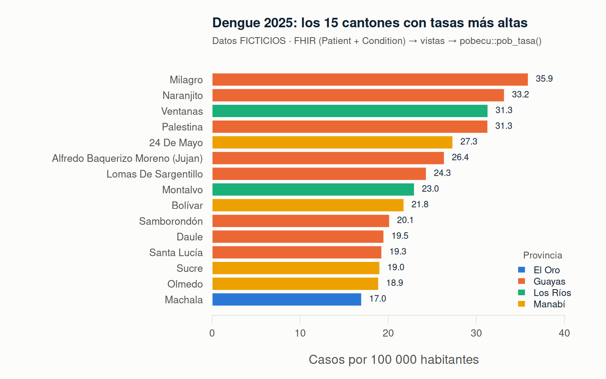

## Validación y privacidad

`vista_validar()` revisa una definición de vista. `fhir_validar()` pide al
**servidor** que valide un recurso mediante `$validate`; el alcance de esa
validación depende de los perfiles y capacidades del servidor.

Desde 0.5.0, el atributo `valido` distingue tres resultados:

| Valor | Significado |
|---|---|
| `TRUE` | El servidor devuelve un OperationOutcome completo, sin errores ni problemas fatales, en una respuesta HTTP satisfactoria |
| `FALSE` | El OperationOutcome contiene errores o problemas fatales en una respuesta HTTP satisfactoria |
| `NA` | La operación falla por HTTP o la respuesta no permite determinar la validez |

```r
# Requiere una conexión y un servidor que admita $validate
resultado <- fhir_validar(con, list(resourceType = "Patient", gender = "female"))
if (!isTRUE(attr(resultado, "valido"))) {
  stop("El recurso no tiene una validación positiva del servidor.")
}
```

El estado HTTP queda disponible en `attr(resultado, "estado")`. Una validación
positiva no certifica la calidad clínica de los datos.

Los errores HTTP omiten por defecto el contenido del servidor, que puede
contener información de pacientes. También se ocultan los valores sensibles
de la consulta, incluido `_id`. Para depuración controlada:

```r
options(fhirviews.mostrar_detalles = TRUE)  # contenido del servidor en errores
options(fhirviews.mostrar_consulta = TRUE) # valores completos de la consulta

# Volver al comportamiento predeterminado
options(fhirviews.mostrar_detalles = FALSE, fhirviews.mostrar_consulta = FALSE)
```

Los detalles estructurados siguen disponibles en `error$outcome` al capturar
un error HTTP. Estas opciones no anonimizan recursos, rutas URL ni archivos de
salida: el acceso y almacenamiento de datos clínicos corresponden al entorno
que ejecuta el análisis. Los tokens se mantienen en memoria salvo que se
solicite explícitamente caché en disco con `cache_disco = TRUE`.

## Conformidad y pruebas

El paquete incluye el [banco oficial de SQL on FHIR](https://github.com/FHIR/sql-on-fhir.js/tree/main/tests).
Los dos motores superan **144/144 pruebas del banco incluido**:

| Motor | Shareable | Experimental | Total |
|---|---:|---:|---:|
| V8 / fhirpath.js | 133/133 | 11/11 | 144/144 |
| DuckDB / SQL nativo | 133/133 | 11/11 | 144/144 |

Las cuatro pruebas experimentales de límites ahora conservan la precisión de
`1.0` y completan las zonas desconocidas de DateTime (`+14:00` en el límite
inferior, `-12:00` en el superior), conservando zonas explícitas. El banco se
lee sin alterar sus literales ni resultados esperados. V8 usa un lector JSON
portable; DuckDB relaciona los tokens numéricos originales con `json_tree()`.
La conformidad se refiere a ese banco y no certifica un sistema clínico.

```r
vista_conformidad()                   # motor V8
vista_conformidad(motor = "duckdb")   # requiere DuckDB y su extensión json
vista_conformidad(descargar = TRUE)  # contrastar con el banco actual de GitHub
vista_conformidad(informe = "sof-test-results.json") # formato de la matriz pública
```

El 144/144 no significa que toda expresión FHIRPath sea traducible a SQL.
Los límites decimales en DuckDB admiten literales sin signo o rutas estáticas desde el
recurso con índices explícitos, escalas entre -18 y 8 y números representables
en `DECIMAL(38,18)`. Las escalas negativas corresponden a exponentes positivos.
No se admite el argumento opcional de precisión ni se infiere escala tras
operaciones, filtros o iteraciones. Esos casos fallan con un mensaje explícito.
Con Parquet o tablas ya normalizadas se usa la representación JSON disponible;
no se recupera una escala que se haya perdido antes. Las vistas que no usan
límites decimales no pagan el coste de extraer los tokens y rutas.

CI comprueba el paquete en Windows, macOS Intel y Linux, además de R-devel y R 4.1.
macOS usa por defecto `macos-26-intel`; esta matriz no valida Apple Silicon.
El workflow admite ejecución manual con elección entre macOS 26 Intel y macOS 15
Intel para reintentar problemas de disponibilidad. El selector no garantiza
capacidad del proveedor: macOS continúa siendo una comprobación obligatoria.
En R 4.1 y R-devel se comprueban el cliente y V8. Los tres sistemas con
R release incluyen DuckDB y sus pruebas SQL.
La prueba de privacidad de Bulk Data usa una credencial ficticia completa y
una carpeta que contiene `abc`: comprueba que se muestra la ruta y se oculta
el token, sin confundir coincidencias de la ruta con una credencial expuesta.
También exige el valor exacto de la cabecera de autorización de descarga.

Las pruebas HTTP usan respuestas simuladas. La integración de escritura se
habilita por separado contra un **servidor de pruebas propio**:

```sh
FHIRVIEWS_SERVIDOR_ESCRITURA=http://localhost:8080/fhir \
FHIRVIEWS_SOLO_SERVIDOR_PROPIO=true NOT_CRAN=true \
  Rscript -e 'testthat::test_local(filter = "^servidor$")'
```

Ese servidor debe permitir escritura; algunas pruebas requieren terminología
y Bulk Data. La suite omite operaciones que el servidor no admite. Consulta
[`tests/testthat/test-servidor.R`](tests/testthat/test-servidor.R) para preparar
un HAPI aislado.

Para ejecutar la integración completa de forma reproducible desde el repositorio,
con Docker o Podman y las dependencias de prueba instaladas (además de las
dependencias obligatorias del paquete: `pkgload`, `testthat`, `DBI` y `duckdb`):

```sh
bash data-raw/probar-hapi.sh
```

El script usa una imagen fijada por digest, abre un puerto aleatorio solo en
localhost y elimina su propio contenedor al terminar, incluso si las pruebas
fallan. Imprime la carpeta que conserva los registros, el resumen JSON y CSV,
las omisiones y el entorno de R. La ejecución exige escritura, transacciones,
terminología básica, Bulk Data y el nuevo recorrido SQL → FHIR → servidor →
tabla; una omisión inesperada hace fallar la prueba.
La variante de ValueSet en línea no admitida por HAPI queda registrada aparte.
El workflow **Integracion HAPI** ejecuta este mismo script y conserva los
resultados durante 14 días. En la primera ejecución puede descargar la imagen
y la extensión JSON de DuckDB.

### Validación de SQL → FHIR contra perfiles R4

El grupo obligatorio `SQL a FHIR, perfiles R4, referencias y retorno a tablas`
usa un Patient y dos Observation ficticios obtenidos de consultas DuckDB con
parámetros. Realiza estas comprobaciones:

1. Construye y escribe los recursos conservando un decimal `72.00`.
2. Ejecuta `$validate` con los perfiles base explícitos
   `http://hl7.org/fhir/StructureDefinition/Patient` y
   `http://hl7.org/fhir/StructureDefinition/Observation`.
3. Guarda los recursos de prueba con sus identificadores y comprueba que
   `Observation.subject.reference` apunta al Patient creado.
4. Envía un `gender` inválido y exige que el validador detecte el error.
5. Lee con `fhir_leer(..., como_recursos = TRUE)` y compara los valores,
   referencias y límites decimales usando V8 y SQL nativo.
6. Elimina los recursos de prueba; el script elimina además su contenedor.

El resumen incluye fallos, errores, advertencias, comprobaciones y razones de
omisión. La política de aceptación impide aprobar si falta este grupo. Esta
validación cubre perfiles **base R4**; los perfiles clínicos o nacionales del
proyecto deben comprobarse expresamente con su URL canónica.

**Ensayo local de cierre R4:** integración aprobada con HAPI 8.12.0-2 fijado
por digest, **130 comprobaciones** y sin fallos, errores ni advertencias.
Incluye las 16 originales de SQL → FHIR, las 20 de Encounter/Condition,
las 38 de Immunization y las 10 del nuevo grupo del candidato R4. Se registraron
las dos omisiones previstas (lectura pública y ValueSet en línea), y el contenedor
se eliminó al finalizar. La
[evidencia de integración de 0.5.0.9000](https://github.com/f-slg/fhirviews/blob/main/data-raw/validacion-0.5.0.9000/cierre-r4/hapi/resumen.json)
incluye cada grupo, los registros y el entorno de R en la misma carpeta.
La [ejecución anterior de 120 comprobaciones](https://github.com/f-slg/fhirviews/blob/main/data-raw/validacion-0.5.0.9000/immunization-hapi/resumen.json)
se conserva como evidencia histórica. Ambas usan datos ficticios.

El nuevo grupo obligatorio `Encounter y Condition desde SQL, perfiles R4 y
referencias` construye Patient → Encounter → Condition con consultas DuckDB
parametrizadas. Valida los perfiles base explícitos, guarda y lee los tres
recursos y comprueba las referencias y las tablas en V8 y DuckDB. Sus controles
negativos exigen que HAPI rechace un estado de Encounter y un código clínico
de Condition inexistentes, además de un destino incorrecto con
`Reference.type` explícito. En este servidor, la referencia literal incorrecta
sin `Reference.type` no fue rechazada por `$validate`: por eso los ejemplos
lo declaran y el mapeador comprueba además el tipo de la referencia literal.

El grupo obligatorio `Immunization desde SQL, perfil R4, dosis y referencias`
añade dos eventos ficticios, con `occurrenceDateTime` y `occurrenceString`,
número de dosis entero o textual y una cantidad `0.50`. Comprueba los perfiles
base, Patient y Encounter referenciados, persistencia, lectura que conserva
escala, comparación de tablas y la vista de catálogo en V8 y DuckDB. Exige
que el validador rechace estado inválido, destino de paciente incorrecto con
tipo explícito, comparador en SimpleQuantity y una entrada de educación que
incumpla `imm-1`. La política de aceptación impide omitir este grupo.

### SQL → FHIR con PostgreSQL y SQL Server

Además de las pruebas locales con DuckDB y SQLite, el script
`data-raw/probar-sql-dbi.sh` ejecuta consultas contra **dos bases reales y
aisladas**. Crea contenedores propios de PostgreSQL y SQL Server Developer,
fijados por digest en `data-raw/postgres-image.txt` y
`data-raw/sqlserver-image.txt`, y los elimina al finalizar. Publica puertos
aleatorios solamente en localhost y usa credenciales aleatorias de un solo
uso, que no escribe en los informes. Los datos son ficticios.

Requisitos: Docker o Podman, `openssl`, los paquetes R siguientes y un
controlador **Microsoft ODBC Driver 18 for SQL Server** disponible para
`odbc`. `RPostgres` requiere las bibliotecas de PostgreSQL y `odbc`, unixODBC.
El script inicia SQL Server con `ACCEPT_EULA=Y` y edición Developer, para
desarrollo y pruebas, conforme a las condiciones de la imagen de Microsoft.

```r
install.packages(c("DBI", "RPostgres", "odbc", "duckdb", "pkgload", "testthat"))
```

```sh
# Ejecutar desde la raíz del repositorio; la carpeta indicada debe ser nueva.
FHIRVIEWS_CONTENEDOR=podman bash data-raw/probar-sql-dbi.sh /tmp/fhirviews-sql-dbi
# También se admite FHIRVIEWS_CONTENEDOR=docker.
```

`FHIRVIEWS_ODBC_DRIVER` permite indicar otro nombre registrado o la ruta
absoluta de la biblioteca del controlador; por defecto usa
`ODBC Driver 18 for SQL Server`. `FHIRVIEWS_SQL_ESPERA` ajusta la espera de
conexión, en segundos, cuyo valor predeterminado es 120. La conexión de
prueba ODBC cifra el tráfico y acepta el certificado del contenedor local;
esa configuración corresponde a este ensayo aislado.

Cada base debe superar cinco grupos obligatorios:

1. Tipos nativos: fechas `Date`, booleanos, tildes y claves BIGINT mayores
   que `2^53`, extraídas como texto sin redondeo.
2. Construcción de Patient con nombres, fecha de nacimiento, estado activo
   y omisión de valores SQL `NULL`.
3. Consultas con parámetros (`$1` en RPostgres; `?` en ODBC), cero filas,
   texto con caracteres SQL y rechazo de identificadores duplicados o
   códigos inválidos.
4. Construcción de Observation con referencias al paciente, fecha con hora
   en UTC y un `DECIMAL(12,2)` extraído como texto para conservar `72.00`.
   En SQL Server se convierte explícitamente `DATETIMEOFFSET` a UTC y
   `DATETIME2` antes de leerlo como `POSIXct`.
5. Escritura y lectura NDJSON y comparación de valores y límites decimales
   al regresar a tablas mediante V8 y DuckDB.

Las consultas y los `CAST` son específicos de cada base; `fhir_desde_sql()`
los ejecuta mediante DBI. La validación de perfiles base R4 se comprueba
por separado en la integración HAPI descrita arriba.

**Resultado local del 14 de noviembre de 2026:** 72 comprobaciones aprobadas,
sin fallos, errores, advertencias ni omisiones. Se probaron PostgreSQL
17.12 con RPostgres 1.4.10 y SQL Server 2022 CU27 (16.0.4295.3) con
`odbc` 1.7.2 y Microsoft ODBC 18.6.1.1. Ambos contenedores se eliminaron.
La [evidencia DBI](https://github.com/f-slg/fhirviews/blob/main/data-raw/validacion-0.5.0.9000/sql-dbi/resumen.json)
incluye las versiones y el resultado de cada grupo; la misma carpeta guarda
los recursos de salida ficticios, los registros y el entorno de R. Las
consultas ejecutables están en el script del repositorio.

El workflow **Integracion SQL DBI** ejecuta el mismo ensayo y conserva sus
resultados durante 14 días; exige los diez grupos y rechaza cualquier fallo,
advertencia u omisión. Consulta la CI del commit que se vaya a publicar para
comprobar también la matriz de R en Windows, macOS y Linux.

### Secuencia de comprobación del candidato

La matriz de R-CMD-check prueba primero el paquete y después instala el archivo
fuente construido en una biblioteca nueva. La aceptación se ejecuta en otro
proceso R y comprueba la ruta de carga, la ayuda, las viñetas y el informe del
perfil solicitado. Ambos perfiles exigen el recorrido de cinco tipos R4; el
completo añade SQL parametrizado, comparación V8/DuckDB y recuperación transaccional.

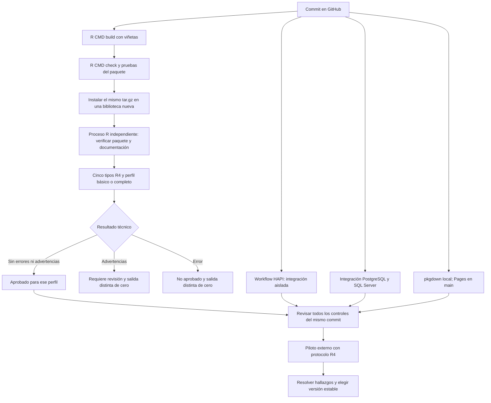

Los informes de aceptación se guardan como artefactos `piloto-*` durante 14 días.
Una aprobación de un perfil básico no evalúa la recuperación con DuckDB; ese
control queda como `no_evaluado`. Los workflows verifican el alcance declarado,
y su resultado debe consultarse para el commit específico que se vaya a entregar.

## Rendimiento

### Medición de la API Rust en 0.5.0.9002

El [informe verificable](https://github.com/f-slg/fhirviews/tree/main/data-raw/validacion-0.5.0.9002)
corresponde al paquete instalado desde el commit `8d6a122`, con bytecode R,
Ubuntu 26.04.1, Intel i7-10750H, R 4.5.2 y Rust 1.75.0. Compara los siete
mapas ficticios de `tests/testthat/helper-constructor-r4.R`: **126 muestras**,
300 y 3.000 filas, tres repeticiones y orden aleatorio. Cada llamada produjo
el mismo JSON exacto que la ruta R.

La medición usó el binario GNU Linux compilado localmente. Los ZIP de
distribución tienen pruebas funcionales separadas; estos tiempos no miden
el binario musl ni los ejecutables Windows/macOS.

Medianas para **3.000 filas**, en segundos:

| Recurso | R (s) | R con plan (s) | Componente Rust (s) | R / Rust |
|---|---:|---:|---:|---:|
| Condition | 6,983 | 6,703 | 2,307 | 3,03× |
| DiagnosticReport | 19,695 | 15,755 | 6,352 | 3,10× |
| Encounter | 8,666 | 5,500 | 2,642 | 3,28× |
| Immunization | 9,317 | 5,837 | 3,116 | 2,99× |
| Observation | 10,098 | 6,043 | 2,986 | 3,38× |
| Patient | 3,362 | 1,855 | 1,538 | 2,19× |
| Specimen | 9,564 | 6,382 | 3,447 | 2,77× |

En estos mapas y equipo, el componente fue entre **2,19 y 3,38 veces** más
rápido que R público, y entre **1,21 y 2,91 veces** más rápido que el plan R
experimental. Los mapas tienen estructuras distintas; las cifras no comparan
la complejidad de los recursos ni prueban que se hayan agotado las mejoras R.

**Los lotes pequeños pueden favorecer R.** Para 300 Patient se midieron
0,341 s con R, 0,166 s con el plan R y 0,437 s con el componente. El plan R
experimental también fue más rápido que Rust en algunos otros lotes de 300.
Por eso la selección es explícita y R sigue siendo la opción predeterminada;
no hay un umbral automático de activación validado para otras cargas.

La preparación del plan R experimental tardó 0,692 s y la primera llamada
al componente, con tres Patient, 0,437 s; se registran aparte. Los tiempos por
lote incluyen comprobación del binario, arranque, transporte temporal y lectura
del plan. Se excluyen compilación, instalación, generación de filas/mapas,
comparación del resultado y GC previo. Se guardan las muestras individuales,
que muestran variación; tres repeticiones no constituyen un estudio general
de rendimiento. No se midieron memoria de esta API, rendimiento en otros
sistemas, perfiles clínicos, consultas SQL on FHIR ni Helios.

El archivo fuente comprobado pasó `R CMD check --as-cran --no-manual` con
**0 errores, 0 advertencias y 1 nota por la numeración de desarrollo**.
Las diez comprobaciones CI del código pasaron: cinco configuraciones R,
componente Rust en tres plataformas, HAPI y SQL DBI. Cada plataforma ejecutó
286 comprobaciones dirigidas y los 587 controles del laboratorio; el núcleo
incluye 12 pruebas nativas. Los resultados y los SHA-256 quedan conservados
junto al script [medir-componente-rust.R](https://github.com/f-slg/fhirviews/blob/main/data-raw/medir-componente-rust.R).

<details>
<summary>Laboratorio histórico Rust de 0.5.0.9000</summary>

### Evaluación experimental de Rust

El constructor público utiliza R por defecto; desde 0.5.0.9002 puede seleccionar
el componente CLI descrito arriba. El [laboratorio Rust](https://github.com/f-slg/fhirviews/tree/main/data-raw/experimento-rust)
queda fuera del paquete instalado. Sus mediciones de referencia usan **0.5.0.9000**,
Ubuntu 26.04.1, R 4.5.2, Rust 1.75.0 e Intel i7-10750H; son anteriores a 0.5.0.9001.
Medianas para 3.000 filas, tres repeticiones por método:

| Recurso | R actual (s) | R con plan (s) | R + Rust (s) | R actual / Rust |
|---|---:|---:|---:|---:|
| Patient | 6,031 | 3,444 | 2,856 | 2,11× |
| Encounter | 12,231 | 7,988 | 2,748 | 4,45× |
| Condition | 13,753 | 8,888 | 3,153 | 4,36× |
| Observation | 10,904 | 5,891 | 2,553 | 4,27× |
| Immunization | 11,799 | 7,173 | 3,052 | 3,87× |

Las 90 muestras contrastan JSON exacto en cada lote e incluyen arranque de
Rust, lectura del plan y transporte temporal. La preparación común es de
0,52 s. Frente al plan R, Rust fue entre 1,21 y 2,91 veces más rápido en este
equipo. En una ejecución separada con 3.000 Immunization, la suma RSS muestreada
fue de 170,2 MiB (R), 184,1 MiB (plan R) y 192,6 MiB (Rust); puede contar
páginas compartidas dos veces. Estas medidas Linux no demuestran ahorro de memoria.

Pasaron siete tests Rust y 587 controles diferenciales en Windows, macOS y Linux.
La CI contrasta también la paridad con desarrollos posteriores. La API CLI de
0.5.0.9002 conserva diagnósticos R completos y respaldo explícito; un enlace
nativo, su ABI/toolchain y distribución dentro del paquete serían trabajo adicional.
Consulta [resultados, hashes y reproducción](https://github.com/f-slg/fhirviews/blob/main/data-raw/experimento-rust/README.md).

</details>

<details>
<summary>Mediciones históricas de motores y comparación con fhircrackr</summary>

### Mediciones anteriores de V8 y DuckDB

Las mediciones de esta sección son anteriores a los cambios de precisión de
0.5.0.9000; no se han vuelto a medir con esta versión de desarrollo.

La siguiente medición compara ambos motores con pacientes sintéticos y una
vista que incluye `where`, cuatro columnas y `forEach` sobre `name`.

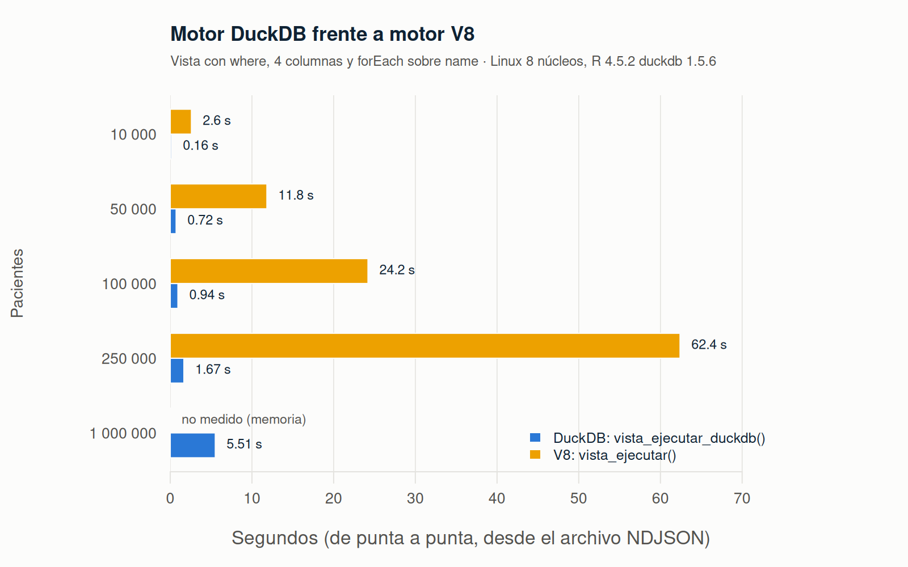

| Pacientes | Filas | Motor V8 | Motor DuckDB | Veces más rápido |
|---:|---:|---:|---:|---:|
| 10 000 | 17 824 | 2,3 s | 0,22 s | 11 |
| 50 000 | 89 128 | 11,0 s | 0,92 s | 12 |
| 100 000 | 178 062 | 23,2 s | 1,18 s | 20 |
| 250 000 | 444 912 | 58,9 s | 1,56 s | 38 |
| 1 000 000 | 1 780 958 | — | 5,8 s | — |

Tiempo de punta a punta, desde el archivo NDJSON hasta el `data.frame`, con
pacientes sintéticos y una vista con `where`, cuatro columnas y `forEach` sobre
`name` (`data-raw/motor-duckdb.R`; Linux, 8 núcleos, R 4.5.2, duckdb 1.5.6).

Son resultados de ese equipo y esa vista, no una garantía de rendimiento.
La expansión de colecciones, el tamaño del resultado, el disco y la memoria
pueden cambiar el comportamiento. El script reproducible está en
[`data-raw/motor-duckdb.R`](https://github.com/f-slg/fhirviews/blob/main/data-raw/motor-duckdb.R).

### Comparación con fhircrackr

[fhircrackr](https://CRAN.R-project.org/package=fhircrackr) es un paquete de
CRAN para aplanar recursos FHIR en R. Describe las columnas con
XPath sobre Bundles XML y expande las colecciones con `fhir_melt()`. La
comparación obtiene **la misma tabla** con ambos paquetes: filtro por fecha,
cuatro columnas por paciente y una fila por nombre. Antes de medir, el script
comprueba que los tres resultados sean idénticos.

| Pacientes | Filas | fhircrackr 2.4.0 · 1 núcleo | fhircrackr 2.4.0 · 8 núcleos | fhirviews · V8 | fhirviews · DuckDB |
|---:|---:|---:|---:|---:|---:|
| 1 000 | 1 752 | 0,56 s | 0,35 s | 0,16 s | 0,10 s |
| 10 000 | 17 824 | 4,4 s | 1,6 s | 1,3 s | 0,18 s |
| 50 000 | 89 180 | 25,1 s | 6,9 s | 7,2 s | 0,60 s |
| 100 000 | 178 316 | 48,5 s | 15,8 s | 15,4 s | 1,11 s |

Tiempo de punta a punta, desde los archivos hasta el `data.frame`, mediana de
tres corridas. Cada paquete lee su formato natural: NDJSON en fhirviews y
Bundles XML de 500 recursos en fhircrackr. Con los datos ya en memoria, solo la
transformación, el motor V8 es entre 4 y 5 veces más rápido que
`fhir_crack()` + `fhir_melt()`.

Cómo leer estos números:

- El motor V8 usa un solo núcleo. Frente a fhircrackr con un núcleo es unas
  **3 veces más rápido**; con `ncores = 8`, fhircrackr alcanza tiempos
  similares a los de V8. DuckDB usa todos los núcleos disponibles, de modo que
  su ventaja combina el motor con el paralelismo.
- Se usó un solo tipo de recurso (`Patient`) sintético y sencillo, en un solo
  equipo (Linux, 12 núcleos, R 4.5.2, duckdb 2.0.0). Con recursos más anidados
  el resultado puede cambiar.
- En fhirviews la extracción es un `ViewDefinition` estándar y portable. En
  fhircrackr, el filtro por fecha y la numeración de los nombres se hacen en R
  después de `fhir_crack()`, porque XPath 1.0 no compara fechas.

El script reproducible está en
[`data-raw/benchmark-fhircrackr.R`](https://github.com/f-slg/fhirviews/blob/main/data-raw/benchmark-fhircrackr.R) y los
resultados en [`data-raw/benchmark-fhircrackr.csv`](https://github.com/f-slg/fhirviews/blob/main/data-raw/benchmark-fhircrackr.csv)
(un núcleo) y
[`data-raw/benchmark-fhircrackr-ncores8.csv`](https://github.com/f-slg/fhirviews/blob/main/data-raw/benchmark-fhircrackr-ncores8.csv)
(ocho núcleos).

#### Un recurso más anidado: Observation

La misma comparación con 100 000 `Observation` más complejas: dos codificaciones
por recurso que hay que filtrar por sistema, elementos de elección
(`effective[x]`, `value[x]`), la referencia al paciente y una fila por
componente de la presión arterial (`forEachOrNull`).

| Observaciones | Filas | fhircrackr · 1 núcleo | fhircrackr · 8 núcleos | fhirviews · V8 | fhirviews · DuckDB |
|---:|---:|---:|---:|---:|---:|
| 1 000 | 1 274 | 0,44 s | 0,32 s | 0,18 s | 0,07 s |
| 10 000 | 12 639 | 4,1 s | 1,6 s | 1,6 s | 0,18 s |
| 50 000 | 63 059 | 20,8 s | 7,2 s | 8,4 s | 0,72 s |
| 100 000 | 125 578 | 44,0 s | sin memoria | 17,6 s | 1,42 s |

El resultado se mantiene con un núcleo: V8 es unas 2,5 veces más rápido que
fhircrackr. Con ocho núcleos, fhircrackr iguala a V8 o lo supera ligeramente,
pero cada proceso paralelo copia los datos: con 100 000 observaciones los ocho
procesos superaron los 14 GB de memoria del equipo y el sistema los detuvo.
V8 y DuckDB procesaron ese tamaño sin problemas.

Script: [`data-raw/benchmark-fhircrackr-observation.R`](https://github.com/f-slg/fhirviews/blob/main/data-raw/benchmark-fhircrackr-observation.R).

</details>

## Alcance y límites

- **FHIR R4 y JSON.** El modelo incluido es R4; no se declara compatibilidad
  con R5 ni con recursos XML.
- **FHIRPath.** La evaluación ocurre en V8. La resolución remota con
  `resolve()` está desactivada; las consultas de terminología se realizan con
  las funciones `tx_*` antes de ejecutar la vista.
- **Precisión y fechas.** La evaluación y salida JSON/NDJSON conservan los
  literales decimales de la fuente original. Las columnas numéricas ordinarias
  de R no conservan su escala; modificar recursos descarta su fuente JSON.
  Las fechas quedan como texto ISO 8601 para admitir `2025` o `2025-03`.
- **Memoria y esquema.** `vista_ejecutar()` reúne el resultado en memoria;
  el procesamiento por bloques requiere que tu función gestione la salida.
  Los avisos de conversión de tipos deben revisarse antes de persistir datos.
- **DuckDB experimental.** El traductor SQL cubre un subconjunto de FHIRPath.
  Contrasta tus vistas con V8 antes de llevarlas a gran escala.
- **Capacidades del servidor.** SMART, `$validate`, terminología y `$export`
  dependen de la configuración y los permisos del servidor conectado.

Las propuestas y su seguimiento están en
[GitHub Issues](https://github.com/f-slg/fhirviews/issues).

## Estabilización de R4

La próxima entrega consolidará **FHIR R4 4.0.1** con un alcance explícito.
La versión de desarrollo actual es `0.5.0.9002`; el kit actualizado entrega
ese mismo archivo y prueba por separado el ejemplo de laboratorio. El archivo
Zenodo de `0.5.0.9000` tiene un DOI propio, que no se transfiere a esta versión.
Preparar el candidato no publica un lanzamiento ni emite otro DOI.

| Componente | Alcance del cierre R4 |
|---|---|
| Cliente y vistas V8 | Recursos R4, paginación, autenticación y operaciones según las capacidades del servidor. |
| Construcción desde tablas o DBI | Siete tipos: `Patient`, `Observation`, `Encounter`, `Condition`, `Immunization`, `Specimen` y `DiagnosticReport`; una fila por recurso y mapeos explícitos. |
| Validación local | Tipos, cardinalidades, elecciones, fechas, destinos y bindings requeridos enumerables. Los controles léxicos de `code` y URI siguen las [reglas de primitivos R4](https://hl7.org/fhir/R4/datatypes.html#primitive). |
| Perfiles y terminología | HAPI comprueba perfiles base; perfiles del proyecto, invariantes y terminología externa se contrastan con su entorno acordado. |
| Motor DuckDB | Conserva la etiqueta experimental y el subconjunto FHIRPath documentado; se compara con V8. |
| Componente Rust | API opcional mediante CLI externa, con respaldo R explícito. Ejecutable y distribución nativa independientes del paquete R. |
| Otros recursos desde SQL | Medicamentos y actores se incorporarán por grupos. La lectura y las vistas pueden trabajar con otros recursos R4. |
| Federación y otras versiones | Consultas conjuntas entre servidores y conversión R4/R6 pendientes; no hay una API multiversión habilitada. |

El cierre técnico exige que el **mismo archivo fuente** se instale y apruebe
en una biblioteca nueva, con ayuda, viñetas y ejemplos incluidos. El control
instalado `r4_cinco_recursos` del candidato
`r4_cinco_recursos` construye seis recursos ficticios: un Patient, un Encounter,
un Condition, un Observation y dos Immunization. En ambos perfiles comprueba:

- Referencias a Patient y Encounter, booleanos falsos y ausencia completa de
  los objetos opcionales cuando faltan sus datos.
- Fecha válida de nacimiento, las dos variantes de `occurrence[x]` y las dos
  de `doseNumber[x]`, sin rellenar las variantes ausentes.
- Literales `72.00` y `0.50` en JSON y NDJSON, límites inferiores `71.995`
  y `0.495`, y regreso a las cinco tablas con V8.
- Rechazo de cinco casos: sujeto obligatorio ausente, ids duplicados,
  estado inválido, paciente ausente y comparador prohibido en SimpleQuantity.

El perfil `completo` construye los recursos del control mediante consultas
parametrizadas DBI/DuckDB y compara las cinco vistas con el motor SQL. La tarea R09/F09, obligatoria en alcance siete y excluida con motivo en núcleo, ejecuta `examples/laboratorio-r4.R`, que construye Specimen
y DiagnosticReport con referencias repetibles y compara V8/DuckDB. El grupo
obligatorio HAPI valida los recursos del control contra perfiles base; las
integraciones PostgreSQL y SQL Server comprueban sus controladores y tipos.

La **evaluación externa** requiere que otra persona instale el candidato,
explique los resultados, modifique una vista, contraste el NDJSON y repita las
tareas. El protocolo [PILOTO-R4.md](https://github.com/f-slg/fhirviews/blob/main/data-raw/piloto-r4-v2/PILOTO-R4.md) incluye tareas,
referencias y criterios de cierre. Los informes automáticos dejan
`validacion_usuario_externo = pendiente` hasta documentar esa evaluación aparte.
El ensayo local marca la validación de perfiles como no evaluada; HAPI aporta
su evidencia independiente, y los perfiles propios requieren otra comprobación.

Después del piloto y de corregir sus hallazgos se fijará la versión estable y
su artefacto. El archivo anterior 0.5.0.9000 conserva su DOI y el ORCID del autor;
el desarrollo actual 0.5.0.9002 mantiene metadatos de cita separados. El orden
posterior será federación entre servidores R4 y, después, adaptadores y
exportación R4/R6 por recurso. Rust dispone de una interfaz CLI opcional;
los ZIP por plataforma tienen su propia compilación y prueba de consumo.
La integración nativa dentro del paquete R sigue siendo un trabajo separado.

## Pendientes y orden de trabajo

Las pruebas automáticas, el archivo Zenodo y el laboratorio Rust ya tienen
evidencia. Las siguientes tareas requieren trabajo adicional:

| Prioridad | Pendiente | Criterio para cerrarlo |
|---|---|---|
| 1 | **Piloto externo R4** | Una persona ajena al desarrollo instala el candidato identificado, repite las tareas y registra comprensión, ayuda y hallazgos con el [protocolo R4](https://github.com/f-slg/fhirviews/blob/main/data-raw/piloto-r4-v2/PILOTO-R4.md). La CI no sustituye esa evaluación. |
| 2 | **Entrega estable del alcance R4** | Resolver los hallazgos, elegir versión y artefacto, comprobar ese mismo archivo y verificar su cita. El envío `0.5.0` a CRAN conserva su seguimiento independiente. |
| 3 | **Evaluación adicional de Rust** | La API, el respaldo R y los ZIP para cuatro plataformas disponen de pruebas separadas. Falta evaluar otras cargas, equipos y memoria. Las mediciones existentes usaron el binario GNU Linux; no acreditan el rendimiento de los nuevos ZIP. Un enlace nativo dentro del paquete exigiría revisar ABI, toolchains, vendoring y licencias para CRAN. |
| 4 | **Más constructores R4** | `Specimen` y `DiagnosticReport` ya están incorporados. Siguen medicamentos y actores según las fuentes; cada grupo necesita metadatos, colecciones, referencias y retorno SQL → FHIR → perfiles → tablas. |
| 5 | **Federación entre servidores R4** | Conservar origen y procedencia, distinguir ids repetidos entre servidores, revisar referencias y contrastar las consultas conjuntas. |
| 6 | **Adaptadores R4/R6** | Elegir recursos y reglas por versión, conservar el original y documentar pérdidas o campos sin equivalencia antes de exportar. |

La nueva vista `alergias` amplía la extracción de **AllergyIntolerance**; la
construcción SQL → FHIR admite siete tipos. La lectura de alergias
no acredita un nuevo conversor ni sustituye la validación de perfiles.

## Piloto y documentación local

### Protocolo actual para el cierre R4

**[Descargar el kit externo R4 ZIP](https://github.com/f-slg/fhirviews/raw/refs/heads/main/data-raw/fhirviews-kit-piloto-r4-v2.zip)**
· [SHA-256 del ZIP](https://github.com/f-slg/fhirviews/raw/refs/heads/main/data-raw/fhirviews-kit-piloto-r4-v2.zip.sha256)

El kit incluye el **paquete comprobado 0.5.0.9002**, su identidad, un lanzador,
protocolos R/FHIR y un formulario local en **español e inglés**. El protocolo
**2.1** distingue perfil de persona, nivel técnico y alcance núcleo/siete.
Cada perfil tiene nueve tareas diferentes, preguntas de comprensión, criterios
observables, evidencia, ayuda, tiempos activos/esperas y repetición por tarea.
El alcance siete exige completo y laboratorio R09/F09; núcleo lo excluye
expresamente. La autonomía se limita a tareas repetidas sin ayuda y con evidencia.
[Evaluación detallada](https://github.com/f-slg/fhirviews/blob/main/data-raw/piloto-r4-v2/EVALUACION-PILOTO.md)
· [English](https://github.com/f-slg/fhirviews/blob/main/data-raw/piloto-r4-v2/EVALUACION-PILOTO.en.md).
Conserva las fichas 2.0 con su kit y hash: no se importan en 2.1.

Extrae todo el ZIP y abre R desde esa carpeta. Instala las dependencias indicadas en `LEEME.md` y ejecuta:

```r
source("INICIAR.R")
iniciar_piloto("basico", "sesion-P01-intento01")
abrir_sesion("sesion-P01-intento01")
```

El lanzador verifica el archivo antes de instalarlo en una biblioteca aislada.
Completo añade DBI/DuckDB y requiere R >= 4.2 en este kit; básico usa R >= 4.1.
El formulario conserva fichas separadas, tareas, ayudas e incidencias, y exporta
JSON/CSV/texto. No ejecuta R ni envía resultados. La comprobación técnica deja
pendientes las tareas humanas y la decisión de cierre. Las
[instrucciones del kit](https://github.com/f-slg/fhirviews/blob/main/data-raw/piloto-r4-v2/LEEME.md)
son la guía detallada para participantes: explican cómo comprobar la descarga,
elegir perfil y nivel técnico, ejecutar y repetir tareas, interpretar los
cinco controles, exportar fichas y compartir evidencia con privacidad. Los
[protocolos de perfil R y FHIR](https://github.com/f-slg/fhirviews/tree/main/data-raw/piloto-r4-v2)
describen las tareas individuales. El formulario y el lanzador son herramientas
distintas: uno registra la sesión; el otro instala y ejecuta los controles.

La [guía del participante R4](https://github.com/f-slg/fhirviews/blob/main/data-raw/piloto-r4-v2/PILOTO-R4.md) se incluye en el kit. Usa el candidato que indique su manifiesto
y el ensayo instalado de esta sección. Para ejecutar solamente el recorrido
de seis recursos, sin todo el kit de vigilancia:

```r
Sys.setenv(FHIRVIEWS_R4_SALIDA = "r4-basico-01", FHIRVIEWS_R4_SQL = "false")
source(system.file("examples", "r4-estabilidad.R", package = "fhirviews"))
```

Con `FHIRVIEWS_R4_SQL = "true"` requiere DBI/DuckDB y compara ambos motores.
Cada carpeta debe ser nueva. Este ejemplo local utiliza datos ficticios y
conserva los JSON de salida y su resumen.

### Kit anterior de participantes: candidato 0.5.0

<details>
<summary>Material histórico del piloto 0.5.0</summary>

**[Descargar el kit del piloto ZIP](https://github.com/f-slg/fhirviews/raw/refs/heads/main/data-raw/fhirviews-kit-piloto-v1.zip)**

1. Descarga y descomprime el ZIP.
2. Abre `FORMULARIO-PILOTO.html` en un navegador.
3. Elige el perfil **R** o **FHIR**, registra el candidato y sigue las tareas.
4. Exporta el JSON para conservar ambas fichas y prepara el aviso al mantenedor.
   El envío se realiza manualmente por el canal acordado.

El kit incluye protocolos detallados, casillas de comprobación, registro de
tiempos y ayuda, incidencias, criterios de cierre y un anexo para el observador.
El formulario funciona localmente y no transmite información automáticamente.
El guardado del navegador no sustituye la exportación del informe.

También puedes consultar los protocolos en el repositorio:

- [Perfil R: analista, investigador o epidemiólogo](https://github.com/f-slg/fhirviews/blob/main/data-raw/piloto-participantes-v1/PROTOCOLO-PERFIL-R.md).
- [Perfil FHIR: interoperabilidad e informática sanitaria](https://github.com/f-slg/fhirviews/blob/main/data-raw/piloto-participantes-v1/PROTOCOLO-PERFIL-FHIR.md).
- [Instrucciones y archivos del kit](https://github.com/f-slg/fhirviews/blob/main/data-raw/piloto-participantes-v1/LEEME.md).

El ZIP contiene los materiales de evaluación, no el paquete R. Para un
piloto, el mantenedor entrega el archivo candidato
identificado en el manifiesto para evaluar exactamente la misma versión.
Este kit v1 mantiene la referencia histórica al candidato 0.5.0; para el
cierre actual de SQL → FHIR R4 usa el protocolo R4 anterior.

</details>

### Alternativa avanzada: ejecutar el control técnico del paquete

Este procedimiento manual instala un archivo fuente y ejecuta el ejemplo
técnico incluido en el paquete. **No reemplaza el kit del piloto externo**:
no verifica el ZIP completo, no instala en la biblioteca aislada del kit y no
incluye por sí solo la observación de tareas, la ficha de participante ni el
cierre humano. Para participar, sigue la sección anterior y su
[guía detallada](https://github.com/f-slg/fhirviews/blob/main/data-raw/piloto-r4-v2/LEEME.md).

Úsalo solo si el mantenedor solicita explícitamente repetir ese control. El
archivo debe ser el candidato exacto identificado en `CANDIDATO.json`; no
descargues un `.tar.gz` de otra versión y lo presentes como resultado del kit.

#### Control técnico manual (no es una sesión completa del piloto)

El control usa los datos ficticios incluidos. Instala las dependencias y el
archivo fuente que te entregue el mantenedor:

```r
install.packages(c("cli", "httr2", "jsonlite", "rlang", "V8"))
install.packages("fhirviews_0.5.0.9002.tar.gz", repos = NULL, type = "source")
```

Reinicia R, elige una carpeta nueva y ejecuta:

```r
Sys.setenv(
  FHIRVIEWS_PILOTO_SALIDA = "piloto-basico-01",
  FHIRVIEWS_PILOTO_PERFIL = "basico"
)
source(system.file("examples", "piloto.R", package = "fhirviews"))
```

Abre `piloto-basico-01/aceptacion.csv` para ver los controles y
`aceptacion.json` para sus diagnósticos. Los estados son `aprobado`, `fallo`,
`requiere_revision`, `pendiente` y `no_evaluado`. Cualquier advertencia requiere
revisión y evita la aprobación automática; el informe registra códigos seguros
sin copiar los mensajes originales.

El informe actual usa `esquema_informe = 2`. El perfil `basico` comprueba la API,
los resultados de vigilancia, el rechazo estricto de un bloque incompatible y
el recorrido R4 de cinco tipos desde tablas. Para comprobar también rollback,
consultas SQL parametrizadas y ambas implementaciones de las cinco vistas,
instala `DBI` y `duckdb`, cambia el perfil a `completo` y usa otra carpeta nueva.
Los archivos permanecen locales; completa `experiencia-usuario.txt` con los
obstáculos, la ayuda necesaria y tu evaluación. La aprobación técnica deja
pendiente esa evaluación humana y no valida un servidor ni datos propios.

La ayuda y las viñetas están disponibles en la instalación:

```r
help(package = "fhirviews")
help("vista_ejecutar_lotes", package = "fhirviews")
browseVignettes("fhirviews")
```

La [guía del mantenedor](https://github.com/f-slg/fhirviews/blob/main/inst/examples/PILOTO-MANTENEDOR.md) describe cómo
construir y verificar el candidato, interpretar los códigos y cerrar el piloto.
También se distribuye dentro del paquete, en `examples/PILOTO-MANTENEDOR.md`.

## Guías y referencia

El código fuente está disponible en el repositorio público. La ayuda y las
viñetas también se pueden consultar localmente, como se describe en la sección
anterior, sin depender de la disponibilidad del sitio web.

| Guía | Contenido |
|---|---|
| [Primeros pasos](https://f-slg.github.io/fhirviews/articles/fhirviews.html) | Cliente, recursos y primeras vistas con el caso clínico |
| [ViewDefinition en detalle](https://f-slg.github.io/fhirviews/articles/vistas.html) | Columnas, colecciones, filtros, tipos y SQL |
| [Servidores y grandes volúmenes](https://f-slg.github.io/fhirviews/articles/servidores-y-volumen.html) | SMART, exportación masiva y DuckDB |
| [Tasas por cantón](https://f-slg.github.io/fhirviews/articles/tasas-pobecu.html) | Indicadores con FHIR y población de Ecuador |
| [Arquitectura](https://f-slg.github.io/fhirviews/articles/arquitectura.html) | Motores, evaluación por lotes y seguridad |
| [Referencia de funciones](https://f-slg.github.io/fhirviews/reference/) | Firmas, argumentos y ejemplos de la API |

Proyectos relacionados:
[pobecu](https://f-slg.github.io/pobecu/) aporta proyecciones poblacionales
del INEC y permite calcular tasas; [geoecu](https://f-slg.github.io/geoecu/)
aporta límites territoriales de CONALI para mapearlas. El artículo de
[tasas por cantón](https://f-slg.github.io/fhirviews/articles/tasas-pobecu.html)
muestra el recorrido completo desde datos FHIR hasta la tasa y el mapa.
[aprende-fhir](https://github.com/f-slg/aprende-fhir) ofrece material docente
con un caso clínico ficticio.

## Citar el paquete

**Autor y mantenedor:** Ronald Fabricio Salas Guerrero,
[ORCID 0000-0001-5077-1522](https://orcid.org/0000-0001-5077-1522).

```r
citation("fhirviews")
toBibtex(citation("fhirviews"))
```

| Qué utilizaste | Cómo identificarlo |
|---|---|
| Desarrollo actual `0.5.0.9002` | Cita la versión instalada y conserva el SHA del commit. Todavía no tiene DOI de versión. |
| Archivo `0.5.0.9000` | [DOI 10.5281/zenodo.24238726](https://doi.org/10.5281/zenodo.24238726), correspondiente al código archivado desde `565243e`. |
| Proyecto y sus versiones | [DOI de concepto 10.5281/zenodo.24238725](https://doi.org/10.5281/zenodo.24238725). Para reproducir un análisis, identifica además la versión concreta. |

ORCID identifica al autor; Zenodo preserva un archivo citable. Pueden utilizarse
antes de la publicación en CRAN: no son un trámite previo obligatorio ni una
certificación de aceptación. La cita de R incorpora el DOI de `0.5.0.9000` solo
para esa versión. El desarrollo `0.5.0.9002` conserva su propia versión y la URL
del repositorio. Los metadatos están en
[`CITATION.cff`](https://github.com/f-slg/fhirviews/blob/main/CITATION.cff) y
[`.zenodo.json`](https://github.com/f-slg/fhirviews/blob/main/.zenodo.json).

La [guía de Zenodo](https://github.com/f-slg/fhirviews/blob/main/data-raw/zenodo/README.md)
detalla autoría, archivos, hashes y futuras versiones. La
[constancia de publicación](https://github.com/f-slg/fhirviews/blob/main/data-raw/zenodo/publicacion-0.5.0.9000.json)
identifica el ZIP realmente preservado; el paquete R complementario de GitHub
tiene un hash distinto y se documenta por separado. Los nuevos cambios no
modifican el archivo al que corresponde el DOI anterior.

## Contribuir

Para dudas de uso, participa en [Discussions](https://github.com/f-slg/fhirviews/discussions).
Para errores o propuestas, abre un [issue](https://github.com/f-slg/fhirviews/issues/new/choose)
con un ejemplo mínimo reproducible y datos ficticios. Consulta la
[guía de contribución](https://github.com/f-slg/fhirviews/blob/main/.github/CONTRIBUTING.md) y el
[código de conducta](https://github.com/f-slg/fhirviews/blob/main/.github/CODE_OF_CONDUCT.md).

## Licencia

Licencia [MIT](https://github.com/f-slg/fhirviews/blob/main/LICENSE.md). Las licencias y atribuciones del código y los datos
incluidos se detallan en [`inst/COPYRIGHTS`](https://github.com/f-slg/fhirviews/blob/main/inst/COPYRIGHTS).

fhirviews es un proyecto independiente. FHIR® y HL7® son marcas registradas de
Health Level Seven International; su uso no implica respaldo institucional.
Todos los datos de ejemplo incluidos son ficticios.
