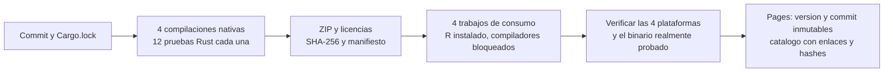

# Distribucion del componente Rust externo

El componente `fhirviews-rust-validator` 0.1.0 usa el contrato
`fhirviews-r4-validator/1` para validar estructuras R4 4.0.1 ya construidas
y tipificadas por fhirviews >= 0.5.0.9002. R sigue siendo la opcion
predeterminada. No es un motor FHIRPath, conversor R4/R6 ni validador de
perfiles clinicos. La API y los siete constructores no cambian con esta
distribucion.

## Consumo sin compilador

El [catalogo JSON](https://f-slg.github.io/fhirviews/componentes/rust/catalogo.json)
publica cuatro plataformas:

| Clave | Target Rust | Compilacion y consumo nativos |
|---|---|---|
| linux-x86_64 | x86_64-unknown-linux-musl | Ubuntu 22.04; ELF estatico sin interprete ni DT_NEEDED |
| windows-x86_64 | x86_64-pc-windows-msvc | Runner Windows; +crt-static y control de importaciones PE |
| macos-intel | x86_64-apple-darwin | macOS 15 Intel; deployment target 15.0 |
| macos-apple-silicon | aarch64-apple-darwin | macOS 15 ARM64; deployment target 15.0 |

El [README principal](../../README.md#validación-con-el-componente-rust-opcional)
y su [version inglesa](../../README.en.md#validation-with-the-optional-rust-component)
incluyen un ejemplo R: elegir plataforma, descargar el ZIP, comparar SHA-256
con el catalogo **antes** de descomprimir/ejecutar, elegir una carpeta nueva,
y pasar la ruta a `fhir_componente_rust(..., fallback = FALSE)`.
El ejemplo usa un temporal; para reutilizarlo entre sesiones debe elegirse
una carpeta persistente. No se instala Rust, no se cambia PATH del usuario
ni se modifica el registro. El componente no usa la red; la descarga es
una accion explicita del usuario.

No se distribuyen Linux ARM64, Windows ARM64 ni macOS universal. Un ZIP para
otra arquitectura no se presenta como compatible. Los binarios macOS no
estan firmados ni notarizados: las politicas del equipo pueden impedir
ejecutarlos. No se desactiva Gatekeeper ni se quita cuarentena automaticamente.
Una arquitectura nativa comprobada en CI no acredita todos los equipos,
versiones del sistema o restricciones corporativas.

## Compilacion, licencias e integridad

El workflow [rust-distribucion.yaml](../../.github/workflows/rust-distribucion.yaml)
usa Rust 1.75.0, Cargo.lock, `--release --locked --jobs 2` y cuatro runners
nativos. El runtime C de Windows se enlaza con
`RUSTFLAGS=-C target-feature=+crt-static`; el empaquetador comprueba la tabla
de importaciones y rechaza dependencias VC/UCRT dinamicas adicionales.
Linux usa musl y comprueba ELF64 x86_64 sin interprete dinamico ni bibliotecas
`DT_NEEDED`. macOS enlaza con libSystem y fija minimo 15.0.

Cada ZIP contiene una unica raiz y:

- `bin/fhirviews-rust-validator` (`.exe` en Windows).
- `MANIFIESTO.json`: version, protocolo, FHIR, plataforma, commit fuente,
  toolchain, runner, flags, formato/enlace del ejecutable y hashes/tamanos.
- `SHA256SUMS`, `Cargo.lock`, licencia MIT del componente y guia breve.
- `DEPENDENCIAS.json` y los avisos de licencia de cada paquete transitivo
  obtenido mediante `cargo metadata --locked --format-version 1`.
- COPYRIGHT, LICENSE-MIT y LICENSE-APACHE del toolchain Rust. Linux incorpora
  ademas [COPYRIGHT de musl 1.2.3](https://git.musl-libc.org/cgit/musl/plain/COPYRIGHT?h=v1.2.3),
  fijado por SHA-256 `f9bc4423732350eb0b3f7ed7e91d530298476f8fec0c6c427a1c04ade22655af`.
  La [construccion oficial de Rust 1.75.0](https://github.com/rust-lang/rust/blob/1.75.0/src/ci/docker/scripts/musl-toolchain.sh)
  fija esa version de musl.

Se genera tambien SHA-256 del ZIP completo. Sus fechas ZIP se fijan y las
entradas se ordenan; esto no promete compilaciones identicas entre maquinas
o distintas instalaciones de toolchains. SHA-256 verifica integridad frente
al catalogo HTTPS del proyecto; no es una firma digital del autor.

`paquetes.py verificar` comprueba primero el SHA externo; despues exige una
raiz, nombres seguros tambien en Windows, ausencia de colisiones, enlaces,
archivos adicionales y archivos ausentes, limites de tamano, hashes internos,
arquitectura y contrato. Solo extrae en una carpeta nueva, sin ejecutar el
contenido ni invocar Rust. Sus pruebas usan cabeceras sinteticas; las pruebas
del workflow con binarios reales aportan la evidencia de compilacion/consumo.

## Reproducir en Linux x86_64

Desde la raiz del repositorio, con Python >= 3.9 y el toolchain Rust
instalados por el mantenedor:

```sh
rustup toolchain install 1.75.0 --profile minimal --target x86_64-unknown-linux-musl
cargo +1.75.0 build --release --locked --jobs 2 --target x86_64-unknown-linux-musl --manifest-path componentes/rust/Cargo.toml
cargo +1.75.0 test --locked --jobs 2 --target x86_64-unknown-linux-musl --manifest-path componentes/rust/Cargo.toml
cargo +1.75.0 metadata --locked --format-version 1 --manifest-path componentes/rust/Cargo.toml > /tmp/fhirviews-cargo-metadata.json
rustup run 1.75.0 rustc --print sysroot
python3 data-raw/distribucion-rust/test_paquetes.py
python3 data-raw/distribucion-rust/test_publicar.py
```

Con el sysroot mostrado y el commit de 40 caracteres comprobado, ejecutar
`paquetes.py crear --binario RUTA --target x86_64-unknown-linux-musl
--metadata /tmp/fhirviews-cargo-metadata.json --rust-root SYSROOT
--salida CARPETA_NUEVA --commit SHA --runner local-linux`.
La creacion si ejecuta `--capabilities` y `rustc --version` de las fuentes
conocidas; la verificacion y extraccion no ejecutan esos comandos:

```sh
python3 data-raw/distribucion-rust/paquetes.py verificar PAQUETE.zip --sha256 SHA256 --extraer CARPETA_NUEVA
```

## Evidencia de consumo y publicacion

Cada plataforma produce un artefacto `binario-TARGET`. Un **trabajo nuevo**
descarga ese artefacto, verifica y extrae en una ruta con espacios. Instala
fhirviews con `R CMD INSTALL --install-tests`, antepone comandos Cargo,
rustc y rustup que fallan/registran cualquier invocacion y ejecuta
`probar-instalado.R` con `testthat::test_package()`.
En Windows se usan bloqueadores `.exe`, compilados en el trabajo productor
desde `bloqueo-compiladores.rs` y verificados por SHA-256. Evitan que Windows
prefiera un compilador `.exe` real frente a un script `.cmd`. Son instrumentos
de CI, no compiladores ni parte de los ZIP publicos. La preparacion comprueba
que cada bloqueador devuelve 97 y registra una invocacion de autoprueba;
despues la instalacion y las pruebas R deben completar sin generar ese registro.
Comprueba JSON y NDJSON exactos, vistas, referencias, decimales, diagnosticos,
respaldo R y SQL parametrizado para los siete constructores. No acepta
pruebas omitidas, warnings ni fallos. El informe `consumidor.json` identifica
el SHA-256 del ejecutable efectivamente usado, commit, plataforma, paquete R
y conteos; no basta con que exista el archivo ejecutable.



Publicar requiere las cuatro compilaciones y los cuatro consumidores
aprobados. En PR se generan artefactos de CI sin publicar archivos publicos.
En `main`, `publicar.py` revalida paquetes e informes y prepara Pages en
`componentes/rust/0.1.0/COMMIT/`. Cada ZIP tiene checksum, manifiesto e informe
de consumo propios; `MANIFIESTO-DISTRIBUCION.json` fija el conjunto.
Si ese directorio ya existe, se verifica y reutiliza completo; una ejecucion
no sobrescribe bytes publicados con una recompilacion. Un directorio previo
incompleto o corrupto detiene la publicacion.

`componentes/rust/catalogo.json` apunta al conjunto publicado. El despliegue
conserva los demas archivos y comparte exclusividad con pkgdown para evitar
escrituras simultaneas. No crea tags ni GitHub releases: por tanto no dispara
el archivo automatico de una version R completa en Zenodo. ORCID y DOI de
0.5.0.9000 conservan su asociacion con el archivo anterior; publicar binarios
no acredita una nueva version estable ni aceptacion CRAN.

La salida local Linux obtuvo 12 pruebas Rust y 286 comprobaciones del
consumidor instalado sin compilador. Los resultados multiplataforma deben
consultarse en la [ejecucion de CI](https://github.com/f-slg/fhirviews/actions/workflows/rust-distribucion.yaml)
y sus artefactos, no deducirse de la matriz configurada.
Los [tiempos de la API 0.5.0.9002](../validacion-0.5.0.9002/README.md) se
obtuvieron con el binario GNU Linux anterior: no miden estos ZIP musl,
Windows o macOS, ni memoria, ni rendimiento frente a Helios.
