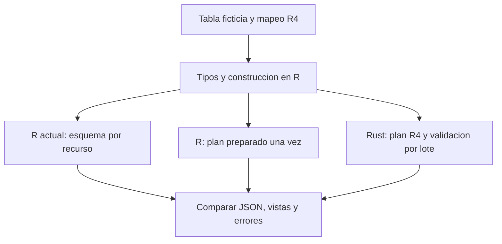

# Laboratorio Rust para validacion estructural R4

Estado: prototipo medido, excluido de la distribucion R mediante `.Rbuildignore`.
No cambia `fhir_desde_tabla()`, DESCRIPTION, NAMESPACE ni la instalacion del
paquete. No convierte versiones FHIR y no es un validador general de JSON FHIR.

## Pregunta y alcance

El perfilado de SQL → FHIR encontro coste en `validar_recurso_mapeado()` y las
referencias. Este experimento compara R actual, un plan R4 preparado en R y
validacion estructural por lotes en Rust, manteniendo los conversores de tipos,
asignacion, compactacion, serializacion decimal y lectura FHIR existentes en R.



Los metadatos se compilan desde `inst/schema/mapeo-r4.json`; los tipos de recurso
conocidos proceden del mismo modelo R4 de fhirpath.js. Se preparan 62 contextos
y 148 tipos del modelo, incluidos tipos base. No se habilitan nuevos recursos
de construccion: siguen siendo Patient, Observation, Encounter, Condition e
Immunization. Los primitivos llegan tipados por R; la CLI no sustituye esa etapa.

Rust comprueba obligatorios, elecciones, cardinalidades, bindings requeridos
enumerables y destinos de referencias. Recorre JSON por linea con `RawValue`
y `arbitrary_precision`; no reescribe recursos ni hace aritmetica decimal.
El resultado devuelve controles o error con fila/campo/motivo, sin valores del
recurso. Los mensajes traducidos por el adaptador R son resumidos. Los errores
de filas anteriores prevalecen sobre una conversion primitiva posterior; los
identificadores duplicados se revisan despues de la validacion, igual que en R.

El constructor preparado es una copia de la funcion instalada con un entorno
privado; no modifica el namespace del paquete. La alternativa Rust reutiliza
los conversores R y valida el lote antes de devolverlo. Todo trabajo, incluido
el arranque del proceso Rust y los archivos temporales, cuenta en la medicion.
Los invariantes, terminologias externas y perfiles siguen requiriendo HAPI u
otro validador. La paridad con R no demuestra conformidad clinica independiente.

## Resultados del 15 de noviembre de 2026

Ubuntu 26.04.1 x86_64, Intel i7-10750H, R 4.5.2 instalado con bytecode,
rustc/cargo 1.75.0, compilacion release con LTO thin y dos trabajos de compilacion.
Cada constructor se calento con cinco filas por tipo. Se midieron 300 y 3000
filas, tres repeticiones por celda y orden aleatorio de metodos (semilla 20261115).
Antes de cada llamada se ejecuto GC de R fuera del reloj. Los mapas, datos y
preparacion compartida (0.52 s) quedan fuera de los tiempos por lote. No se
ejecutaron otras compilaciones ni pruebas locales durante la medicion final.
La corrida exploratoria con pkgload no se usa en los resultados publicados.

Medianas para 3000 filas, en segundos:

| Resource | Current R (s) | R with plan (s) | R + Rust (s) | Current R / Rust |
|---|---:|---:|---:|---:|
| Patient | 6.031 | 3.444 | 2.856 | 2.11× |
| Encounter | 12.231 | 7.988 | 2.748 | 4.45× |
| Condition | 13.753 | 8.888 | 3.153 | 4.36× |
| Observation | 10.904 | 5.891 | 2.553 | 4.27× |
| Immunization | 11.799 | 7.173 | 3.052 | 3.87× |

Las 90 muestras y sus rangos figuran en [tiempos.csv](resultados-20261115/tiempos.csv)
y [resumen.csv](resultados-20261115/resumen.csv). El JSON exacto se comparo en
cada lote; el coste de esa comparacion queda fuera del reloj. No son tiempos
garantizados para otros mapas, maquinas, tamaños o sistemas operativos.

La comprobacion diferencial paso 251 controles: 20 escenarios validos de los
cinco recursos (0, 1, 8 y 31 filas), 33 escenarios de error y variantes legales
de referencias. Otros 168 escenarios de referencias dieron 336 comparaciones
contra R. Ademas pasaron siete tests del nucleo Rust. Se contrastan clase, fila
y campo de error, no el texto completo del mensaje. Se comprueban salida
JSON/NDJSON, consultas SQL on FHIR, Unicode, false, omision de ausentes,
elecciones y referencias, errores ordenados y escala 0.50 / 0.5 / 72.00, con
lowBoundary 0.495 / 0.45 / 71.995 y un decimal mayor que la precision de double.

Memoria: una ejecucion nueva por metodo, con 3000 Immunization. Pico de suma RSS
de R y sus hijos, muestreado cada 10 ms durante carga, preparacion y constructor:

| Metodo | Pico observado (MiB) |
|---|---:|
| R actual | 170.17 |
| R con plan | 184.11 |
| R + Rust | 192.65 |

Se pueden contar paginas compartidas mas de una vez y perder picos entre
muestras. La preparacion del plan solo se realiza en los metodos que la usan.
La muestra Rust tuvo un pico aproximadamente 13.2% superior a R; no demuestra
menor uso de memoria. El script usa psutil para incluir al hijo Rust, en lugar
de comparar solo la memoria del proceso R. No se midio rendimiento en Windows
ni macOS. El workflow `rust-experimento.yaml` contrasta paridad funcional en los
tres sistemas; una CLI MSVC no demuestra compatibilidad de una biblioteca con Rtools.

## Reproducir desde la raiz del repositorio

Se requiere el paquete fhirviews 0.5.0.9000 instalado, con sus dependencias R,
rustc/cargo 1.75.0 y Python con psutil solo para memoria. La instalacion del
compilador es una accion del mantenedor; el paquete no lo descarga ni instala.
En este ensayo el compilador se alojo en /tmp, sin modificar el perfil de shell.

```sh
# Si usas una biblioteca R aislada, declara su ruta. El resto de .libPaths se conserva.
export FHIRVIEWS_RUST_LIB=/ruta/biblioteca-R

cargo +1.75.0 build --release --locked --jobs 2 --manifest-path data-raw/experimento-rust/Cargo.toml
cargo +1.75.0 test --locked --jobs 2 --manifest-path data-raw/experimento-rust/Cargo.toml

# Cada salida debe ser nueva; en Windows el ejecutable termina en .exe.
Rscript data-raw/experimento-rust/comprobar.R data-raw/experimento-rust/target/release/fhirviews-validator-experiment /tmp/paridad-nueva
Rscript data-raw/experimento-rust/aristas.R data-raw/experimento-rust/target/release/fhirviews-validator-experiment /tmp/aristas-nuevas
Rscript data-raw/experimento-rust/medir.R data-raw/experimento-rust/target/release/fhirviews-validator-experiment /tmp/tiempos-nuevos
python3 data-raw/experimento-rust/memoria.py data-raw/experimento-rust/target/release/fhirviews-validator-experiment /tmp/memoria-nueva
```

Ejecutar las fases de tiempo y memoria de forma secuencial, sin compilaciones
concurrentes ni modificar los scripts mientras corren. `--offline` permite
repetir la compilacion una vez descargadas las dependencias de Cargo.lock.
No se versionan target/, ejecutables ni recursos temporales generados.

El [manifiesto](resultados-20261115/MANIFIESTO.json) identifica el commit de
codigo, los hashes de los scripts y resultados, el esquema R4 y el ejecutable
local. El binario puede tener otro hash en otra maquina; no es una promesa de
compilacion binaria reproducible. El [entorno](resultados-20261115/entorno.json)
conserva versiones y sesion R. Las [licencias](resultados-20261115/licencias.json)
proceden de cargo metadata y corresponden a las dependencias fijadas, no a
fuentes vendorizadas. El archivo Zenodo 0.5.0.9000 es anterior a este experimento.

## Decision y trabajo antes de integrarlo

La mejora justifica continuar en validacion estructural por lotes. La opcion
de R con plan tambien mejora el tiempo y conserva una alternativa sin Rust.
Para activar un motor opcional faltan una interfaz nativa, errores completos,
pruebas de instalacion/ABI, distribucion y atribucion de dependencias, y medir
de nuevo el recorrido completo. Se debe conservar la posibilidad de usar R.
No se propone reemplazar V8/FHIRPath ni DuckDB, que ya ejecutan motores nativos.

CRAN exige declarar cargo/rustc si se incorporan al paquete, comprobar el
compilador y no instalarlo automaticamente durante la instalacion, controlar
los trabajos de compilacion y distribuir o fijar las fuentes de dependencias
con los requisitos de licencia. Cargo.lock fija versiones; por si solo no
ofrece una instalacion R sin red ni resuelve Rtools/ABI. Ver las
[instrucciones oficiales de CRAN](https://cran.r-project.org/web/packages/using_rust.html),
la [guia de extendr](https://extendr.rs/installation-guide.html) y
[RawValue de serde_json](https://docs.rs/serde_json/latest/serde_json/value/struct.RawValue.html).
R4/R6 y la federacion siguen siendo trabajo separado del laboratorio Rust.
