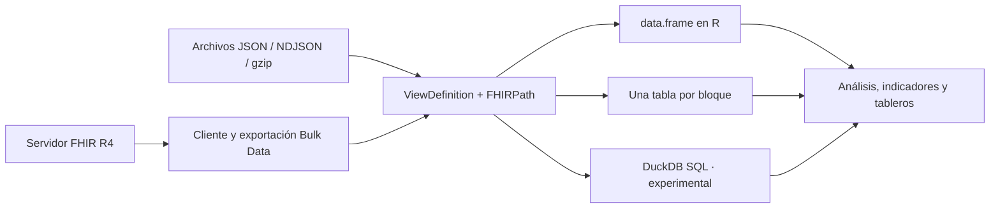

# fhirviews

**De recursos FHIR a tablas reproducibles en R.**

**fhirviews** consulta servidores **HL7 FHIR R4** y transforma sus
recursos en `data.frame` mediante **SQL on FHIR** y **FHIRPath**. Define
una vista una vez, guárdala como `ViewDefinition` y reutilízala sobre
archivos locales, respuestas del servidor o exportaciones poblacionales.

Está pensado para análisis clínico, investigación, vigilancia
epidemiológica y docencia desde R. Incluye autenticación SMART on FHIR,
vistas para salud pública y procesamiento NDJSON por bloques, sin
instalar Java ni Spark.

[Documentación](https://f-slg.github.io/fhirviews/) ·
[Referencia](https://f-slg.github.io/fhirviews/reference/) · [Novedades
de 0.5.0](https://f-slg.github.io/fhirviews/NEWS.md) · [Reportar un
problema](https://github.com/f-slg/fhirviews/issues/new/choose)


> **Versión 0.5.0 · distribución en GitHub.** Procesamiento por bloques,
> recuperación de exportaciones con validación de contenido y mejoras de
> privacidad. El motor SQL de DuckDB sigue siendo **experimental**. El
> paquete todavía no se ha enviado a CRAN.

## Contenido

- [Qué puedes hacer](#qu%C3%A9-puedes-hacer)
- [Instalación](#instalaci%C3%B3n)
- [Inicio rápido: de FHIR a una
  tabla](#inicio-r%C3%A1pido-de-fhir-a-una-tabla)
- [Elegir cómo procesar los datos](#elegir-c%C3%B3mo-procesar-los-datos)
- [Consultar un servidor FHIR](#consultar-un-servidor-fhir)
- [Autenticación y exportación
  masiva](#autenticaci%C3%B3n-y-exportaci%C3%B3n-masiva)
- [Procesar archivos por bloques](#procesar-archivos-por-bloques)
- [Trabajar con DuckDB](#trabajar-con-duckdb)
- [Vistas de salud pública y
  terminologías](#vistas-de-salud-p%C3%BAblica-y-terminolog%C3%ADas)
- [Validación y privacidad](#validaci%C3%B3n-y-privacidad)
- [Conformidad y pruebas](#conformidad-y-pruebas)
- [Rendimiento](#rendimiento)
- [Alcance y límites](#alcance-y-l%C3%ADmites)
- [Guías y referencia](#gu%C3%ADas-y-referencia)
- [Contribuir, citar y licencia](#contribuir-citar-y-licencia)

## Qué puedes hacer

| Necesidad | Herramientas |
|----|----|
| Convertir JSON, Bundles o recursos de R en tablas | [`vista_crear()`](https://f-slg.github.io/fhirviews/reference/vista_crear.md), [`vista_ejecutar()`](https://f-slg.github.io/fhirviews/reference/vista_ejecutar.md) |
| Consultar FHIR con paginación automática | [`fhir_conectar()`](https://f-slg.github.io/fhirviews/reference/fhir_conectar.md), [`fhir_buscar()`](https://f-slg.github.io/fhirviews/reference/fhir_buscar.md), [`fhir_leer()`](https://f-slg.github.io/fhirviews/reference/fhir_leer.md) |
| Acceder a servidores protegidos | [`fhir_auth_cliente()`](https://f-slg.github.io/fhirviews/reference/fhir_auth.md), [`fhir_auth_backend()`](https://f-slg.github.io/fhirviews/reference/fhir_auth.md), [`fhir_auth_interactiva()`](https://f-slg.github.io/fhirviews/reference/fhir_auth.md) |
| Descargar una población mediante Bulk Data | [`fhir_exportar()`](https://f-slg.github.io/fhirviews/reference/fhir_exportar.md), [`fhir_exportar_estado()`](https://f-slg.github.io/fhirviews/reference/fhir_exportar.md) |
| Recorrer NDJSON y gzip sin reunir toda la salida en memoria | [`vista_ejecutar_lotes()`](https://f-slg.github.io/fhirviews/reference/vista_ejecutar_lotes.md) |
| Ejecutar una vista traducible a SQL sobre NDJSON o Parquet | [`vista_ejecutar_duckdb()`](https://f-slg.github.io/fhirviews/reference/vista_ejecutar_duckdb.md) — experimental |
| Consultar varias tablas con SQL | [`vista_duckdb()`](https://f-slg.github.io/fhirviews/reference/vista_duckdb.md) — vistas evaluadas con V8 y guardadas en una transacción |
| Partir de vistas para salud pública | [`vista_catalogo()`](https://f-slg.github.io/fhirviews/reference/vista_catalogo.md), [`vista_plantilla()`](https://f-slg.github.io/fhirviews/reference/vista_plantilla.md) |
| Definir cohortes con códigos de un ValueSet | [`tx_expandir()`](https://f-slg.github.io/fhirviews/reference/tx_expandir.md), [`vista_con_valueset()`](https://f-slg.github.io/fhirviews/reference/vista_con_valueset.md) |
| Escribir y validar recursos en el servidor | [`fhir_crear()`](https://f-slg.github.io/fhirviews/reference/fhir_crear.md), [`fhir_actualizar()`](https://f-slg.github.io/fhirviews/reference/fhir_crear.md), [`fhir_borrar()`](https://f-slg.github.io/fhirviews/reference/fhir_crear.md), [`fhir_validar()`](https://f-slg.github.io/fhirviews/reference/fhir_validar.md) |

Un `ViewDefinition` describe las columnas, filtros y colecciones que se
quieren extraer mediante expresiones FHIRPath. Guardar esa definición
junto al análisis hace explícitas las decisiones de transformación y
facilita su revisión.



## Instalación

El cliente y el motor V8 requieren **R ≥ 4.1.0**. Instala desde GitHub:

``` r

install.packages("pak")  # una sola vez
pak::pak("f-slg/fhirviews")
```

La rama principal recibe cambios. Para reproducir un análisis, instala
un commit concreto y conserva
[`sessionInfo()`](https://rdrr.io/r/utils/sessionInfo.html) junto con la
vista y los datos:

``` r

pak::pak("f-slg/fhirviews@<SHA-del-commit>")
```

FHIRPath se ejecuta con
[fhirpath.js](https://github.com/HL7/fhirpath.js), incluido en el
paquete, a través de [V8](https://cran.r-project.org/package=V8). En
sistemas con binarios disponibles, la instalación de V8 no requiere
pasos adicionales. Si compilas desde código fuente, consulta sus
[instrucciones de
instalación](https://github.com/jeroen/V8#installation).

Instala las dependencias opcionales según tu flujo:

| Funcionalidad | Paquetes adicionales |
|----|----|
| Tablas y motor SQL de DuckDB | `DBI`, `duckdb` ≥ 1.3.0; la versión actual de DuckDB requiere R ≥ 4.2 |
| Consultas diferidas sobre DuckDB | Los anteriores, más `dplyr` y `dbplyr` |
| SMART Backend Services, con JWT firmado | `jose`, `openssl` |
| Inicio de sesión interactivo, con PKCE | `httpuv` |
| Addins y panel Connections de RStudio | `rstudioapi` |

``` r

# Ejemplo: habilitar DuckDB
install.packages(c("DBI", "duckdb"))
```

## Inicio rápido: de FHIR a una tabla

Este ejemplo usa datos **ficticios incluidos en el paquete**. Una vez
instalado, funciona sin conexión y no requiere dependencias opcionales.

``` r

library(fhirviews)

archivo <- system.file("extdata", "caso_clinico.ndjson", package = "fhirviews")

signos <- vista_crear(
  "Observation",
  c(fecha  = "effective.ofType(dateTime)",
    medida = "code.text",
    valor  = "value.ofType(Quantity).value",
    unidad = "value.ofType(Quantity).unit"),
  where = "value.ofType(Quantity).exists()"
)

tabla <- vista_ejecutar(archivo, signos)
tabla[, c("id", "medida", "valor", "unidad")]
#>          id                  medida  valor            unidad
#> 1  obs-temp    Temperatura corporal  38.40                °C
#> 2    obs-fr Frecuencia respiratoria  20.00 respiraciones/min
#> 3    obs-fc     Frecuencia cardíaca 102.00       latidos/min
#> 4 obs-tumor        Tamaño del tumor   3.50                cm
#> 5   obs-bsa     Superficie corporal   1.77                m2
```

La vista selecciona `Observation`, filtra las que tienen `valueQuantity`
y extrae cuatro columnas.
[`vista_crear()`](https://f-slg.github.io/fhirviews/reference/vista_crear.md)
añade la clave del recurso en `id`. También puedes empezar con una vista
del catálogo:

``` r

tabla_catalogo <- vista_ejecutar(archivo, vista_plantilla("signos_vitales"))
head(tabla_catalogo)

# Guardar la definición en JSON para versionarla o compartirla
json_vista <- vista_json(signos)
writeLines(json_vista, "signos-vitales.json")
vista_reutilizable <- vista_leer("signos-vitales.json")
```

## Elegir cómo procesar los datos

| Situación | Función | Dónde queda el resultado |
|----|----|----|
| Los recursos y la tabla caben en memoria | [`vista_ejecutar()`](https://f-slg.github.io/fhirviews/reference/vista_ejecutar.md) | Un `data.frame` completo |
| Quieres leer NDJSON o gzip por bloques con FHIRPath en V8 | [`vista_ejecutar_lotes()`](https://f-slg.github.io/fhirviews/reference/vista_ejecutar_lotes.md) | En la función `procesar(tabla, bloque)` que tú defines |
| Tienes NDJSON o Parquet y una vista compatible con el traductor SQL | [`vista_ejecutar_duckdb()`](https://f-slg.github.io/fhirviews/reference/vista_ejecutar_duckdb.md) | En R, una tabla de DuckDB o una consulta diferida |
| Quieres consultar juntas varias vistas evaluadas con V8 | [`vista_duckdb()`](https://f-slg.github.io/fhirviews/reference/vista_duckdb.md) | Tablas en una conexión DBI |

El procesamiento por bloques limita la entrada que se lee en cada paso.
La memoria total depende también de las filas generadas por la vista y
de lo que conserve tu función. En DuckDB, usa `tabla` o
`diferido = TRUE` para evitar traer toda la salida a R.

## Consultar un servidor FHIR

El siguiente ejemplo usa un servidor público de pruebas y requiere
conexión:

``` r

con <- fhir_conectar("https://hapi.fhir.org/baseR4")

pacientes <- fhir_buscar(
  con, "Patient", `_count` = 20, max_paginas = 2, progreso = FALSE
)

vista_pacientes <- vista_crear(
  "Patient", c(sexo = "gender", nacimiento = "birthDate")
)
vista_ejecutar(pacientes, vista_pacientes)
```

La búsqueda sigue los enlaces
[`next`](https://rdrr.io/r/base/Control.html) del servidor. `_count`
solicita el tamaño de página; `max_paginas` limita las páginas
descargadas. La disponibilidad y los resultados de los servidores
públicos pueden variar.

Usa `fhir_capacidades(con)` para consultar los recursos y operaciones
que admite el servidor,
[`fhir_leer()`](https://f-slg.github.io/fhirviews/reference/fhir_leer.md)
para leer un recurso concreto y
[`fhir_everything()`](https://f-slg.github.io/fhirviews/reference/fhir_everything.md)
para solicitar `$everything`. En RStudio, el panel **Connections**
permite explorar recursos y los addins ejecutan peticiones FHIR o vistas
desde el editor.

## Autenticación y exportación masiva

Para SMART Backend Services, registra previamente el cliente y su clave
pública en el servidor de autorización. La clave privada debe ser RSA de
al menos 2048 bits o EC P-384.

``` r

# Sustituye la URL, el identificador y la clave por los de tu entorno
con <- fhir_conectar(
  "https://fhir.hospital.ejemplo/r4",
  autenticacion = fhir_auth_backend(
    "tablero-vigilancia", "~/.claves/privada.pem",
    alcances = "system/*.rs", kid = "clave-2026"
  )
)

# Iniciar el trabajo y conservar su referencia antes de descargar
exp <- fhir_exportar(
  con, "paciente", tipos = c("Patient", "Condition"),
  carpeta = "exportacion", esperar = FALSE
)
exp <- fhir_exportar_estado(exp, esperar = TRUE)
```

El cliente obtiene y renueva el token. La exportación respeta
`Retry-After` y verifica el NDJSON recibido antes de registrar cada
archivo como completo: contenido JSON, tipo de recurso y conteo cuando
el manifiesto lo incluye. También admite archivos gzip.

Si una descarga se interrumpe, vuelve a ejecutar
`exp <- fhir_exportar_estado(exp, esperar = TRUE)` conservando el objeto
y la carpeta. Los archivos completos del mismo trabajo se reutilizan si
su checksum coincide; los ausentes o alterados se descargan de nuevo.
Cada archivo incompleto se reinicia desde el comienzo. La recuperación
depende de que el servidor conserve el trabajo y sus URL de descarga.

También están disponibles *client credentials* con secreto e inicio de
sesión interactivo con PKCE. Consulta la [guía de autenticación y Bulk
Data](https://f-slg.github.io/fhirviews/articles/servidores-y-volumen.html).

## Procesar archivos por bloques

Este ejemplo completo recorre el archivo incluido y muestra un resumen
por bloque. La función de procesamiento puede escribir cada tabla en una
base de datos o generar agregados:

``` r

archivo <- system.file("extdata", "caso_clinico.ndjson", package = "fhirviews")
vista <- vista_crear("Observation", c(medida = "code.text"))

totales <- vista_ejecutar_lotes(
  archivo, vista,
  procesar = function(tabla, bloque) {
    cat("Bloque", bloque, ":", nrow(tabla), "filas\n")
  },
  tamano_lote = 20
)
totales
```

Para una exportación propia, sustituye `archivo` por sus rutas NDJSON o
`.ndjson.gz`. El retorno contiene `bloques`, `recursos` y `filas`; los
resultados de la función `procesar()` se descartan.

Si `procesar()` falla, la ejecución se detiene y sus escrituras
anteriores permanecen. Declara tipos de columna con `type` en el
`ViewDefinition` y comprueba el esquema antes de insertar en una tabla
existente. Los tipos inferidos pueden variar entre bloques; los valores
incompatibles con un tipo explícito generan un aviso y pueden
conservarse sin convertir.

## Trabajar con DuckDB

El motor SQL **experimental** traduce un `ViewDefinition` a una consulta
de DuckDB. Es útil cuando la entrada es grande y la vista puede
expresarse en el subconjunto FHIRPath que admite el traductor:

``` r

archivo <- system.file("extdata", "caso_clinico.ndjson", package = "fhirviews")
vista <- vista_crear("Patient", c(sexo = "gender"))

pacientes_sql <- vista_ejecutar_duckdb(archivo, vista)
vista_sql(vista)  # inspeccionar la consulta generada
```

Prueba primero la vista con
[`vista_ejecutar()`](https://f-slg.github.io/fhirviews/reference/vista_ejecutar.md)
sobre una muestra representativa. Las expresiones que el traductor no
admite producen un error. Para NDJSON o Parquet propios, usa sus rutas
en lugar de `archivo`.

El motor SQL necesita la extensión `json` de DuckDB y puede descargarla
la primera vez. En entornos sin internet, prepara esa extensión con la
misma versión de DuckDB y comprueba `LOAD json` antes de ejecutar el
proceso. La construcción estándar de las viñetas evita esa descarga; sus
ejemplos SQL se habilitan explícitamente con
`FHIRVIEWS_VINETAS_DUCKDB=true`.

Para guardar varias vistas evaluadas con el motor V8 y consultarlas con
SQL, usa
[`vista_duckdb()`](https://f-slg.github.io/fhirviews/reference/vista_duckdb.md).
Esta función escribe las tablas en una transacción; no utiliza el
traductor experimental.

## Vistas de salud pública y terminologías

El catálogo incluye siete vistas: pacientes, diagnósticos, encuentros,
inmunizaciones, medicamentos, signos vitales y notificación obligatoria.
Puedes inspeccionarlas y adaptar sus constantes:

``` r

vista_catalogo()[, c("nombre", "recurso")]

archivo_dengue <- system.file(
  "extdata", "dengue_2025.ndjson.gz", package = "fhirviews"
)
casos <- vista_ejecutar(archivo_dengue, vista_plantilla("notificacion_obligatoria"))
```

Con un servidor de terminología,
[`tx_expandir()`](https://f-slg.github.io/fhirviews/reference/tx_expandir.md)
obtiene los códigos de un ValueSet,
[`tx_buscar_codigo()`](https://f-slg.github.io/fhirviews/reference/tx_buscar_codigo.md)
consulta `$lookup` y
[`tx_validar_codigo()`](https://f-slg.github.io/fhirviews/reference/tx_validar_codigo.md)
invoca `$validate-code`.
[`vista_con_valueset()`](https://f-slg.github.io/fhirviews/reference/vista_con_valueset.md)
incorpora los códigos expandidos a la vista para que su ejecución
posterior no dependa de la red.

### Demostración reproducible de vigilancia

Para ejecutar un flujo completo con los datos ficticios incluidos:

``` r

source(system.file("examples", "vigilancia.R", package = "fhirviews"))
```

El script imprime la carpeta de salida y comprueba que los resúmenes
coincidan con los eventos seleccionados. Con el conjunto incluido parte
de 755 eventos, selecciona 661 confirmados con CIE-10 A90/A91 y excluye
94 refutados. Genera:

- Eventos confirmados y resúmenes por cantón y mes de inicio, en CSV.
- Controles de conteo para revisar la transformación.
- Las vistas JSON, la versión del paquete, el checksum de entrada y
  [`sessionInfo()`](https://rdrr.io/r/utils/sessionInfo.html).
- Un archivo `LEEME.txt` con la definición del indicador y sus límites.

Son **conteos de eventos ficticios**, no pacientes únicos ni tasas
poblacionales. Los códigos territoriales deben leerse como texto para
conservar los ceros iniciales. Para elegir otra carpeta, configura
`FHIRVIEWS_DEMO_SALIDA` antes de ejecutar el script; la carpeta debe ser
nueva para evitar sobrescrituras.

Para convertir casos en indicadores territoriales, consulta el [ejemplo
de tasas por cantón con FHIR y
pobecu](https://f-slg.github.io/fhirviews/articles/tasas-pobecu.html).


## Validación y privacidad

[`vista_validar()`](https://f-slg.github.io/fhirviews/reference/vista_validar.md)
revisa una definición de vista.
[`fhir_validar()`](https://f-slg.github.io/fhirviews/reference/fhir_validar.md)
pide al **servidor** que valide un recurso mediante `$validate`; el
alcance de esa validación depende de los perfiles y capacidades del
servidor.

Desde 0.5.0, el atributo `valido` distingue tres resultados:

| Valor | Significado |
|----|----|
| `TRUE` | El servidor devuelve un OperationOutcome completo, sin errores ni problemas fatales, en una respuesta HTTP satisfactoria |
| `FALSE` | El OperationOutcome contiene errores o problemas fatales en una respuesta HTTP satisfactoria |
| `NA` | La operación falla por HTTP o la respuesta no permite determinar la validez |

``` r

# Requiere una conexión y un servidor que admita $validate
resultado <- fhir_validar(con, list(resourceType = "Patient", gender = "female"))
if (!isTRUE(attr(resultado, "valido"))) {
  stop("El recurso no tiene una validación positiva del servidor.")
}
```

El estado HTTP queda disponible en `attr(resultado, "estado")`. Una
validación positiva no certifica la calidad clínica de los datos.

Los errores HTTP omiten por defecto el contenido del servidor, que puede
contener información de pacientes. También se ocultan los valores
sensibles de la consulta, incluido `_id`. Para depuración controlada:

``` r

options(fhirviews.mostrar_detalles = TRUE)  # contenido del servidor en errores
options(fhirviews.mostrar_consulta = TRUE) # valores completos de la consulta

# Volver al comportamiento predeterminado
options(fhirviews.mostrar_detalles = FALSE, fhirviews.mostrar_consulta = FALSE)
```

Los detalles estructurados siguen disponibles en `error$outcome` al
capturar un error HTTP. Estas opciones no anonimizan recursos, rutas URL
ni archivos de salida: el acceso y almacenamiento de datos clínicos
corresponden al entorno que ejecuta el análisis. Los tokens se mantienen
en memoria salvo que se solicite explícitamente caché en disco con
`cache_disco = TRUE`.

## Conformidad y pruebas

El paquete incluye el [banco oficial de SQL on
FHIR](https://github.com/FHIR/sql-on-fhir.js/tree/main/tests). Los dos
motores superan **133/133 pruebas del perfil shareable** y **7/11
experimentales** del banco incluido. Las cuatro pendientes corresponden
a `lowBoundary()` y `highBoundary()` y a diferencias de precisión o zona
horaria. La conformidad se refiere a ese banco y no certifica un sistema
clínico.

``` r

vista_conformidad()                   # motor V8
vista_conformidad(motor = "duckdb")   # requiere DuckDB y su extensión json
```


CI comprueba el paquete en Windows, macOS y Linux, además de R-devel y R
4.1. En R 4.1 y R-devel se comprueban el cliente y V8. Los tres sistemas
con R release incluyen DuckDB y sus pruebas SQL. Las pruebas HTTP usan
respuestas simuladas. La integración de escritura se habilita por
separado contra un **servidor de pruebas propio**:

``` sh
FHIRVIEWS_SERVIDOR_ESCRITURA=http://localhost:8080/fhir \
  Rscript -e 'devtools::test(filter = "servidor")'
```

Ese servidor debe permitir escritura; algunas pruebas requieren
terminología y Bulk Data. La suite omite operaciones que el servidor no
admite. Consulta
[`tests/testthat/test-servidor.R`](https://f-slg.github.io/fhirviews/tests/testthat/test-servidor.R)
para preparar un HAPI aislado.

Para ejecutar la integración completa de forma reproducible desde el
repositorio, con Docker o Podman y las dependencias de prueba
instaladas:

``` sh
bash data-raw/probar-hapi.sh
```

El script usa una imagen fijada por digest, abre un puerto aleatorio
solo en localhost y elimina su propio contenedor al terminar, incluso si
las pruebas fallan. Imprime la carpeta que conserva los registros, el
resumen JSON y CSV, las omisiones y el entorno de R. La ejecución exige
escritura, transacciones, terminología básica y Bulk Data; una omisión
inesperada hace fallar la prueba. La variante de ValueSet en línea no
admitida por HAPI queda registrada aparte. El workflow **Integracion
HAPI** ejecuta este mismo script y conserva los resultados durante 14
días. En la primera ejecución puede descargar la imagen y la extensión
JSON de DuckDB.

## Rendimiento

La siguiente medición compara ambos motores con pacientes sintéticos y
una vista que incluye `where`, cuatro columnas y `forEach` sobre `name`.


| Pacientes |     Filas | Motor V8 | Motor DuckDB | Veces más rápido |
|----------:|----------:|---------:|-------------:|-----------------:|
|    10 000 |    17 824 |    2,3 s |       0,22 s |               11 |
|    50 000 |    89 128 |   11,0 s |       0,92 s |               12 |
|   100 000 |   178 062 |   23,2 s |       1,18 s |               20 |
|   250 000 |   444 912 |   58,9 s |       1,56 s |               38 |
| 1 000 000 | 1 780 958 |        — |        5,8 s |                — |

Tiempo de punta a punta, desde el archivo NDJSON hasta el `data.frame`,
con pacientes sintéticos y una vista con `where`, cuatro columnas y
`forEach` sobre `name` (`data-raw/motor-duckdb.R`; Linux, 8 núcleos, R
4.5.2, duckdb 1.5.6).

Son resultados de ese equipo y esa vista, no una garantía de
rendimiento. La expansión de colecciones, el tamaño del resultado, el
disco y la memoria pueden cambiar el comportamiento. El script
reproducible está en
[`data-raw/motor-duckdb.R`](https://f-slg.github.io/fhirviews/data-raw/motor-duckdb.R).

## Alcance y límites

- **FHIR R4 y JSON.** El modelo incluido es R4; no se declara
  compatibilidad con R5 ni con recursos XML.
- **FHIRPath.** La evaluación ocurre en V8. La resolución remota con
  `resolve()` está desactivada; las consultas de terminología se
  realizan con las funciones `tx_*` antes de ejecutar la vista.
- **Precisión y fechas.** Los números de JSON pierden los ceros
  decimales finales al leerse. Las fechas se conservan como texto ISO
  8601 para admitir valores parciales como `2025` o `2025-03`.
- **Memoria y esquema.**
  [`vista_ejecutar()`](https://f-slg.github.io/fhirviews/reference/vista_ejecutar.md)
  reúne el resultado en memoria; el procesamiento por bloques requiere
  que tu función gestione la salida. Los avisos de conversión de tipos
  deben revisarse antes de persistir datos.
- **DuckDB experimental.** El traductor SQL cubre un subconjunto de
  FHIRPath. Contrasta tus vistas con V8 antes de llevarlas a gran
  escala.
- **Capacidades del servidor.** SMART, `$validate`, terminología y
  `$export` dependen de la configuración y los permisos del servidor
  conectado.

Las prioridades de desarrollo incluyen estabilizar el motor DuckDB,
mejorar la precisión decimal y ampliar las operaciones de búsqueda y
terminología. Las propuestas y su seguimiento están en [GitHub
Issues](https://github.com/f-slg/fhirviews/issues).

## Guías y referencia

| Guía | Contenido |
|----|----|
| [Primeros pasos](https://f-slg.github.io/fhirviews/articles/fhirviews.html) | Cliente, recursos y primeras vistas con el caso clínico |
| [ViewDefinition en detalle](https://f-slg.github.io/fhirviews/articles/vistas.html) | Columnas, colecciones, filtros, tipos y SQL |
| [Servidores y grandes volúmenes](https://f-slg.github.io/fhirviews/articles/servidores-y-volumen.html) | SMART, exportación masiva y DuckDB |
| [Tasas por cantón](https://f-slg.github.io/fhirviews/articles/tasas-pobecu.html) | Indicadores con FHIR y población de Ecuador |
| [Arquitectura](https://f-slg.github.io/fhirviews/articles/arquitectura.html) | Motores, evaluación por lotes y seguridad |
| [Referencia de funciones](https://f-slg.github.io/fhirviews/reference/) | Firmas, argumentos y ejemplos de la API |

Proyectos relacionados: [pobecu](https://f-slg.github.io/pobecu/) para
población de Ecuador, [geoecu](https://f-slg.github.io/geoecu/) para
límites territoriales y
[aprende-fhir](https://github.com/f-slg/aprende-fhir) para docencia con
un caso clínico ficticio.

## Contribuir, citar y licencia

Para dudas de uso, participa en
[Discussions](https://github.com/f-slg/fhirviews/discussions). Para
errores o propuestas, abre un
[issue](https://github.com/f-slg/fhirviews/issues/new/choose) con un
ejemplo mínimo reproducible y datos ficticios. Consulta la [guía de
contribución](https://f-slg.github.io/fhirviews/CONTRIBUTING.md) y el
[código de
conducta](https://f-slg.github.io/fhirviews/CODE_OF_CONDUCT.md).

Para citar el paquete:

``` r

citation("fhirviews")
```

**Autor y mantenedor:** Ronald Fabricio Salas Guerrero. Licencia
[MIT](https://f-slg.github.io/fhirviews/LICENSE.md). Las licencias y
atribuciones del código y los datos incluidos se detallan en
[`inst/COPYRIGHTS`](https://f-slg.github.io/fhirviews/inst/COPYRIGHTS).

fhirviews es un proyecto independiente. FHIR® y HL7® son marcas
registradas de Health Level Seven International; su uso no implica
respaldo institucional. Todos los datos de ejemplo incluidos son
ficticios.
