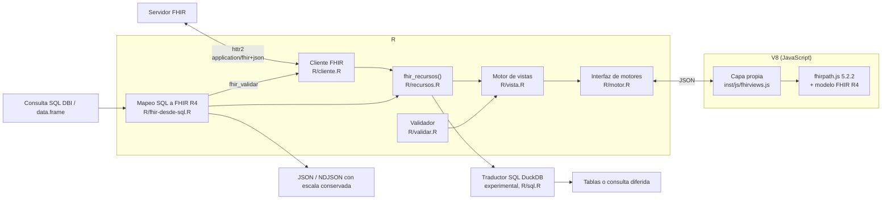
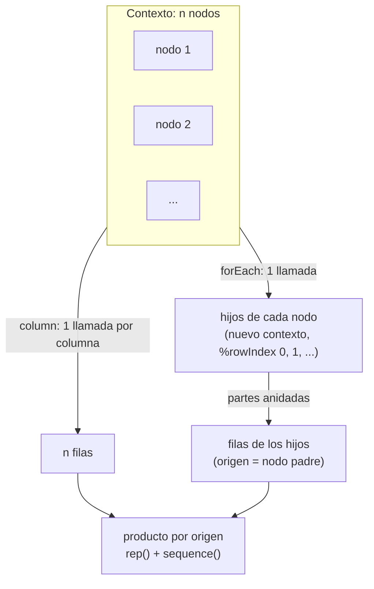
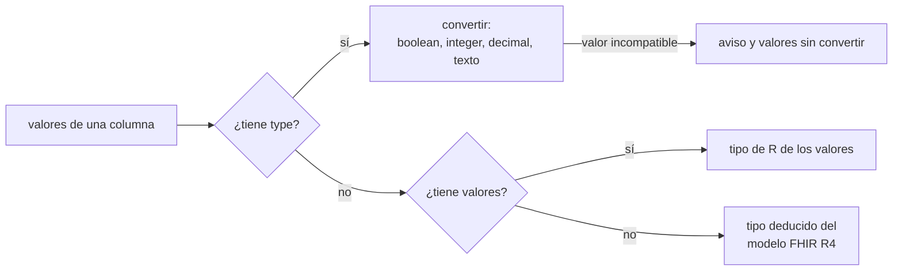

```{r, include = FALSE}
knitr::opts_chunk$set(collapse = TRUE, comment = "#>")
```

Este artículo describe el diseño interno de fhirviews para quien quiera
entender sus resultados, evaluar si sirve para un proyecto o contribuir al
código. Para empezar a usarlo, mejor la viñeta
[*Primeros pasos*](../fhirviews.html).

```{r}
library(fhirviews)
fhirviews_motor()
```

## Visión general



El mapeo SQL a FHIR admite Patient, Observation, Encounter, Condition,
Immunization, Specimen y DiagnosticReport de R4 4.0.1. Los controles locales revisan la estructura; la
validación de perfiles usa el servidor mediante `fhir_validar()`. El traductor
DuckDB es una alternativa al motor V8 para las vistas admitidas. La federación,
la conversión R4/R6 permanecen pendientes. La validación estructural dispone
de un componente Rust externo opcional, seleccionado explícitamente desde R.

El paquete separa las siguientes responsabilidades:

| Pieza | Archivo | Responsabilidad |
|---|---|---|
| Cliente | `R/cliente.R` | Peticiones HTTP, paginación, errores |
| Autenticación | `R/autenticacion.R` | SMART on FHIR / OAuth2: descubrimiento, tokens y su renovación |
| Exportación masiva | `R/bulk.R` | FHIR Bulk Data (`$export`): inicio, espera, manifiesto y descarga |
| Motor DuckDB | `R/sql.R` | Traducción de `ViewDefinition` y FHIRPath a SQL de DuckDB |
| Recursos | `R/recursos.R` | Reunir recursos de cualquier fuente y conservar su JSON original |
| Motor de vistas | `R/vista.R`, `R/validar.R` | Validar y ejecutar `ViewDefinition`, armar la tabla |
| Motor de FHIRPath | `R/motor.R`, `inst/js/fhirviews.js` | Evaluar expresiones FHIRPath por lotes |
| SQL a FHIR | `R/fhir-desde-sql.R`, `inst/schema/mapeo-r4.json` | Mapear columnas a siete tipos R4, comprobar estructura y escribir JSON/NDJSON |
| Componente Rust opcional | `R/componente-rust.R`, `componentes/rust/` | Validar recursos construidos y tipificados por R mediante una CLI con contrato versionado y respaldo R explícito |
| Decimales | `R/sql-limites.R`, `inst/js/lossless-json/` | Conservar los literales numericos y calcular limites con su escala |

## Cliente FHIR

Todas las peticiones pasan por una sola función interna, `peticion_json()`,
que:

- envía `Accept: application/fhir+json` (y `Content-Type` del mismo tipo con
  cuerpo), un `User-Agent` propio y las cabeceras de la conexión;
- agrega el token *bearer* **solo** si la URL pertenece al servidor de la
  conexión (los enlaces `next` que apunten a otro dominio no lo reciben);
- reintenta hasta tres veces ante 429 y 503, respetando `Retry-After`;
- convierte cualquier respuesta de error en una condición de R con clase
  `fhirviews_error_http_<código>`, el estado y el `OperationOutcome`
  completo, y un mensaje con sus `issue`:

```{r, eval = FALSE}
e <- tryCatch(fhir_leer(con, "Patient", "x"), fhirviews_error_http_404 = function(e) e)
e$estado       # 404
e$outcome      # OperationOutcome como lista de R
```

La paginación sigue los enlaces `next` de cada Bundle hasta que no hay más o
se alcanza `max_paginas`, y se detiene con un aviso si el servidor repite un
enlace. Cada página se guarda también como texto JSON (ver más abajo).

`fhir_crear()` distingue los Bundle `transaction` y `batch`, que se envían a
la base del servidor para que los procese, del resto de recursos, que se
envían a `[base]/[tipo]`.

## Autenticación SMART on FHIR

`fhir_auth_cliente()`, `fhir_auth_backend()` y `fhir_auth_interactiva()` solo
describen la autenticación; `fhir_conectar()` la prepara:

1. Si no se indicaron las URL, las descubre con `fhir_smart_configuracion()`:
   primero `[base]/.well-known/smart-configuration` y, si no existe, las
   extensiones `oauth-uris` del `CapabilityStatement` (SMART v1).
2. Crea un cliente OAuth de httr2 con el método de autenticación adecuado:
   `client_secret_basic` o `client_secret_post` (según lo que declare el
   servidor) o `private_key_jwt` con una clave RS384 o ES384.
3. En cada petición al propio servidor, `peticion_json()` obtiene el token
   vigente de la caché en memoria de httr2, que lo pide la primera vez y lo
   renueva cuando le quedan menos de 30 segundos. Si el servidor responde 401,
   descarta el token, pide otro y reintenta una sola vez.

En *Backend Services*, httr2 firma un JWT nuevo en cada pedido de token
(`iss` y `sub` = id del cliente, `aud` = URL del token, `exp` a cinco minutos,
`jti` aleatorio y `kid` en la cabecera). Se verificó con un servidor de
autorización independiente, escrito en Python con PyJWT, que comprueba la firma
y rechaza un `jti` repetido o una clave que no corresponde.

## Exportación masiva

`fhir_exportar()` sigue el protocolo asíncrono de
[FHIR Bulk Data](https://hl7.org/fhir/uv/bulkdata/):

| Paso | Petición | Respuesta esperada |
|---|---|---|
| Inicio | `GET [base]/$export`, `Patient/$export` o `Group/[id]/$export`, con `Prefer: respond-async` | `202 Accepted` + `Content-Location` |
| Estado | `GET [Content-Location]` | `202` (en curso, con `Retry-After` y `X-Progress`) o `200` con el manifiesto |
| Descarga | `GET [archivo]` por cada entrada de `output` y `error` | NDJSON |
| Cancelación | `DELETE [Content-Location]` | `202` |

Detalles de diseño:

- **Espera.** Respeta `Retry-After` (en segundos o como fecha HTTP); sin él,
  espera 1, 2, 4... segundos hasta un máximo de 60 entre consultas. Al superar
  `max_espera`, devuelve el trabajo en curso con un aviso, para retomarlo con
  `fhir_exportar_estado()`.
- **Descarga.** Los archivos se escriben directamente en disco, sin pasar por
  la memoria; sin tiempo total máximo, pero se cortan si la transferencia se
  detiene durante `tiempo` segundos.
- **Seguridad.** El token se envía a un archivo solo si el manifiesto lo exige
  (`requiresAccessToken`) y el archivo está en el mismo servidor; si está en
  otro dominio, se detiene con un error en lugar de enviarlo.

## Recursos y el texto JSON original

`fhir_recursos()` acepta listas de R, Bundles, texto JSON o NDJSON y archivos
(incluidos `.ndjson.gz`), y devuelve una lista de clase `fhir_recursos`.
Cuando los recursos vienen de texto (un archivo o un servidor), además guarda
ese texto en el atributo `fuente`:

```{r}
caso <- fhir_recursos(system.file("extdata", "caso_clinico.ndjson",
                                  package = "fhirviews"))
length(attr(caso, "fuente"))   # una línea de NDJSON por recurso
```

Al ejecutar una vista, el motor pasa ese texto a V8 y conserva sus literales
decimales mediante el reviver de `JSON.parse()` o lossless-json. Esto evita
serializar de nuevo las listas de R y perder los ceros que expresan precisión.
Si la lista se modifica (`r[[1]] <- ...`), la fuente original se descarta y
se usa la versión modificada. Los resultados de rendimiento anteriores al
cambio de lector no se han vuelto a medir con la versión de desarrollo.

## Motor de FHIRPath

### Interfaz

El motor de vistas no llama a fhirpath.js directamente: usa un *motor*, una
lista de funciones (`cargar`, `evaluar`, `validar`, `tipo`, `tamano`,
`liberar`, `version`). Hoy existe el motor `"v8"`; un motor escrito en R solo
tendría que implementar la misma interfaz y se elegiría con
`options(fhirviews.motor = ...)`.

### Almacén de nodos

En V8 vive un almacén de **nodos**: los recursos cargados y los elementos que
devuelven `forEach` y `repeat`. R los maneja por su índice. Una llamada
evalúa una expresión sobre muchos nodos a la vez:

```{r}
m <- fhirviews:::motor_actual()
inicio <- m$tamano()
ids <- m$cargar(caso[vapply(caso, function(r) r$resourceType == "Observation",
                            logical(1))])
length(ids)
# una sola llamada para las 12 observaciones
m$evaluar(ids[1:3], "code.text")
# los componentes se guardan como nodos y conservan su tipo
comp <- m$evaluar(ids, "component", modo = "nodos")
m$evaluar(unlist(comp)[1:2], "value.ofType(Quantity).value")
m$liberar(inicio)
```

Como los nodos guardados conservan su tipo FHIR (son `ResourceNode` de
fhirpath.js), `ofType(Quantity)` funciona sobre un componente aunque se
evalúe aparte de su recurso. Las expresiones se compilan una vez y se guardan
en caché, y `%resource` apunta siempre al recurso de origen del nodo.

### Funciones de SQL on FHIR

fhirpath.js no trae `getResourceKey()` ni `getReferenceKey()`; la capa propia
las define:

- `getResourceKey()` devuelve el `id` del recurso.
- `getReferenceKey([tipo])` devuelve el id de una referencia relativa o
  absoluta (sin `_history`). Con un tipo, solo si la referencia apunta a ese
  tipo de recurso.

Las constantes de fecha y hora (`valueDate`, `valueDateTime`...) se pasan
como literales de FHIRPath (`@2025-01-01`) para que se comparen como fechas.

### Carga de fhirpath.js

`fhirpath.min.js` contiene bytes `0x1A` (Ctrl-Z) dentro de las tablas del
analizador ANTLR. En Windows, la lectura en modo texto los toma como fin de
archivo y corta el script, así que los archivos JavaScript se leen en binario
(`readBin()`) en lugar de con `V8::source()`.

## Motor de vistas

### Lotes y contextos

Un *contexto* es un lote de nodos con su `%rowIndex`. Cada parte de la vista
se evalúa sobre todo el lote y devuelve filas que recuerdan de qué nodo
salieron (`origen`):



- **`column`**: una llamada a FHIRPath por columna para todo el lote. Sin
  `collection: true`, una expresión que devuelve varios valores es un error
  que explica cómo resolverlo.
- **`forEach` / `forEachOrNull`**: una llamada que devuelve los hijos de cada
  nodo como nodos nuevos; `%rowIndex` es su posición. Con `forEachOrNull`, los
  nodos sin hijos reciben un nodo vacío, que produce una fila con `NA`.
- **`repeat`**: recorrido en profundidad (preorden) por las rutas indicadas,
  nivel por nivel: una llamada por ruta y nivel del árbol.
- **`unionAll`**: las filas de cada rama se concatenan y se ordenan de forma
  estable por su origen.
- **Producto**: las filas de las partes de una selección se combinan por
  recurso de origen con índices, sin bucles por recurso.

Así, el número de llamadas a V8 depende de la forma de la vista, no del
número de recursos:

```{r}
vista <- vista_crear("Patient", c(sistema = "system", valor = "value"),
                     por_cada = "telecom")
system.time(vista_ejecutar(caso, vista))
```

### Orden de columnas y de filas

Las columnas siguen la especificación: las de `column`, luego las de los
`select` anidados y al final las del `unionAll`. El orden de las filas sigue
el de los recursos y, dentro de cada uno, el de sus elementos; la
especificación no lo garantiza, así que no conviene depender de él.

### Tipos



Para deducir el tipo sin datos, la capa JS recorre la expresión paso a paso
con el modelo R4 de fhirpath.js (`path2Type`, `choiceTypePaths`,
`pathsDefinedElsewhere`) y conoce el tipo que devuelven las funciones
habituales (`exists()` es lógico, `count()` entero, `join()` texto...):

```{r}
ctx <- list(tipo = "Patient", ruta = "Patient")
m$tipo(ctx, "birthDate")$tipo
m$tipo(ctx, "name.where(use = 'official').family")$tipo
m$tipo(list(tipo = "Observation", ruta = "Observation"),
       "component.value.ofType(Quantity).value")$tipo
```

Si la expresión es más compleja (operadores, funciones desconocidas), no se
deduce nada y la columna vacía queda como lógica, como en R.

### Validación

`vista_validar()` revisa toda la vista antes de ejecutarla y devuelve **todos**
los problemas a la vez (en `e$problemas`): elementos permitidos, un solo tipo
de iteración por selección, arreglos no vacíos, nombres de columnas válidos
en SQL y sin repetir, ramas de `unionAll` con las mismas columnas, constantes
con un solo valor y sin nombres reservados, y que cada expresión FHIRPath
compile.

## Motor DuckDB

`vista_ejecutar_duckdb()` es un segundo motor, experimental, que no usa V8:
traduce el `ViewDefinition` completo a **una sola consulta SQL** de DuckDB.

- **Lectura sin esquema.** Cada línea del NDJSON se lee como un valor `JSON`
  con `read_json_objects()` (Parquet con `read_parquet()` y `to_json()`). No
  hace falta un esquema FHIR, así que funcionan los elementos de elección, las
  extensiones y los recursos heterogéneos.
- **Colecciones como listas.** Cada expresión FHIRPath traducida es una lista
  `JSON[]`, un valor JSON o un valor de SQL tipado. `a.b` es `json_extract` sobre
  cada elemento; `where()` y `select()` son `list_filter()` y
  `list_transform()`; los elementos de elección (`value`, `onset`...) buscan
  todas sus variantes según el modelo R4.
- **Estructura dentro de cada fila.** Cada `select` produce la lista de filas
  de un recurso; `forEach` usa `list_transform()` con el índice (para
  `%rowIndex`), `unionAll` concatena listas, `repeat` se resuelve por niveles
  (hasta `fhirviews.sql_profundidad`, 12 por defecto) y la consulta final
  aplica `unnest()`. DuckDB procesa los archivos por bloques. Las vistas con
  límites decimales añaden una extracción correlacionada de las rutas de
  `json_tree()` para asociarlas a los tokens numéricos originales; el resto
  de vistas no hace ese trabajo adicional.
- **Errores.** Lo que no se puede traducir con certeza da un error de clase
  `fhirviews_error_sql` al traducir; una columna con varios valores sin
  `collection` o un `where` que no da un lógico son errores al ejecutar.
- **Garantía.** Ambos motores aprueban el banco incluido: 133/133
  *shareable* y 11/11 experimentales, 144/144 en total. Además, una prueba
  diferencial ejecuta las vistas de todas las viñetas con los dos motores y
  exige tablas idénticas, valores y tipos.

```{r, eval = requireNamespace("duckdb", quietly = TRUE)}
cat(substr(vista_sql(vista_crear("Patient", c(sexo = "gender"))), 1, 300), "...")
```

## Seguridad y privacidad

- **FHIRPath aislado.** fhirpath.js corre en V8 sin acceso a red ni a
  archivos. Las funciones que harían peticiones (`resolve()`, `memberOf()`
  con un servidor de terminología) están desactivadas porque el modo
  asíncrono no se habilita.
- **Entrada JSON.** La lectura usa `JSON.parse()` con acceso al literal
  numérico cuando V8 lo admite, y la copia local de lossless-json en los
  demás motores. Las expresiones viajan a V8 como texto JSON escapado. Los addins de RStudio
  convierten el texto seleccionado en una cadena de R con `deparse1()`.
- **Token.** No se imprime (tampoco el secreto ni la clave privada), solo se
  envía al servidor de la conexión, el código que genera el panel *Connections*
  lo toma de `Sys.getenv()` y se avisa si se usaría sin cifrar por http.
- **Datos personales.** Los valores de búsqueda se ocultan en los mensajes
  por defecto y el contenido del servidor también se omite. Las opciones
  `fhirviews.mostrar_consulta` y `fhirviews.mostrar_detalles` permiten depurar
  incluyendo esos datos; los campos estructurados de las respuestas y los
  archivos de salida siguen bajo control de la aplicación.

## Construcción de recursos desde SQL

`fhir_desde_sql()` recoge una consulta mediante DBI y pasa la tabla a
`fhir_desde_tabla()`. Un `fhir_mapa()` asocia columnas, constantes y claves de
referencia a destinos JSON concretos. No evalúa código R ni intenta invertir
expresiones de un `ViewDefinition`.

Los metadatos de `inst/schema/mapeo-r4.json` se derivan de los snapshots base
de Patient, Observation, Encounter, Condition, Immunization, Specimen,
DiagnosticReport y sus tipos en FHIR R4 4.0.1.
El generador conserva el SHA256 del archivo fuente, los destinos de
Reference y los bindings. Enumera solo ValueSets completos y simples del
paquete; las fuentes externas, filtros e imports se remiten a validación
terminológica externa. Se comprueban rutas, tipos, cardinalidades, campos
obligatorios, elecciones incompatibles y códigos de bindings requeridos
enumerados. Para Coding/CodeableConcept se exige al menos un par system/code
del ValueSet; las traducciones adicionales están permitidas. Los bindings
extensibles, preferidos y de ejemplo conservan su flexibilidad.
Las referencias comprueban los destinos declarados y los tipos identificables
en referencias literales, además de la coherencia con Reference.type.
Los contextos de `SimpleQuantity` se conservan por separado y prohíben
`comparator`, incluido `Immunization.doseQuantity` y los extremos de un Range.
Las Quantity generales mantienen su esquema base. `Date` conserva precisión
de fecha al mapearse a `dateTime`; no se asigna una hora a un dato sin hora.
`fhir_escribir()` conserva los decimales aportados como texto numérico,
incluidos ceros finales, mediante lossless-json. Las comprobaciones locales
no ejecutan todas las invariantes, perfiles ni servicios de terminología:
esa etapa corresponde a `fhir_validar()` sobre un servidor configurado.

El ejemplo instalado `examples/sql-a-fhir.R` recorre SQL → recursos → NDJSON
→ vista tabular con datos ficticios. La integración aislada añade validación
contra los siete perfiles base, persistencia de los recursos de prueba y
lectura de sus referencias antes de comparar los dos motores. El ejemplo
`examples/encuentros-diagnosticos.R` muestra el recorrido enlazado y
`examples/inmunizaciones-sql.R`, la vacunación con ambos tipos de fecha y dosis.
`examples/laboratorio-r4.R` construye una muestra, dos observaciones y un
informe mediante SQL, con colecciones `result[].reference` y
`specimen[].reference`; compara las tablas V8 y DuckDB y se contrasta con HAPI.

Los destinos `[].reference` distribuyen una lista de claves o referencias
literales por fila y conservan su orden y duplicados. No pueden compartir
campos o índices del mismo arreglo; otros objetos complejos repetidos usan
índices explícitos. No se infieren relaciones entre listas independientes.

`fhir_componente_rust()` selecciona una CLI externa: R prepara y reutiliza un
plan basado en los mismos metadatos y verifica contrato, versión FHIR,
identidad del esquema y conteo de recursos. El componente revisa la
estructura de recursos ya tipificados por R, leyendo NDJSON por líneas.
Un rechazo se reproduce con R para conservar mensaje y precedencia; un
fallo de proceso puede activar el respaldo R con un aviso. No evalúa
FHIRPath ni perfiles. Los archivos temporales se eliminan al terminar y no
hay consultas de red. La consulta DBI, los recursos y el JSON siguen en
memoria R. Esta interfaz no enlaza a la ABI de R; el ejecutable se compila y
distribuye aparte, sin instalarlo durante la instalación del paquete.

## Limitaciones conocidas

- **Precisión decimal.** La evaluación y escritura conservan el literal de
  la fuente JSON. Los números ordinarios de R no conservan los ceros finales;
  modificar recursos descarta su fuente. Los límites SQL admiten literales
  sin signo o rutas estáticas con índices, escalas de -18 a 8 y valores
  representables en `DECIMAL(38,18)`. El argumento de precisión y las
  operaciones que pierden identidad se rechazan en SQL. No se recupera la
  escala original desde datos ya normalizados en Parquet u otra tabla.
- **SQL a FHIR.** Siete tipos R4, una fila por recurso, sin agrupación
  automática, `contained`, envío masivo ni interpretación de StructureMap.
- **Referencias.** `getReferenceKey()` no resuelve referencias `urn:uuid:` (las
  de los Bundle de transacción) ni a recursos contenidos (`#id`): devuelve
  vacío.
- **FHIR R4.** El modelo de tipos es el de R4.
- **Interrupciones.** Una evaluación larga dentro de V8 no se puede detener
  con Ctrl+C hasta que termina la llamada.

## Pruebas

| Conjunto | Qué cubre | Dónde corre |
|---|---|---|
| Banco oficial de SQL on FHIR | 144/144, incluyendo las 11 experimentales | V8 siempre; DuckDB cuando está instalado |
| SQL a FHIR | Mapeos, tipos, obligatorios, referencias, decimales y archivos | Siempre; consultas con DBI cuando hay controlador |
| Motor y vistas | FHIRPath, tipos, validación, casos límite | Siempre |
| Cliente simulado | Peticiones, paginación, errores, transacciones (httr2 simulado) | Siempre |
| RStudio | Panel *Connections* con un observador simulado | Siempre |
| Servidor público | Lectura y paginación en hapi.fhir.org | Fuera de CRAN, con conexión |
| Servidor propio | Escritura, SQL → FHIR, perfiles R4, referencias y retorno a tablas | Si `FHIRVIEWS_SERVIDOR_ESCRITURA` apunta a un servidor de pruebas |

La cobertura histórica fue de alrededor del 91 %; no se ha recalculado para
la versión de desarrollo 0.5.0.9000.
